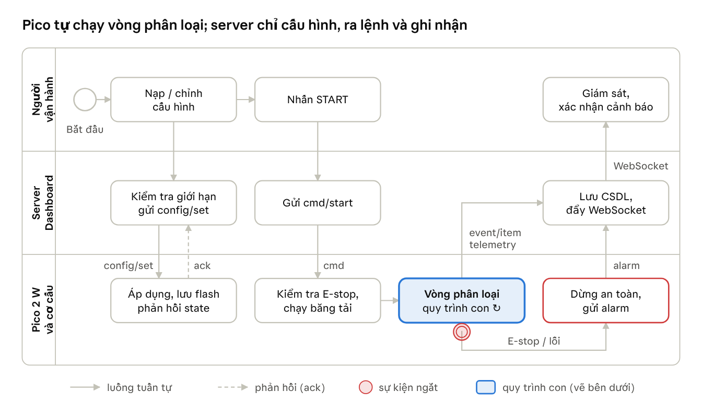
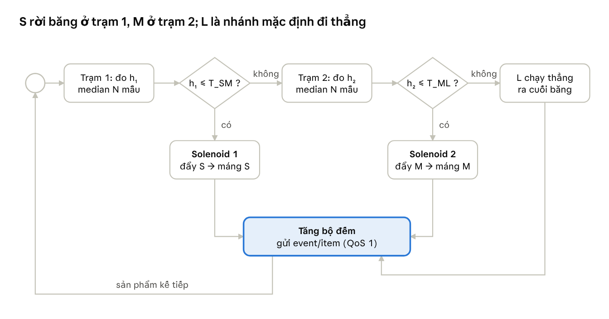
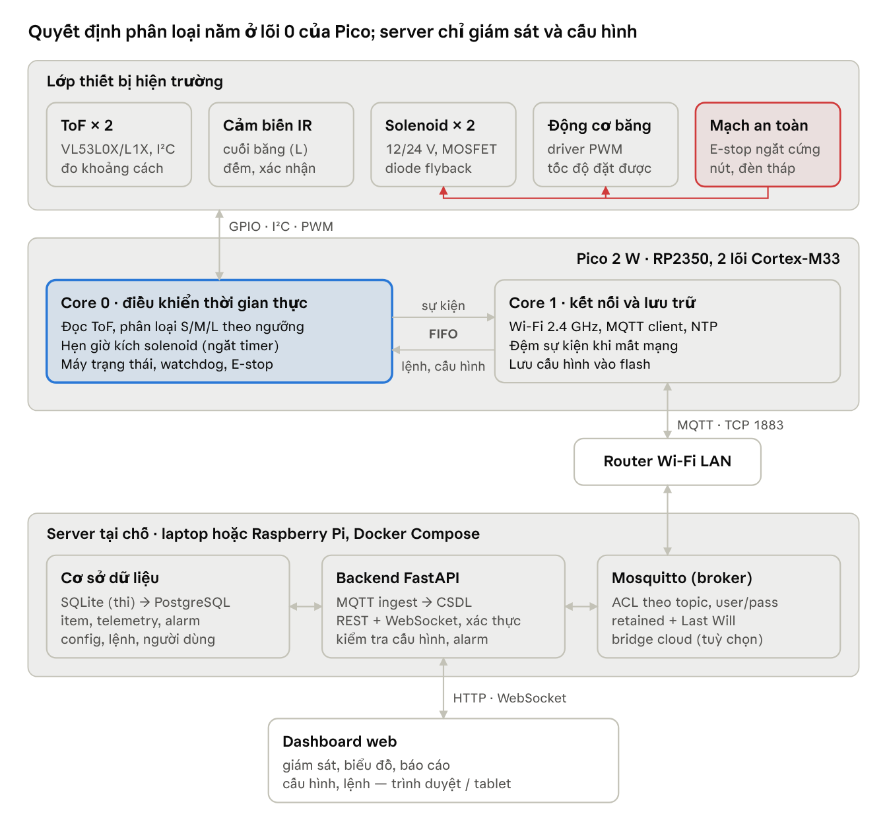
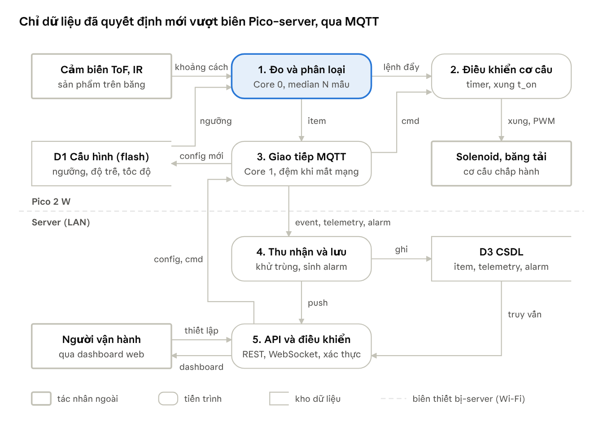
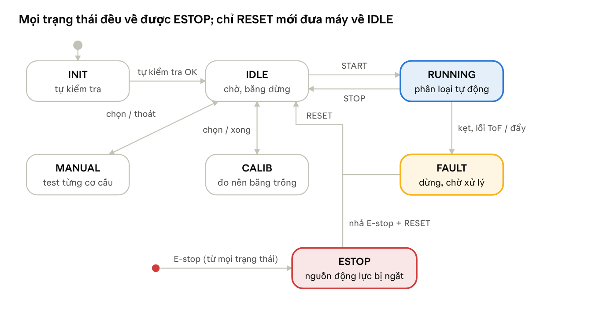
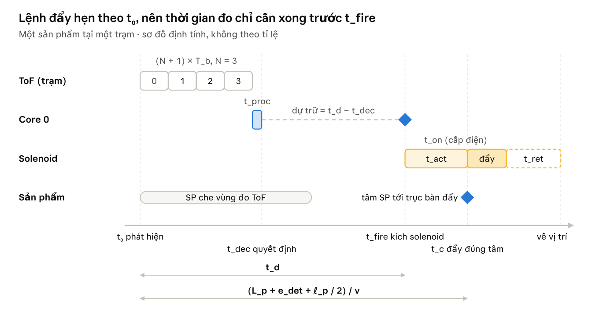
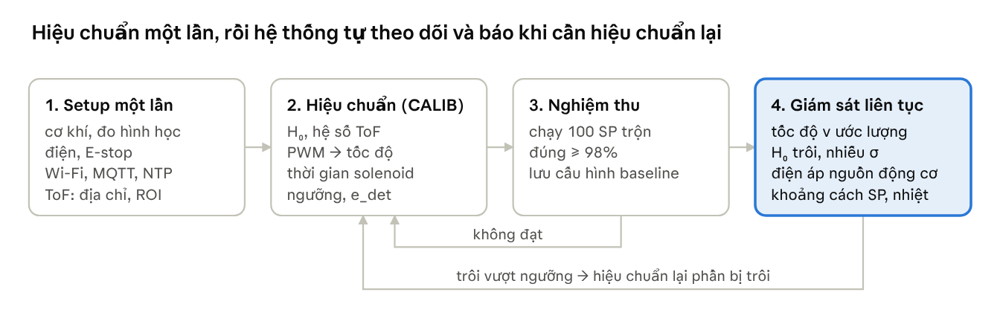

# Phân tích & Thiết kế hệ thống phân loại sản phẩm theo chiều cao – Pico 2 + IoT Dashboard

> **Nguồn chuyển đổi:** `Phân tích & Thiết kế hệ thống phân loại sản phẩm theo chiều cao – Pico 2 + IoT D (1).docx`  
> **Bộ đặc tả triển khai:** Xem chỉ mục và ma trận đối chiếu tại [`specs/README.md`](specs/README.md) và bảng thuật ngữ tại [`glossary.md`](glossary.md).

*Oct 9, 2026 · @Pham Trung Minh · Đội UNKNOW – Khoa CNTT – VMU*

## 1. Tổng quan & khảo sát

Pico 2 W tự đo, phân loại và kích solenoid ngay tại biên; server chỉ giám sát, lưu trữ, cấu hình và ra lệnh qua MQTT. Mất mạng thì dây chuyền vẫn phân loại đúng, dữ liệu được gửi bù sau.

### 1.1 Bối cảnh và hướng thiết kế đã chốt

- Cuộc thi VMU–PEGATRON 2026: băng tải phân loại sản phẩm S/M/L theo chiều cao.
- Cơ khí: 2 trạm, mỗi trạm 1 cảm biến ToF + 1 solenoid đẩy điện. Trạm 1 đẩy S, trạm 2 đẩy M, L chạy thẳng về cuối băng; máng S và M cùng một phía.
- Yêu cầu mới: một MCU Pico 2 điều khiển toàn bộ, gửi dữ liệu về server; người dùng xem dashboard, thiết lập thông số và điều khiển hệ thống từ xa.

### 1.2 Phạm vi

| Trong phạm vi | Ngoài phạm vi (giai đoạn này) |
| --- | --- |
| Đo chiều cao, phân loại S/M/L, đẩy sản phẩm | Nhận dạng màu, mã vạch, cân khối lượng |
| Điều khiển băng tải, nút cứng, E-stop | Robot gắp, nhiều băng tải phối hợp |
| Truyền dữ liệu MQTT, server, CSDL | Tích hợp ERP/MES của doanh nghiệp |
| Dashboard giám sát, cấu hình, điều khiển, báo cáo | Ứng dụng di động riêng (dùng web responsive) |

### 1.3 Bên liên quan

| Bên liên quan | Vai trò | Nhu cầu chính |
| --- | --- | --- |
| Người vận hành | Chạy/dừng máy, theo dõi, xử lý cảnh báo | Thao tác ít, trạng thái rõ, dừng an toàn tức thì |
| Quản trị (thành viên đội) | Cấu hình ngưỡng, độ trễ, tài khoản | Đổi thông số không cần nạp lại firmware |
| Ban giám khảo / BTC | Đánh giá | Độ chính xác, tốc độ, tính ổn định, trình bày dữ liệu |
| Doanh nghiệp (PEGATRON) | Người dùng tiềm năng | Truy vết từng sản phẩm, báo cáo sản lượng, khả năng mở rộng |
| Đội phát triển (UNKNOW, Khoa CNTT) | Thiết kế, lập trình, bảo trì | Kiến trúc module, dễ kiểm thử, dễ demo |

### 1.4 Khảo sát và lựa chọn công nghệ

| Hạng mục | Phương án đã xét | Chọn | Lý do |
| --- | --- | --- | --- |
| Kết nối của MCU | Pico 2 W (Wi-Fi tích hợp) · Pico 2 + W5500 (Ethernet) · Pico 2 + ESP32 qua UART | Pico 2 W | Một bo mạch, không thêm mạch giao tiếp. Nếu thể lệ bắt buộc bản không W, dùng W5500 — dây ổn định hơn Wi-Fi ở hội trường đông thiết bị |
| Giao thức lên server | HTTP REST (polling) · WebSocket · MQTT | MQTT | Nhẹ, publish/subscribe hai chiều, có QoS, retained message và Last Will để báo online/offline |
| Ngôn ngữ firmware | MicroPython · C/C++ (Pico SDK) · Arduino-Pico | C/C++ (Arduino-Pico hoặc Pico SDK) | Ngắt timer chính xác, tách 2 lõi rõ ràng. MicroPython hợp để thử nghiệm nhanh cảm biến |
| Broker | Mosquitto tại chỗ · broker cloud (EMQX, HiveMQ) | Mosquitto trong LAN | Không phụ thuộc Internet hội trường; có thể bridge lên cloud khi cần |
| Backend | Node-RED · Node.js · Python FastAPI | Python FastAPI | Viết nhanh REST + WebSocket, dễ kiểm thử, đội quen Python |
| CSDL | SQLite · PostgreSQL/TimescaleDB · InfluxDB | SQLite (thi) → PostgreSQL (mở rộng) | Một máy là đủ cho thi; schema giữ nguyên khi chuyển |
| Dashboard | Grafana · Node-RED Dashboard · web tự viết | Web tự viết, phục vụ từ backend | Cần cả giám sát, cấu hình và điều khiển trên một giao diện. Trang GitHub Pages (HTTPS) không gọi được backend HTTP trong LAN, nên chỉ dùng cho bản mô phỏng |
| Đo chiều cao | ToF · siêu âm · mảng IR | ToF (VL53L0X/VL53L1X) | Đã chốt; chùm hẹp, I²C. Hai cảm biến cùng địa chỉ 0x29 nên cần chân XSHUT để gán lại địa chỉ khi khởi động |

## 2. Yêu cầu chức năng (FR)

27 yêu cầu chia 9 nhóm; 21 yêu cầu Bắt buộc là phạm vi tối thiểu cho ngày thi. Ưu tiên theo MoSCoW: Bắt buộc · Nên có · Có thể.

| ID | Nhóm | Yêu cầu | Ưu tiên | Tiêu chí chấp nhận |
| --- | --- | --- | --- | --- |
| FR-01 | Đo & phân loại | Phát hiện sản phẩm đi vào vùng đo của từng trạm (khoảng cách ToF nhỏ hơn mức nền băng trống) | Bắt buộc | Không bỏ sót sản phẩm nào trong lô thử |
| FR-02 | Đo & phân loại | Tính chiều cao h = H₀ − d, lấy trung vị N mẫu khi sản phẩm nằm dưới cảm biến | Bắt buộc | Sai số trong giới hạn NFR-02 |
| FR-03 | Đo & phân loại | Phân loại theo 2 ngưỡng cấu hình được: h ≤ T_SM → S; T_SM < h ≤ T_ML → M; h > T_ML → L | Bắt buộc | Kết quả đúng với bảng chiều cao chuẩn |
| FR-04 | Đo & phân loại | Trạm 2 đo lại sản phẩm đi qua trạm 1 để quyết định M hay L | Bắt buộc | Sản phẩm S lọt qua trạm 1 vẫn bị ghi nhận lỗi, không bị đẩy nhầm sang máng M |
| FR-05 | Cơ cấu chấp hành | Kích solenoid trạm 1 (S) và trạm 2 (M) sau độ trễ t_d, độ rộng xung t_on cấu hình được | Bắt buộc | Sản phẩm rơi đúng máng |
| FR-06 | Cơ cấu chấp hành | Điều khiển động cơ băng tải: chạy, dừng, đặt tốc độ (PWM) | Bắt buộc | Tốc độ đổi theo cấu hình trong ≤ 1 s |
| FR-07 | Cơ cấu chấp hành | Xác nhận L ở cuối băng và đếm bằng cảm biến IR | Nên có | Tổng S + M + L khớp số sản phẩm đưa vào |
| FR-08 | Vận hành tại chỗ | Nút cứng START, STOP, E-STOP và đèn tháp/còi báo trạng thái | Bắt buộc | E-STOP dừng mọi chuyển động trong mọi trạng thái |
| FR-09 | Vận hành tại chỗ | Các chế độ AUTO, MANUAL (test từng cơ cấu), CALIB | Bắt buộc | Chuyển chế độ chỉ khi băng dừng |
| FR-10 | Vận hành tại chỗ | Hiệu chuẩn: đo băng trống để lấy H₀ cho từng ToF | Bắt buộc | H₀ được lưu flash và hiển thị trên dashboard |
| FR-11 | Phát hiện lỗi | Phát hiện kẹt (sản phẩm không rời vùng đo sau thời gian chờ), lỗi I²C ToF, mất kết nối | Nên có | Sinh alarm có mã lỗi, máy về FAULT |
| FR-12 | Truyền thông | Kết nối Wi-Fi, MQTT; tự kết nối lại khi rớt | Bắt buộc | Kết nối lại trong giới hạn NFR-07 |
| FR-13 | Truyền thông | Gửi sự kiện cho từng sản phẩm: số thứ tự, thời điểm, h₁, h₂, loại, trạm, kết quả | Bắt buộc | 100% sản phẩm có bản ghi trên server |
| FR-14 | Truyền thông | Gửi telemetry mỗi 1 s: trạng thái, tốc độ, bộ đếm, thông lượng, RSSI | Bắt buộc | Dashboard cập nhật liên tục |
| FR-15 | Truyền thông | Đệm sự kiện khi mất mạng, gửi bù khi có lại, không tạo bản ghi trùng | Bắt buộc | Kiểm thử TC-04 đạt |
| FR-16 | Truyền thông | Đồng bộ thời gian NTP; khi chưa có NTP gửi thời gian chạy (uptime) để server tự gán | Nên có | Mọi bản ghi có timestamp |
| FR-17 | Giám sát | Dashboard thời gian thực: online/offline, trạng thái máy, tốc độ, số S/M/L, sản phẩm/phút | Bắt buộc | Độ trễ hiển thị trong giới hạn NFR-05 |
| FR-18 | Giám sát | Nhật ký sản phẩm gần nhất và biểu đồ phân bố chiều cao (thấy rõ khoảng cách với ngưỡng) | Bắt buộc | Lọc được theo loại và phiên chạy |
| FR-19 | Giám sát | Danh sách cảnh báo, xác nhận (ack) cảnh báo | Bắt buộc | Lưu người xác nhận và thời điểm |
| FR-20 | Cấu hình | Thiết lập T_SM, T_ML, t_d1, t_d2, t_on, tốc độ băng, N mẫu; kiểm tra giới hạn hợp lệ | Bắt buộc | Giá trị ngoài giới hạn bị từ chối ở cả backend và firmware |
| FR-21 | Cấu hình | Pico áp dụng, lưu flash, phản hồi cấu hình đang chạy; dashboard so khớp "đã gửi" và "đang chạy" | Bắt buộc | Lệch phiên bản thì hiển thị cảnh báo |
| FR-22 | Cấu hình | Lưu lịch sử phiên bản cấu hình, preset và khôi phục | Nên có | Khôi phục được phiên bản bất kỳ |
| FR-23 | Điều khiển từ xa | Lệnh Start, Stop, Reset bộ đếm, Test solenoid, Hiệu chuẩn; mỗi lệnh có phản hồi | Bắt buộc | Lệnh bị từ chối khi E-stop đang nhấn |
| FR-24 | Dữ liệu | Lưu sự kiện, telemetry, cảnh báo, lịch sử lệnh; xuất CSV | Bắt buộc | Xuất được theo khoảng thời gian |
| FR-25 | Dữ liệu | Báo cáo phiên chạy: tổng, tỉ lệ từng loại, số lỗi, thông lượng trung bình | Nên có | Sinh tự động khi kết thúc phiên |
| FR-26 | Người dùng | Đăng nhập, phân quyền Viewer / Operator / Admin | Bắt buộc | Viewer không gửi được lệnh hay cấu hình |
| FR-27 | Demo | Chế độ giả lập phát dữ liệu (dùng lại bản mô phỏng trên GitHub Pages) | Có thể | Dashboard chạy được khi không có phần cứng |

## 3. Yêu cầu phi chức năng (NFR)

Ràng buộc quan trọng nhất: thời gian thực và an toàn không được phụ thuộc mạng. Các chỉ tiêu dưới đây là đề xuất của đội, cần chỉnh lại khi có thể lệ chính thức.

| ID | Nhóm | Yêu cầu | Chỉ tiêu đề xuất | Cách kiểm chứng |
| --- | --- | --- | --- | --- |
| NFR-01 | Độ chính xác | Phân loại đúng | ≥ 98% trên lô ≥ 100 sản phẩm trộn ngẫu nhiên | TC-02 |
| NFR-02 | Độ chính xác | Sai số đo chiều cao | ≤ ±3 mm; khoảng cách giữa chiều cao các cỡ phải ≥ 3 lần sai số | TC-01, mẫu chuẩn |
| NFR-03 | Thời gian thực | Độ lệch thời điểm kích solenoid so với tính toán | ≤ ±5 ms, không phụ thuộc trạng thái mạng | Logic analyzer, TC-03 |
| NFR-04 | Hiệu năng | Thông lượng | Theo thể lệ; mục tiêu ≥ 30 sản phẩm/phút | Đếm trong 5 phút |
| NFR-05 | Hiệu năng | Độ trễ từ sự kiện đến dashboard | ≤ 1 s trong LAN | Đo timestamp hai đầu |
| NFR-06 | Tin cậy | Tự chủ biên khi mất mạng | Phân loại không gián đoạn; đệm ≥ 500 sự kiện | TC-04 |
| NFR-07 | Tin cậy | Tự phục hồi kết nối | ≤ 10 s sau khi mạng có lại | Rút nguồn router |
| NFR-08 | An toàn | E-stop phần cứng ngắt nguồn động lực (động cơ + solenoid) độc lập với MCU | Ngắt ≤ 100 ms dù firmware treo | TC-05 |
| NFR-09 | An toàn | Giới hạn thời gian bật solenoid, chống cháy cuộn dây | Firmware tắt cưỡng bức sau t_on tối đa | Ép lỗi trong MANUAL |
| NFR-10 | An toàn | Watchdog MCU | Treo → reset ≤ 1 s, khởi động ở trạng thái an toàn (băng dừng, solenoid tắt) | TC-08 |
| NFR-11 | Bảo mật | Xác thực và phân quyền | MQTT có user/pass + ACL theo topic; dashboard đăng nhập; mọi lệnh ghi log; TLS khi lên cloud | Review cấu hình |
| NFR-12 | Khả dụng | Server trong phiên thi | ≥ 99%; khởi động lại toàn bộ bằng một lệnh Docker Compose | Chạy thử 2 giờ liên tục |
| NFR-13 | Dễ dùng | Thao tác chính | Start/Stop ≤ 1 thao tác; giao diện dùng được trên máy tính bảng | Thử với người ngoài đội |
| NFR-14 | Bảo trì | Mã nguồn module hoá, tham số tách khỏi code | Đổi ngưỡng không cần nạp lại firmware; nạp firmware bằng UF2 qua USB | Review mã |
| NFR-15 | Mở rộng | Đa thiết bị | Topic và bảng dữ liệu có device_id; thêm băng tải không đổi schema | TC-09 |
| NFR-16 | Điện / EMC | Tách nguồn động lực và logic | Chung GND, diode flyback cho solenoid, dây I²C ngắn có pull-up | Chạy 1 giờ không reset |
| NFR-17 | Lưu trữ | Thời gian giữ dữ liệu | ≥ 30 ngày sự kiện; telemetry gộp theo phút sau 7 ngày | Kiểm tra dung lượng |

## 4. PDS – Đặc tả thiết kế sản phẩm

Sản phẩm là một nguyên mẫu băng tải phân loại 3 cỡ có kết nối IoT, chế tạo 1 bộ cho cuộc thi. Mục ghi "cần xác nhận" phụ thuộc thể lệ hoặc linh kiện chưa chốt.

| Yếu tố PDS | Đặc tả |
| --- | --- |
| Chức năng | Nhận sản phẩm trên băng, đo chiều cao, tách S (trạm 1), M (trạm 2), L (cuối băng); gửi dữ liệu và nhận cấu hình, lệnh từ server |
| Hiệu năng | Theo NFR-01 đến NFR-05: đúng ≥ 98%, sai số đo ≤ ±3 mm, lệch thời điểm đẩy ≤ ±5 ms, dashboard trễ ≤ 1 s |
| Đối tượng xử lý | 3 cỡ sản phẩm theo chiều cao — kích thước, dung sai, vật liệu bề mặt: cần xác nhận theo thể lệ |
| Khoảng cách tối thiểu giữa 2 sản phẩm | ≥ v × (t_on + thời gian hồi solenoid), để solenoid kịp thu về trước sản phẩm kế tiếp |
| Môi trường | Trong nhà, 20–35 °C, ánh sáng hội trường (ToF dùng laser 940 nm, cần che nắng trực tiếp), nhiều mạng Wi-Fi 2.4 GHz xung quanh |
| Kích thước, bố trí | 2 trạm dọc băng; ToF gắn phía trên, cách mặt băng H₀ cố định; solenoid và máng S, M cùng một phía; IR cuối băng — kích thước khung: cần xác nhận |
| Nguồn điện | Động lực 12/24 V (theo solenoid và động cơ đã chọn), logic 5 V → 3,3 V cho Pico; hai nhánh chung GND |
| Điều khiển | Raspberry Pi Pico 2 W (RP2350, 2 lõi Cortex-M33, Wi-Fi 2.4 GHz); lõi 0 thời gian thực, lõi 1 truyền thông |
| Truyền thông | MQTT 3.1.1 qua Wi-Fi tới broker Mosquitto trong LAN; payload JSON |
| Phần mềm server | FastAPI + SQLite, dashboard web, đóng gói Docker Compose, chạy trên laptop hoặc Raspberry Pi |
| An toàn | E-stop nút nấm, tiếp điểm thường đóng ngắt trực tiếp nguồn động lực; Pico chỉ đọc trạng thái E-stop. Tham chiếu IEC 60204-1 và ISO 13850 cho mạch dừng khẩn |
| Giao diện người dùng | Nút cứng + đèn tháp tại máy; dashboard web phân quyền trên máy tính hoặc máy tính bảng |
| Bảo trì | Tham số chỉnh từ dashboard; firmware nạp UF2 qua USB; linh kiện module dễ thay (ToF breakout, module MOSFET) |
| Tiêu chuẩn kỹ thuật | MQTT 3.1.1, JSON, BPMN 2.0 cho mô tả quy trình, REST/OpenAPI cho API |
| Kiểm thử | Bộ kiểm thử TC-01 đến TC-09 (mục 8) |
| Số lượng, vòng đời | 1 nguyên mẫu; dùng lại cho giảng dạy, thực hành IoT sau cuộc thi |
| Chi phí | Cần xác nhận ngân sách đội; ưu tiên linh kiện phổ biến tại Việt Nam |
| Rủi ro chính | Nhiễu Wi-Fi, ToF đo sai trên bề mặt tối hoặc bóng, nhiễu từ solenoid làm reset MCU (biện pháp ở mục 8) |

## 5. Use case & BPMN

Có 10 use case; quy trình chính tách làm hai tầng: tầng cộng tác người–server–Pico (cấu hình, ra lệnh, giám sát) và quy trình con phân loại chạy hoàn toàn trong Pico.

### 5.1 Use case

| UC | Tác nhân | Use case |
| --- | --- | --- |
| UC-01 | Mọi người dùng | Đăng nhập dashboard |
| UC-02 | Viewer trở lên | Xem giám sát thời gian thực |
| UC-03 | Operator | Chạy / dừng máy (nút cứng hoặc dashboard) |
| UC-04 | Operator | Test từng cơ cấu ở chế độ MANUAL |
| UC-05 | Operator | Xác nhận cảnh báo |
| UC-06 | Admin | Thiết lập thông số vận hành |
| UC-07 | Admin | Hiệu chuẩn ToF (đo H₀) |
| UC-08 | Viewer trở lên | Xem lịch sử, xuất CSV, báo cáo phiên |
| UC-09 | Admin | Quản lý tài khoản, phân quyền |
| UC-10 | Pico (hệ thống) | Phân loại tự động |

### 5.2 BPMN quy trình vận hành


*BPMN cộng tác · 3 làn: Người vận hành, Server/Dashboard, Pico 2 W*

Cấu hình đi một chiều xuống Pico và chỉ có hiệu lực khi Pico phản hồi state; dữ liệu sản xuất đi một chiều lên server.

### 5.3 BPMN quy trình con: vòng phân loại


*Quy trình con "Vòng phân loại" chạy trên lõi 0 của Pico*

Mỗi trạm quyết định độc lập ngay dưới cảm biến của nó, nên Pico không cần theo dõi vị trí sản phẩm dọc băng.

### 5.4 Luồng ngoại lệ

- E-stop: mạch cứng ngắt nguồn động lực; Pico chuyển ESTOP, gửi alarm. Chỉ trở lại IDLE khi nhả E-stop và nhấn RESET.
- Kẹt / lỗi ToF: sản phẩm nằm trong vùng đo quá thời gian chờ, hoặc I²C không phản hồi → dừng băng, FAULT, alarm.
- Mất mạng: vòng phân loại tiếp tục; sự kiện vào bộ đệm vòng, gửi bù theo số thứ tự khi kết nối lại.
- Cấu hình không hợp lệ: backend từ chối trước khi gửi; nếu vẫn tới Pico, firmware giữ cấu hình cũ và phản hồi lỗi.
- Lệnh khi E-stop đang nhấn: Pico từ chối, cmd/ack trả về lý do.

## 6. Kiến trúc hệ thống

Kiến trúc edge–server: lõi 0 của Pico giữ toàn bộ vòng điều khiển, lõi 1 lo kết nối; E-stop ngắt nguồn động lực bằng phần cứng (đường đỏ), không đi qua MCU.


*Kiến trúc 4 lớp: thiết bị → Pico 2 W → mạng LAN → server → dashboard*

Hai lõi chỉ trao đổi qua FIFO phần cứng của RP2350, nên Wi-Fi chậm hay rớt không làm trễ lệnh đẩy.

### 6.1 Phân công tác vụ firmware

| Lõi | Tác vụ | Kích hoạt |
| --- | --- | --- |
| Core 0 | Đọc ToF1, ToF2 ở chế độ đo liên tục, lọc trung vị | Mỗi mẫu mới từ cảm biến |
| Core 0 | Phân loại, đặt hẹn giờ đẩy t_d | Khi sản phẩm đã đủ N mẫu |
| Core 0 | Bật solenoid, tắt sau t_on (chặn trên t_on tối đa) | Ngắt alarm timer phần cứng |
| Core 0 | Máy trạng thái, đọc nút, giám sát E-stop | Chu kỳ 1 ms |
| Core 0 | Cho watchdog ăn — chỉ khi cả hai lõi còn báo sống | Chu kỳ 100 ms |
| Core 1 | Wi-Fi, MQTT, tự kết nối lại, NTP | Liên tục |
| Core 1 | Gửi telemetry | 1 s |
| Core 1 | Gửi sự kiện và gửi bù từ bộ đệm vòng | Có sự kiện / khi online lại |
| Core 1 | Kiểm tra và lưu cấu hình vào flash | Chỉ khi máy ở IDLE |

Ghi flash trên RP2350 tạm dừng đọc mã từ flash của cả hai lõi, nên cấu hình mới nhận khi đang chạy chỉ áp dụng trong RAM; việc lưu flash chờ đến khi băng dừng.

### 6.2 Bản đồ chân Pico 2 W (đề xuất)

| Chức năng | Chân | Ghi chú |
| --- | --- | --- |
| I²C0 SDA / SCL (2 ToF chung bus) | GP4 / GP5 | Pull-up 4,7 kΩ lên 3V3 |
| XSHUT ToF1 / ToF2 | GP6 / GP7 | Bật lần lượt để gán địa chỉ 0x30, 0x31 |
| IR cuối băng | GP8 | Ngắt cạnh |
| Đèn tháp Đỏ / Vàng / Xanh, còi | GP10–GP13 | Qua ULN2003 |
| Solenoid 1 / Solenoid 2 | GP14 / GP15 | MOSFET logic-level, diode flyback |
| Động cơ PWM / DIR | GP16 / GP17 | Tới driver động cơ |
| Nút START / STOP | GP18 / GP19 | Pull-up nội, chống dội bằng phần mềm |
| Giám sát E-stop | GP20 | Qua opto cách ly, chỉ đọc |
| Không dùng | GP23, GP24, GP25, GP29 | Dùng nội bộ cho chip Wi-Fi CYW43439 |

### 6.3 Ngăn xếp phần mềm

| Thành phần | Công nghệ |
| --- | --- |
| Firmware | C/C++ (Arduino-Pico hoặc Pico SDK), thư viện VL53L0X/L1X, PubSubClient hoặc lwIP MQTT, ArduinoJson |
| Broker | Eclipse Mosquitto 2.x |
| Backend | Python FastAPI, aiomqtt, SQLAlchemy, JWT |
| CSDL | SQLite (WAL) giai đoạn thi; PostgreSQL/TimescaleDB khi mở rộng |
| Dashboard | SPA (Vue hoặc React) + Chart.js, nhận số liệu qua WebSocket |
| Triển khai | Docker Compose 3 dịch vụ: mosquitto, api (kèm file trĩnh của dashboard), db |

## 7. Data flow, topic MQTT & mô hình dữ liệu

Mức ngữ cảnh (DFD 0) có 3 tác nhân ngoài: cảm biến đưa khoảng cách vào, cơ cấu chấp hành nhận lệnh ra, người vận hành trao đổi qua dashboard. Mức 1 dưới đây tách thành 5 tiến trình; chỉ 2 luồng vượt biên thiết bị–server.


*DFD mức 1 · 5 tiến trình, 2 kho dữ liệu, 3 tác nhân ngoài*

Luồng khoảng cách → lệnh đẩy nằm trọn trong Pico; server chỉ nhận kết quả và gửi xuống cấu hình, lệnh.

### 7.1 Danh sách topic MQTT

Gốc topic: vmu/unknow/sorter/{device_id}/ (ví dụ device_id = line01).

| Topic (sau gốc) | Hướng | QoS | Retain | Nội dung | Tần suất |
| --- | --- | --- | --- | --- | --- |
| status | Pico → Server | 1 | Có | online / offline (Last Will) | Khi đổi |
| telemetry | Pico → Server | 0 | Không | Trạng thái, PWM, bộ đếm, sản phẩm/phút, RSSI, độ dài bộ đệm, uptime | 1 s |
| event/item | Pico → Server | 1 | Không | Một bản ghi cho mỗi sản phẩm | Mỗi sản phẩm |
| alarm | Pico → Server | 1 | Không | Mã lỗi, mức độ, mô tả | Khi phát sinh |
| config/reported | Pico → Server | 1 | Có | Cấu hình đang chạy + phiên bản | Khi đổi |
| config/desired | Server → Pico | 1 | Có | Cấu hình mới + phiên bản | Khi người dùng lưu |
| cmd | Server → Pico | 1 | Không | start, stop, reset_counter, test_pusher, calibrate + cmd_id | Theo yêu cầu |
| cmd/ack | Pico → Server | 1 | Không | cmd_id, kết quả, lý do nếu từ chối | Sau mỗi lệnh |

config/desired dùng retain nên Pico khởi động lại vẫn nhận được cấu hình mới nhất; cmd không retain để lệnh cũ không tự chạy lại.

### 7.2 Payload mẫu (giá trị chỉ để minh hoạ)

event/item:

```json
{
  "seq": 1287,
  "ts": "2026-10-09T09:15:02.341Z",
  "uptime_ms": 845120,
  "h1_mm": 48.6,
  "h2_mm": null,
  "cls": "S",
  "station": 1,
  "result": "pushed",
  "cfg_ver": 7
}
```

config/desired và config/reported:

```json
{
  "ver": 8,
  "t_sm_mm": 55.0,
  "t_ml_mm": 85.0,
  "d1_ms": 120,
  "d2_ms": 120,
  "pulse_ms": 80,
  "belt_pwm": 60,
  "n_samples": 5
}
```

cmd và cmd/ack:

```json
{
  "cmd_id": "c-0192",
  "type": "test_pusher",
  "args": {
    "station": 2
  }
}
```

```json
{
  "cmd_id": "c-0192",
  "ok": false,
  "reason": "ESTOP_ACTIVE"
}
```

seq tăng liên tục theo thiết bị; backend đặt ràng buộc duy nhất (device_id, seq) nên bản tin QoS 1 gửi lặp hay gửi bù không tạo bản ghi trùng.

### 7.3 Mô hình dữ liệu

| Bảng | Trường chính | Ghi chú |
| --- | --- | --- |
| devices | id, name, fw_ver, last_seen, online | Mỗi băng tải một dòng |
| runs | id, device_id, operator_id, start_ts, end_ts, total_s, total_m, total_l, faults | Một phiên chạy từ START đến STOP |
| items | id, device_id, run_id, seq, ts, h1_mm, h2_mm, cls, station, result, cfg_ver | Duy nhất (device_id, seq) |
| telemetry | device_id, ts, state, belt_pwm, rate_ppm, rssi, buffer_len | Gộp theo phút sau 7 ngày |
| alarms | id, device_id, ts, code, level, message, ack_by, ack_ts |  |
| configs | device_id, ver, params (JSON), created_by, created_ts, applied_ts | applied_ts ghi khi nhận config/reported cùng ver |
| commands | cmd_id, device_id, type, args, issued_by, issued_ts, ok, reason, ack_ts | Nhật ký kiểm toán |
| users | id, username, password_hash, role | role: viewer, operator, admin |

### 7.4 API cho dashboard

| Phương thức | Đường dẫn | Quyền | Mục đích |
| --- | --- | --- | --- |
| POST | /api/auth/login | Mọi người | Lấy JWT |
| GET | /api/devices, /api/devices/{id}/state | Viewer | Danh sách thiết bị, trạng thái hiện tại |
| GET | /api/items?from=&to=&cls= | Viewer | Nhật ký sản phẩm |
| GET | /api/items/export.csv | Viewer | Xuất CSV |
| GET / PUT | /api/devices/{id}/config | Viewer / Admin | Xem, cập nhật cấu hình (backend kiểm tra giới hạn rồi publish config/desired) |
| POST | /api/devices/{id}/cmd | Operator | Gửi lệnh, trả về kết quả khi có cmd/ack |
| GET / POST | /api/alarms, /api/alarms/{id}/ack | Viewer / Operator | Xem, xác nhận cảnh báo |
| GET | /api/runs/{id}/report | Viewer | Báo cáo phiên |
| WS | /ws/live | Viewer | Đẩy telemetry, item, alarm theo thời gian thực |

## 8. Máy trạng thái, an toàn, kiểm thử & triển khai

Firmware có 7 trạng thái, E-stop có quyền cao nhất; 9 ca kiểm thử bao phủ các chỉ tiêu NFR quan trọng trước ngày thi.

### 8.1 Máy trạng thái firmware


*Máy trạng thái firmware trên Core 0 · 7 trạng thái*

Trạng thái mạng (OFFLINE → CONNECTING → ONLINE) chạy riêng trên Core 1 và không làm máy rời RUNNING. Lệnh từ xa chỉ được nhận ở IDLE hoặc RUNNING; RESET sau E-stop bắt buộc bằng nút cứng tại máy.

### 8.2 Công thức cài đặt (tóm tắt — chi tiết ở mục 9)

Chiều cao sản phẩm, với H₀ là khoảng cách ToF tới mặt băng trống và d là khoảng cách đo được:

$$
h = H_0 - d
$$

Độ trễ từ lúc quyết định đến lúc kích solenoid, với L là khoảng cách từ điểm đo tới tâm bàn đẩy, v là tốc độ băng, t_sol là thời gian tác động của solenoid:

$$
t_d = \frac{L}{v} - t_{sol}
$$

Khoảng cách tối thiểu giữa hai sản phẩm liên tiếp, với t_ret là thời gian solenoid hồi về:

$$
s_{min} = v \cdot (t_{on} + t_{ret})
$$

t_d tính theo công thức chỉ là giá trị khởi đầu; tinh chỉnh thực nghiệm bằng lệnh Test solenoid trên dashboard rồi lưu làm preset.

### 8.3 Biện pháp an toàn

- E-stop nút nấm, tiếp điểm thường đóng nối tiếp với cuộn rơ-le/contactor cấp nguồn động lực; đứt dây cũng tương đương nhấn E-stop.
- Pico đọc trạng thái E-stop qua opto chỉ để báo cáo và khoá lệnh, không nằm trong mạch ngắt.
- Solenoid: firmware chặn t_on tối đa; MOSFET có điện trở kéo xuống ở cực G để solenoid tắt khi Pico reset hoặc chưa khởi động.
- Watchdog phần cứng RP2350; khởi động luôn vào INIT với mọi đầu ra ở mức an toàn.
- Dashboard yêu cầu xác nhận trước lệnh Start từ xa và hiển thị rõ máy đang được điều khiển tại chỗ hay từ xa.

### 8.4 Kế hoạch kiểm thử

| Mã | Hạng mục | Phương pháp | Đạt khi |
| --- | --- | --- | --- |
| TC-01 | Đo chiều cao | 3 mẫu chuẩn × 30 lần đo mỗi trạm | Sai số ≤ ±3 mm (NFR-02) |
| TC-02 | Phân loại tổng hợp | 100 sản phẩm trộn ngẫu nhiên, đối chiếu máng | Đúng ≥ 98% (NFR-01) |
| TC-03 | Thời điểm đẩy | Logic analyzer đo từ cạnh phát hiện tới cạnh GPIO solenoid, có và không có tải Wi-Fi | Lệch ≤ ±5 ms (NFR-03) |
| TC-04 | Mất mạng | Tắt router 60 s khi đang chạy | Phân loại đúng; server nhận đủ, không trùng seq |
| TC-05 | E-stop | Nhấn E-stop ở mỗi trạng thái, kể cả khi firmware bị treo cố ý | Cơ cấu mất nguồn ≤ 100 ms; alarm lên dashboard |
| TC-06 | Cấu hình sai | Gửi ngưỡng âm, T_SM ≥ T_ML, t_on vượt giới hạn | Bị từ chối ở backend; gửi thẳng MQTT thì firmware từ chối |
| TC-07 | Phân quyền và khoá lệnh | Viewer gửi lệnh; Operator gửi Start khi E-stop đang nhấn | Cả hai bị từ chối, có ghi log |
| TC-08 | Watchdog | Ép vòng lặp vô hạn trên Core 0 | Reset ≤ 1 s, băng dừng, solenoid tắt |
| TC-09 | Tải server | Giả lập 5 thiết bị × 2 sản phẩm/s | Dashboard trễ ≤ 1 s, không mất bản ghi |

### 8.5 Rủi ro và biện pháp

| Rủi ro | Biện pháp |
| --- | --- |
| Wi-Fi hội trường nhiễu, rớt kết nối | Router riêng, chọn kênh ít nhiễu; Pico tự chủ biên; dự phòng W5500 Ethernet |
| ToF đo sai trên bề mặt tối, bóng hoặc mép sản phẩm | Hiệu chuẩn trên mẫu thật, lấy trung vị khi sản phẩm nằm giữa vùng đo, che ánh sáng mạnh |
| Hai VL53L0X trùng địa chỉ I²C | Gán lại địa chỉ bằng XSHUT lúc khởi động |
| Nhiễu từ solenoid làm Pico reset | Diode flyback, nguồn tách, tụ lọc gần Pico, đi dây động lực xa dây I²C |
| Sản phẩm sát nhau, solenoid chưa kịp hồi | Ràng buộc s_min; báo lỗi khi phát hiện hai sản phẩm trong cùng một chu kỳ đẩy |
| Ghi flash làm khựng vòng điều khiển | Chỉ ghi khi IDLE (mục 6.1) |

### 8.6 Lộ trình triển khai

1. Phần cứng: lắp ToF, đo thử sai số, chốt H₀ và khoảng cách ToF–solenoid.
2. Firmware Core 0: máy trạng thái, phân loại, hẹn giờ đẩy, E-stop, watchdog — chạy độc lập không mạng.
3. Firmware Core 1: Wi-Fi, MQTT, bộ đệm vòng, nhận cấu hình và lệnh.
4. Server: Docker Compose gồm Mosquitto, FastAPI, SQLite; ingest và API.
5. Dashboard: trang giám sát, trang cấu hình, trang lệnh, lịch sử và CSV.
6. Tích hợp và chạy bộ kiểm thử TC-01 đến TC-09.
7. Diễn tập theo kịch bản thi, kể cả kịch bản mất mạng và E-stop.

### 8.7 Câu hỏi mở

- [ ] Kích thước, dung sai và vật liệu bề mặt của 3 cỡ sản phẩm theo thể lệ?
- [ ] Thể lệ quy định thông lượng hoặc thời gian thi bao nhiêu?
- [ ] Bắt buộc Pico 2 bản thường hay được dùng Pico 2 W?
- [ ] Hội trường có mạng riêng cho đội hay đội tự mang router?
- [ ] Điện áp và hành trình của solenoid đã mua; thời gian tác động t_sol thực đo?

## 9. Mô hình tính toán: tốc độ, thời gian, năng suất

Tốc độ băng tối đa là giá trị nhỏ nhất trong ba giới hạn: đo đủ mẫu, đẩy đúng vị trí và cơ cấu kịp tác động; năng suất sau đó do bước giữa hai sản phẩm quyết định. Mọi mốc thời gian lấy theo t₀ — lúc ToF phát hiện sản phẩm — nên độ trễ xử lý không cộng dồn vào sai số đẩy.

### 9.1 Ký hiệu

| Ký hiệu | Ý nghĩa | Đơn vị | Lấy từ đâu |
| --- | --- | --- | --- |
| v | Tốc độ băng | mm/s | Tính từ động cơ, hiệu chuẩn theo PWM, đo online (9.3) |
| ℓ_p, w_p, h | Dài (theo chiều băng), rộng, cao sản phẩm | mm | Thể lệ; ℓ_p theo từng cỡ |
| H₀ | Khoảng cách ToF tới mặt băng trống | mm | Hiệu chuẩn CALIB |
| θ | Góc nhìn của ToF | ° | Datasheet: VL53L0X khoảng 25°; VL53L1X khoảng 27°, thu hẹp được bằng ROI |
| D_spot | Đường kính vết đo trên mặt sản phẩm | mm | Công thức 9.4 |
| T_b | Thời gian một lần đo ToF (timing budget) | ms | Cấu hình firmware, thường 20–33 ms |
| N | Số mẫu lấy trung vị | – | Cấu hình (3–5) |
| L_p | Khoảng cách trục ToF → trục bàn đẩy | mm | Đo trên khung |
| e_det | Độ lệch vị trí mép trước sản phẩm lúc phát hiện so với trục ToF | mm | Ban đầu ≈ D_spot/2, tinh chỉnh thực nghiệm |
| b | Bề rộng bàn đẩy (theo chiều băng) | mm | Thiết kế cơ khí |
| t_act | Từ lệnh GPIO đến lúc bàn đẩy chạm sản phẩm | ms | Đo (9.11) |
| t_push | Từ lúc chạm đến hết hành trình | ms | Đo |
| t_on | Thời gian cấp điện solenoid | ms | Cấu hình |
| t_ret | Từ lúc ngắt điện đến lúc về vị trí | ms | Đo |
| D_rated | Hệ số làm việc cho phép của solenoid | % | Datasheet solenoid |
| p, g | Bước (đầu–đầu) và khe hở giữa hai sản phẩm: p = ℓ_p + g | mm | Kết quả tính 9.8 |
| Q | Năng suất | sản phẩm/phút | Kết quả tính 9.8 |

### 9.2 Timeline một sản phẩm


*Timeline một sản phẩm tại một trạm: đo → quyết định → hẹn giờ → kích → hồi*

Core 0 đặt alarm timer phần cứng tại t_fire = t₀ + t_d ngay khi có quyết định; chỉ cần t_dec đến trước t_fire là đủ.

### 9.3 Tốc độ băng

Từ động cơ (D_r: đường kính con lăn chủ động, n_m: vòng/phút động cơ, i: tỉ số truyền, s: hệ số trượt):

$$
v = \frac{\pi D_r n_m}{60\, i}\,(1 - s)
$$

Trên thực tế dùng bảng hiệu chuẩn tốc độ theo duty PWM u (đo 4–5 điểm, khớp tuyến tính), vì tải và điện áp làm n_m thay đổi:

$$
v(u) \approx a\,u + b
$$

Đo online mỗi khi một sản phẩm đi qua cả hai trạm (L₁₂: khoảng cách hai trục ToF, t₀,₁ và t₀,₂: thời điểm phát hiện tại hai trạm). Firmware lấy trung bình trượt của giá trị này để tính t_d và gửi lên telemetry:

$$
\hat{v} = \frac{L_{12}}{t_{0,2} - t_{0,1}}
$$

### 9.4 Cửa sổ đo và thời gian ra quyết định

Vết đo của ToF trên mặt sản phẩm phình theo khoảng cách, nên sản phẩm thấp nhất (S) có vết lớn nhất:

$$
D_{spot} = 2\,(H_0 - h)\,\tan\frac{\theta}{2}
$$

Một mẫu chỉ đúng khi sản phẩm che kín vết đo. Thời gian che kín và điều kiện lấy đủ N mẫu hợp lệ (mẫu đầu tiên thường đo lẫn nền và mép nên bỏ):

$$
T_{win} = \frac{\ell_p - D_{spot}}{v} \ge (N+1)\,T_b
$$

Suy ra giới hạn tốc độ do đo — dùng ℓ_p và D_spot của cỡ bất lợi nhất:

$$
v_{max,1} = \frac{\ell_{p,min} - D_{spot,max}}{(N+1)\,T_b}
$$

Nếu ℓ_p ≤ D_spot thì không đo được ở bất kỳ tốc độ nào: phải hạ cảm biến xuống gần hơn, dùng VL53L1X với ROI nhỏ, hoặc lắp ống chắn sáng.

Thời gian ra quyết định tính từ t₀ (t_I2C: đọc thanh ghi, dưới 1 ms ở 400 kHz; t_proc: trung vị + so ngưỡng, cỡ micro giây):

$$
t_{dec} = (N+1)\,T_b + t_{I2C} + t_{proc}
$$

Ngưỡng phân loại đặt giữa hai cỡ kề nhau, và khoảng cách tới ngưỡng phải lớn hơn 3 lần độ lệch chuẩn của chiều cao đo (σ: độ lệch chuẩn một mẫu, trung vị N mẫu có σ khoảng 1,25σ/√N):

$$
T_{SM} = \frac{h_{S,max} + h_{M,min}}{2}, \qquad \frac{h_{M,min} - h_{S,max}}{2} \ge 3 \cdot \frac{1.25\,\sigma}{\sqrt{N}}
$$

T_ML tính tương tự giữa M và L.

### 9.5 Thời điểm kích solenoid và vị trí đặt trạm

Tâm sản phẩm tới trục bàn đẩy lúc t_c; lệnh phải phát sớm hơn một khoảng t_act:

$$
t_c = t_0 + \frac{L_p + e_{det} + \ell_p/2}{v}, \qquad t_d = t_{fire} - t_0 = \frac{L_p + e_{det} + \ell_p/2}{v} - t_{act}
$$

ℓ_p lấy theo cỡ vừa phân loại (bảng kích thước theo thể lệ), v dùng giá trị đo online. Điều kiện để quyết định kịp trước lệnh đẩy cho ra khoảng cách tối thiểu ToF–bàn đẩy (t_m: dự trữ, đề xuất ≥ 20 ms):

$$
t_{dec} + t_m \le t_d \;\Rightarrow\; L_p \ge v\,(t_{dec} + t_{act} + t_m) - e_{det} - \frac{\ell_p}{2}
$$

### 9.6 Sai số vị trí khi đẩy

Sai số có 3 nguồn: lượng tử hoá phát hiện (t₀ chỉ biết trong một chu kỳ T_b), dao động thời gian tác động Δt_act cùng jitter firmware ε_j, và sai số tốc độ tương đối Δv/v tích luỹ theo quãng đường:

$$
\Delta x = v\,(T_b + \varepsilon_j + \Delta t_{act}) + \left(L_p + e_{det} + \frac{\ell_p}{2}\right)\frac{\Delta v}{v} \le \Delta x_{allow}
$$

Δx_allow là lệch tâm cho phép mà sản phẩm không xoay hay kẹt, đề xuất ℓ_p/4. Từ đó có giới hạn tốc độ thứ hai:

$$
v_{max,2} = \frac{\Delta x_{allow} - (L_p + e_{det} + \ell_p/2)\,\Delta v / v}{T_b + \varepsilon_j + \Delta t_{act}}
$$

Hai cách giảm Δx: gắn t₀ vào giữa chu kỳ mẫu đầu tiên (trừ T_b/2, sai số còn ±v·T_b/2), và đặt L_p ngắn để sai số tốc độ ít tích luỹ. Nếu vẫn thiếu, thêm cảm biến IR chặn tia trước mỗi trạm để lấy t₀ bằng ngắt GPIO (sai số cỡ micro giây), ToF chỉ đo chiều cao.

### 9.7 Cơ cấu đẩy: hành trình, thời gian cấp điện, nhiệt

Thời gian cấp điện phải đủ cho bàn đẩy chạm, đi hết hành trình và giữ thêm một chút (t_dwell); trong lúc đẩy sản phẩm vẫn trôi theo băng nên bàn đẩy phải còn nằm trên nửa sau sản phẩm:

$$
t_{on} \ge t_{act} + t_{push} + t_{dwell}, \qquad v_{max,3} = \frac{\ell_p}{2\,t_{push}}
$$

Sản phẩm rời băng khi tâm của nó vượt mép băng phía máng. Với B là bề rộng băng, y_c là vị trí tâm sản phẩm tính từ mép phía solenoid, S là hành trình, v_y là vận tốc ngang lúc rời bàn đẩy, μ là hệ số ma sát sản phẩm–băng: nếu hành trình ngắn, phần còn lại phải nhờ quán tính:

$$
S + \frac{v_y^2}{2\,\mu\,g} \ge B - y_c
$$

Thanh dẫn hướng giữ sản phẩm sát phía solenoid giúp y_c ổn định. Miệng máng phải dài đủ cho sản phẩm vừa trôi dọc vừa trượt ngang (t_clear: từ lúc chạm đến lúc rời băng):

$$
L_{ch} \ge \ell_p + v\,t_{clear}
$$

Giới hạn nhiệt của solenoid quyết định chu kỳ tối thiểu và số lần đẩy tối đa mỗi phút của một trạm:

$$
t_{cyc} = t_{on} + t_{ret} \ge \frac{t_{on}}{D_{rated}}, \qquad Q_{st,max} = \frac{60\,000\,D_{rated}}{t_{on}[\text{ms}]}
$$

### 9.8 Khoảng cách tối thiểu giữa sản phẩm và năng suất

Bước p phải thỏa hai điều kiện. Thứ nhất, giữa hai sản phẩm ToF phải thấy lại mặt băng ít nhất một mẫu, nếu không hai sản phẩm bị đếm là một. Thứ hai, sản phẩm sau không được tới bàn đẩy trước khi bàn đẩy của sản phẩm trước thu về (điều kiện này áp dụng dù sản phẩm sau có bị đẩy hay không):

$$
p \ge \max\left(\ell_p + D_{spot} + v\,T_b,\;\; v\,(t_{on} + t_{ret} - t_{act}) + \frac{\ell_p + b}{2}\right)
$$

Năng suất của dây chuyền:

$$
Q = \frac{60\,v}{p} \quad [\text{sản phẩm/phút},\; v \text{ mm/s},\; p \text{ mm}]
$$

Nếu sản phẩm được thả tay hoặc từ phễu không đều, p_min là khoảng cách cần vạch dấu trên băng hoặc cần cơ cấu cấp phôi giữ được.

### 9.9 Quy trình chọn tốc độ băng

$$
v_{max} = \min\left(v_{max,1},\, v_{max,2},\, v_{max,3}\right), \qquad v_{min} = \frac{Q_{target}\, p}{60}
$$

1. Tính D_spot cho cỡ thấp nhất, kiểm tra ℓ_p > D_spot.
2. Tính v_max,1, v_max,2, v_max,3 và lấy nhỏ nhất.
3. Chọn v khoảng 50–70% v_max để có dự trữ cho sai số và bề mặt sản phẩm khác mẫu.
4. Kiểm tra L_p thực tế trên khung ≥ L_p,min; tính t_d cho từng cỡ.
5. Tính p, Q; so Q với yêu cầu thể lệ và Q_st,max của solenoid.
6. Nạp T_SM, T_ML, t_d1, t_d2, t_on, PWM qua dashboard; chạy TC-02, tinh chỉnh e_det.

### 9.10 Ví dụ tính (số liệu giả định)

Giả định: H₀ = 100 mm; chiều cao S/M/L = 30/50/70 mm; ℓ_p = 60 mm mọi cỡ; VL53L0X θ = 25°; T_b = 20 ms; N = 3; t_act = 20 ms; t_push = 15 ms; t_on = 50 ms; t_ret = 40 ms; Δt_act = 2 ms; ε_j = 0,1 ms; Δv/v = 5%; L_p = 80 mm; b = 30 mm; D_rated = 25%. Thay bằng số đo thật khi có.

| Đại lượng | Phép tính | Kết quả |
| --- | --- | --- |
| D_spot (cỡ S, H₀ − h = 70 mm) | 2 × 70 × tan 12,5° | 31,0 mm |
| e_det ban đầu | D_spot / 2 | 15,5 mm |
| v_max,1 (đo) | (60 − 31) / (4 × 0,020) | 362 mm/s |
| v_max,2 (sai số, Δx_allow = 15 mm) | (15 − 125,5 × 0,05) / 0,0221 | 394 mm/s |
| v_max,3 (bàn đẩy) | 60 / (2 × 0,015) | 2 000 mm/s |
| v chọn | ≈ 55% của 362 | 200 mm/s |
| t_dec | 4 × 20 + 1 + 0,1 | 81 ms |
| t_d | 125,5 / 200 − 0,020 | 608 ms (dự trữ 527 ms) |
| L_p,min | 200 × (0,081 + 0,020 + 0,020) − 15,5 − 30 | < 0 → không ràng buộc |
| Δx tại 200 mm/s | 200 × 0,0221 + 125,5 × 0,05 | 10,7 mm ≤ 15 mm |
| p theo đo | 60 + 31 + 200 × 0,020 | 95 mm |
| p theo bàn đẩy | 200 × (0,050 + 0,040 − 0,020) + (60 + 30)/2 | 59 mm |
| Năng suất Q | 60 × 200 / 95 | ≈ 126 sản phẩm/phút |
| Q_st,max (nhiệt) | 60 000 × 0,25 / 50 | 300 lần/phút ≥ 126 |

Ở ví dụ này khe hở do vết đo ToF quyết định năng suất, không phải solenoid; thu hẹp vết đo (VL53L1X + ROI, hoặc hạ cảm biến) là cách tăng Q hiệu quả nhất.

### 9.11 Đo các tham số thực nghiệm

| Tham số | Cách đo |
| --- | --- |
| v theo PWM | Chạy băng ở 4–5 mức duty, đo thời gian một vạch dấu đi hết quãng đường biết trước (hoặc dùng v̂ từ hai ToF) |
| t_act, t_push, t_ret | Gắn công tắc hành trình ở hai đầu solenoid vào GPIO; Pico ghi timestamp từ lệnh đến cạnh công tắc. Thay thế: quay video chậm 240 khung/s (độ phân giải ~4 ms) |
| σ chiều cao | Đặt mẫu chuẩn đứng yên dưới ToF, lấy 100 mẫu; lặp lại khi băng chạy để thấy ảnh hưởng rung |
| D_spot thực | Trượt một tấm phẳng chậm vào vùng đo, ghi vị trí bắt đầu và kết thúc thay đổi khoảng cách |
| e_det | Chạy 20 sản phẩm, quay video điểm chạm của bàn đẩy; chỉnh e_det cho tới khi chạm đúng tâm |
| Jitter firmware ε_j | Logic analyzer giữa GPIO đánh dấu t₀ và GPIO solenoid, so với t_d đã đặt |

## 10. Setup ban đầu & hiệu chuẩn liên tục

Hiệu chuẩn được làm một lần theo wizard trên dashboard; sau đó Pico tự ước lượng lại tốc độ băng (từ hai ToF và mô hình động cơ), H₀ và độ nhiễu ngay trong lúc chạy, tự bù khi trôi nhỏ và báo hiệu chuẩn lại khi trôi lớn. Cấu hình hiện tại không có encoder, không có IR ở máng, và coi mọi lần đẩy đều thành công. Thay đổi thiết kế quan trọng: người dùng cấu hình hình học theo mm, firmware tự tính thời gian theo ms từ tốc độ ước lượng, nên đổi tốc độ băng không cần chỉnh lại t_d.


*Vòng đời hiệu chuẩn · 4 giai đoạn, 2 vòng quay lại*

Nghiệm thu không đạt hay trôi khi đang chạy đều quay về đúng bước hiệu chuẩn liên quan, không làm lại từ đầu.

### 10.1 Đo tốc độ băng khi không có encoder

| Nguồn ước lượng | Có khi nào | Độ tin cậy | Phần cứng thêm |
| --- | --- | --- | --- |
| ① Cặp ToF: thời gian sản phẩm đi từ trạm 1 tới trạm 2 | Mỗi sản phẩm M, L (S bị đẩy ở trạm 1 nên không có) | Cao nhất — không phụ thuộc kích thước sản phẩm | Không |
| ② Thời gian sản phẩm che ToF1 | Mỗi sản phẩm, kể cả S | Trung bình — cần biết chiều dài từng cỡ, nhiễu cỡ ±4% mỗi lần | Không |
| ③ Mô hình PWM + điện áp nguồn động cơ | Liên tục, kể cả khi băng trống | Thấp hơn — lệch theo tải và nhiệt | Cầu phân áp vào ADC GP27 |
| ④ Sức phản điện động (đo áp + dòng động cơ) | Liên tục | Khá — bám tải thật | Module INA219 chung bus I²C (địa chỉ 0x40), tuỳ chọn |

Drive trong ảnh là động cơ DC giảm tốc 2 dây kéo con lăn qua đai răng GT2, nên giữa động cơ và con lăn không trượt; trượt chỉ có thể xảy ra giữa băng vải và con lăn. Firmware dùng ① làm chuẩn, ② để cập nhật khi chạy toàn S, và ③ (hoặc ④) làm dự phòng khi lâu không có số đo. Vì coi mọi lần đẩy đều thành công, bộ đếm S, M, L lấy thẳng từ quyết định phân loại.

Tốc độ lý thuyết từ truyền động (n_m: vòng/phút trục ra hộp số, Z_m và Z_r: số răng puly động cơ và puly con lăn, D_eff: đường kính con lăn cộng chiều dày băng):

$$
v = \frac{\pi D_{eff}\, n_m}{60} \cdot \frac{Z_m}{Z_r}
$$

① Cặp ToF — dùng cả cạnh vào (t₀) và cạnh ra (t₁) của sản phẩm rồi lấy trung bình hai giá trị; sai số mỗi lần cỡ T_b/Δt:

$$
\hat{v}_{12} = \frac{1}{2}\left(\frac{L_{12}}{t_{0,2} - t_{0,1}} + \frac{L_{12}}{t_{1,2} - t_{1,1}}\right), \qquad \frac{\delta v}{v} \approx \frac{v\,T_b}{L_{12}}
$$

② Thời gian che ToF1 — D_eff,cls là độ dài vết đo hiệu dụng của từng cỡ, xác định ở bước C3:

$$
\hat{v}_{occ} = \frac{\ell_{p,cls} + D_{eff,cls}}{T_{occ}}
$$

③ Mô hình — a, b khớp ở C3 tại điện áp danh định V_nom; V_s đo qua ADC. Firmware cũng bù duty để giữ tốc độ khi nguồn sụt:

$$
v_{model} = a\,\frac{u\,V_s}{V_{nom}} + b, \qquad u_{cmd} = u_{target}\,\frac{V_{nom}}{V_s}
$$

④ Phản điện động (tuỳ chọn) — V_m, I_m đo bằng INA219, R_a và k_v khớp ở C3:

$$
v_{emf} = k_v\,(V_m - I_m R_a)
$$

### 10.2 Setup một lần (trước khi hiệu chuẩn)

| Bước | Việc cần làm | Đầu ra nhập vào dashboard | Đạt khi |
| --- | --- | --- | --- |
| S0 Cơ khí | Căng băng, chỉnh thẳng; ToF vuông góc mặt băng; thanh dẫn hướng ép sản phẩm về phía solenoid | L_p1, L_p2, L₁₂, b, B, D_e (mm) | Băng chạy không lệch quá 1 mm sang ngang sau 1 vòng |
| S1 Điện | Đo nguồn động lực và logic; thử E-stop ngắt; kiểm chiều quay động cơ; bắn thử từng solenoid ở MANUAL | – | TC-05 đạt; Pico không reset khi solenoid đóng cắt 50 lần |
| S2 Kết nối | Wi-Fi, MQTT, NTP; khai báo device_id | device_id | Dashboard thấy online, đồng hồ lệch < 50 ms |
| S3 ToF | Gán địa chỉ 0x30/0x31 qua XSHUT; đặt T_b, ROI | T_b, ROI | Cả hai ToF trả số ổn định |

### 10.3 Các bước hiệu chuẩn (wizard chế độ CALIB)

| Bước | Cách làm | Kết quả lưu | Đạt khi |
| --- | --- | --- | --- |
| C1 H₀ băng trống | Chạy băng trống chậm hết ít nhất một vòng; mỗi ToF lấy ≥ 200 mẫu | H₀ = trung vị, σ₀ mỗi trạm | σ₀ ≤ 1/3 sai số cho phép (NFR-02) |
| C2 Hệ số ToF | Đặt lần lượt 3 khối chuẩn đứng yên dưới mỗi ToF, mỗi khối 50 mẫu; khớp tuyến tính | k (hệ số góc), c (bù lệch) mỗi trạm | Phần dư sau hiệu chỉnh ≤ ±1 mm |
| C3 Tốc độ | Dán một mẩu băng dính trên mép băng. Ở mỗi mức duty (5 mức): bấm giờ 10 vòng băng → v_ref = 10·L_băng / t; cho puck chạy qua 2 ToF 5 lần → v̂₁₂; cho khối chuẩn từng cỡ chạy qua ToF1 → D_eff,cls = v_ref·T_occ − ℓ_cls. Ghi V_s ở mỗi lần đo | a, b, u_min, t_ramp, V_nom, D_eff,S/M/L (thêm k_v, R_a nếu có INA219) | v̂₁₂ khớp v_ref trong 2%; mô hình khớp ≤ 3% |
| C4 Solenoid | Gắn một LED vào cùng chân GPIO điều khiển solenoid. Quay video chậm 240 khung/s, bắn 10 lần; đếm khung từ lúc LED sáng tới lúc bàn đẩy chạm vật mẫu và lúc về vị trí | t_act, t_push, t_ret (độ phân giải ~4 ms) | Độ lệch t_act giữa các lần ≤ 1 khung |
| C5 Ngưỡng | Cho 20 sản phẩm mỗi cỡ chạy qua ở tốc độ làm việc; dashboard vẽ phân bố chiều cao | T_SM, T_ML (điểm giữa hai cỡ) | Khoảng cách tới ngưỡng ≥ 3σ (mục 9.4) |
| C6 e_det | Chạy 10 lần mỗi cỡ cần đẩy, quay video từ trên xuống; đo lệch điểm chạm so với tâm sản phẩm, cộng độ lệch vào e_det | e_det mỗi trạm | Lệch ≤ ±5 mm; 10/10 vào đúng máng (quan sát) |
| C7 Nghiệm thu | Chạy TC-02 (100 sản phẩm trộn) | Lưu toàn bộ là phiên bản "baseline" trên flash và CSDL | Đúng ≥ 98% |

Sau C2, chiều cao tính theo công thức có hiệu chỉnh:

$$
h = \frac{(H_0 - d) - c}{k}
$$

Thứ tự C1 → C7 là bắt buộc vì bước sau dùng kết quả bước trước; wizard khoá bước sau cho đến khi bước trước đạt.

### 10.4 Wizard trên dashboard và bản tin MQTT

Dashboard gửi cmd loại calibrate với tham số bước; Pico báo tiến độ và kết quả qua hai topic mới:

| Topic (sau gốc) | Hướng | QoS | Retain | Nội dung |
| --- | --- | --- | --- | --- |
| calib/progress | Pico → Server | 0 | Không | Bước, số mẫu đã lấy, giá trị tạm thời |
| calib/result | Pico → Server | 1 | Có | Kết quả từng bước, đạt/không đạt, phiên bản |

Ví dụ (giá trị minh hoạ):

```json
{
  "cmd_id": "c-0301",
  "type": "calibrate",
  "args": {
    "step": "C1",
    "samples": 200
  }
}
```

```json
{
  "step": "C1",
  "ok": true,
  "st1": {
    "h0_mm": 100.4,
    "sigma_mm": 0.6
  },
  "st2": {
    "h0_mm": 99.8,
    "sigma_mm": 0.7
  },
  "calib_ver": 3
}
```

Bảng calibrations mới trong CSDL: device_id, calib_ver, step, params (JSON), ok, created_by, created_ts. Dashboard có nút "Khôi phục baseline" gửi lại toàn bộ tham số của phiên bản đã nghiệm thu.

### 10.5 Giám sát liên tục khi RUNNING

| Đại lượng | Cách ước lượng trong lúc chạy | Cập nhật | Cảnh báo (đề xuất) | Hành động tự động |
| --- | --- | --- | --- | --- |
| Tốc độ v̂ | Gộp ① cặp ToF, ② thời gian che ToF1, ③/④ mô hình (công thức bên dưới) | Mỗi sản phẩm; mô hình mỗi 100 ms | – | t_d tính lại cho từng sản phẩm từ v̂ |
| Lệch đo – mô hình | So v̂ (chỉ từ ① và ②) với v_model | Mỗi sản phẩm | > 5% kéo dài 30 s: "băng trượt / tải nặng / nguồn yếu"; > 10%: FAULT | Không |
| Tuổi số đo | Thời gian từ lần có số đo ① gần nhất | Liên tục | > 30 s: hiển thị "tốc độ theo mô hình" | Chuyển dần v̂ về v_model |
| Điện áp nguồn động cơ V_s | ADC GP27 qua cầu phân áp | 100 ms | < 90% V_nom | Bù duty theo công thức ③ |
| Dòng động cơ (nếu có INA219) | Đo trực tiếp | 100 ms | Tăng > 50% so với lúc C3 | > 100% kéo dài 1 s: dừng băng, FAULT (nghi kẹt) |
| H₀ mỗi trạm | Trung vị các mẫu "thấy mặt băng" trong khe giữa hai sản phẩm | Liên tục, cửa sổ 200 mẫu | Trôi > 2 mm cảnh báo; > 4 mm đề nghị chạy lại C1 | Trôi ≤ 2 mm: tự bù vào H₀ đang dùng |
| Nhiễu σ | Độ lệch chuẩn các mẫu mặt băng cùng cửa sổ | Liên tục | σ > 2σ₀ (bụi, ánh sáng, rung) | Không |
| Chiều dài sản phẩm ước lượng | ℓ̂_p = v̂·T_occ − D_eff,cls, với v̂ lấy từ ① hoặc ③ (không dùng ② để tránh vòng tròn) | Mỗi sản phẩm | Lệch > 15% so với kích thước cỡ | Đánh dấu bản ghi nghi vấn (2 sản phẩm dính, đặt nghiêng) |
| Bước giữa sản phẩm | v̂ × khoảng thời gian giữa hai t₀ liên tiếp | Mỗi sản phẩm | < p_min (mục 9.8) | Cảnh báo "cấp quá dày" |
| Nhiệt solenoid | Tổng t_on trong cửa sổ trượt 60 s chia 60 s | Mỗi lần đẩy | > 80% D_rated | > 100%: FAULT |
| Sức khoẻ firmware | Thời gian vòng lặp Core 0 lớn nhất, độ dài bộ đệm, RSSI | 1 s | Vòng lặp > 1 ms; bộ đệm > 80% | Không |

Gộp các nguồn tốc độ bằng lọc trượt có trọng số theo độ tin cậy: mỗi số đo mới v_k từ nguồn src kéo ước lượng về phía nó một phần α_src (đề xuất α₁ = 0,3 cho cặp ToF, α₂ = 0,1 cho thời gian che, α₃ = 0,02 mỗi 100 ms cho mô hình). Số đo lệch quá ±20% so với ước lượng hiện tại bị loại trước khi gộp:

$$
\hat{v}_k = \hat{v}_{k-1} + \alpha_{src}\,(v_k - \hat{v}_{k-1})
$$

Từ v̂, firmware tính lại thời điểm đẩy cho từng sản phẩm; t_act là giá trị cố định đo ở C4 vì không có cảm biến theo dõi solenoid:

$$
t_d = \frac{L_p + e_{det} + \ell_p/2}{\hat{v}} - t_{act}
$$

Mục 7.2 cần đổi tương ứng: config/desired mang L_p1, L_p2, e_det (mm) thay cho d1_ms, d2_ms.

Telemetry bổ sung các ước lượng trên (ví dụ minh hoạ):

```json
{
  "state": "RUNNING",
  "v_mm_s": 198.6,
  "v_src": "tof_pair",
  "v_age_s": 4.2,
  "v_model_mm_s": 203.0,
  "vs_v": 11.8,
  "h0_mm": [
    100.6,
    99.9
  ],
  "sigma_mm": [
    0.7,
    0.8
  ],
  "pitch_min_mm": 112,
  "duty_pct": [
    9,
    6
  ],
  "loop_max_us": 140
}
```

Dashboard hiển thị các đại lượng này trong một panel "Sức khoẻ hiệu chuẩn", mỗi dòng xanh/vàng/đỏ theo ngưỡng ở bảng trên, kèm biểu đồ v và H₀ theo thời gian.

### 10.6 Khi nào hiệu chuẩn lại

| Sự kiện | Bước cần làm lại |
| --- | --- |
| Đầu mỗi buổi / trước lượt thi | C1 (khoảng 1 phút) và chạy thử 10 sản phẩm |
| H₀ trôi > 4 mm hoặc xê dịch, va chạm giá ToF | C1, C2, C5 |
| Căng lại hay thay băng, chỉnh đai GT2, thay động cơ, đổi nguồn | C1, C3, C6 |
| Lệch đo – mô hình > 5% kéo dài | C3 |
| Thay solenoid hoặc đổi điện áp solenoid | C4, C6 |
| Quan sát thấy sản phẩm bị đẩy lệch tâm hoặc xoay | C6 |
| Đổi loại sản phẩm (kích thước, bề mặt) | C3 (phần D_eff), C5, C6, C7 |

Mỗi lần hiệu chuẩn lại tạo phiên bản mới; chỉ sau C7 đạt mới được đánh dấu là baseline.
