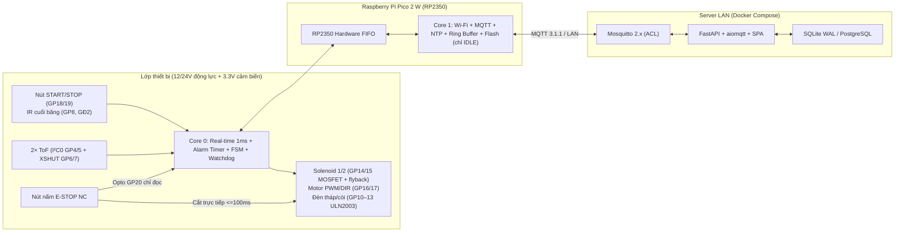

# SPEC-ARCH — Kiến trúc hệ thống, phần cứng & an toàn nền tảng

| Thuộc tính | Giá trị |
| --- | --- |
| Trạng thái | Draft |
| Giai đoạn | 1 |
| Phụ thuộc | — |
| Quyết định liên quan | [`D-05..D-10`](../decisions.md), [`phan-tich-thiet-ke-he-thong.md §1, §4, §6, §8.3`](../phan-tich-thiet-ke-he-thong.md) |
| Thiết kế | [`phan-tich-thiet-ke-he-thong.md §6`](../phan-tich-thiet-ke-he-thong.md) |

## Bản đọc ngắn để duyệt hành vi

- **Sau thay đổi, ai làm được gì:** Đội kỹ thuật có một kiến trúc phân tách rõ ràng giữa vòng điều khiển thời gian thực trên Core 0, truyền thông MQTT trên Core 1, lớp bảo vệ phần cứng E-STOP độc lập và cụm server Docker Compose 3 dịch vụ chạy trong LAN.
- **Ví dụ để tự kiểm:** Nhấn nút nấm E-STOP hoặc ép Core 0 treo vòng lặp vô hạn → nguồn động lực ngắt $\le 100\text{ ms}$ (`ARCH-AC03`) hoặc Watchdog RP2350 reset MCU $\le 1\text{ s}$ về trạng thái an toàn (`ARCH-AC04`).
- **Chưa làm trong lần đầu:** Dự phòng mạch Ethernet W5500 (chỉ kích hoạt nếu thể lệ cấm Pico 2 W), bridge MQTT lên cloud, giao thức ERP/MES.
- **Điều chưa biết & hệ quả:** Thể lệ có cho phép dùng Pico 2 W hay bắt buộc Pico 2 thường (`§8.7`), có router hội trường hay tự mang, và có giữ hay chuyển từ sơ đồ chân nguyên mẫu (`D-05`, `D-07`, `D-09`) sang bản đồ chân mục tiêu (`§6.2`).
- **Phần người dùng chốt:** Tách 2 lõi RP2350 qua FIFO phần cứng, E-STOP thường đóng ngắt trực tiếp nguồn động lực không qua MCU, stack Pico 2 W + Mosquitto LAN + FastAPI + SQLite WAL + Docker Compose.
- **Giải thích kiến thức & quyết định kỹ thuật:** Xem thẻ giải thích cơ chế **Tách 2 lõi RP2350 + Khóa ghi flash khi `IDLE`** và **Mạch E-STOP phần cứng độc lập MCU** ở §9.
- **Biên bản phản biện độc lập trước khi trình:** Chưa chạy phản biện chéo — spec đang ở trạng thái `Draft` mới chuyển đổi từ tài liệu thiết kế.
- **Quyền chạy:** `Ready` chưa cấp quyền code; đợt được giao nằm ở [`../progress.md`](../progress.md).

## 1. Mục tiêu

Thiết lập nền tảng phần cứng–phần mềm cho nguyên mẫu băng tải phân loại 3 cỡ (`S/M/L`) đáp ứng đồng thời:
1. Thời gian thực và an toàn máy **không phụ thuộc vào Wi-Fi/MQTT/server** (`NFR-03`, `NFR-06`, `NFR-08`).
2. Hạ tầng server gọn nhẹ, dựng lại toàn bộ bằng một lệnh Docker Compose trong môi trường mạng LAN hội trường (`NFR-12`), sẵn sàng mở rộng nhiều băng tải theo `device_id` (`NFR-15`).

## 2. Phạm vi

**Trong phạm vi:**
- Kiến trúc 4 lớp: Thiết bị (ToF, IR, động cơ, solenoid, nút cứng, E-STOP) → Pico 2 W (Core 0 / Core 1) → LAN (Mosquitto) → Server (FastAPI + SQLite WAL + Web Dashboard).
- Phân công tác vụ Core 0 vs Core 1 và giao tiếp qua RP2350 Hardware FIFO.
- Bản đồ chân đề xuất Pico 2 W (`§6.2`, `§10.1`), tách nguồn động lực/logic, chống nhiễu EMC (`NFR-16`), an toàn phần cứng E-STOP & Watchdog (`NFR-08`, `NFR-10`).
- Cấu trúc triển khai Docker Compose 3 dịch vụ (`mosquitto`, `api`, `db`) và đóng gói firmware UF2 tách tham số khỏi mã nguồn (`NFR-14`).

**Ngoài phạm vi:**
- Thuật toán đo/phân loại chi tiết (thuộc [`SPEC-SORT`](01-firmware-sorting-control.md)).
- Lược đồ topic/payload MQTT chi tiết (thuộc [`SPEC-MQTT`](02-mqtt-edge-sync.md)).
- API REST/WebSocket và schema SQL chi tiết (thuộc [`SPEC-BACK`](03-backend-api-storage.md)).
- Robot gắp, nhiều băng tải liên kết, ứng dụng di động riêng, tích hợp ERP/MES (`§1.2`).

## 3. Luồng tương tác, ví dụ đầu vào/đầu ra & kịch bản người dùng

- **US1 (P1)** — Là kỹ sư phần cứng/firmware, tôi muốn Core 0 và mạch E-STOP hoạt động độc lập với Wi-Fi/server để mất mạng hoặc treo mạng không làm trễ đẩy hay mất an toàn. AC: `ARCH-AC02`, `ARCH-AC03`, `ARCH-AC04`.
- **US2 (P1)** — Là quản trị đội thi, tôi muốn dựng toàn bộ hạ tầng broker + backend + DB bằng một lệnh Docker Compose và nạp firmware qua file `.uf2` để triển khai nhanh tại hội trường. AC: `ARCH-AC05`, `ARCH-AC06`.

### Luồng tương tác kiến trúc 4 lớp & phân lõi (Mermaid)



### Ví dụ cấu hình hạ tầng & ranh giới chân (Concrete Snapshot)

```text
+-------------------------------------------------------------------+
| [Sơ đồ chân mục tiêu Pico 2 W — phan-tich-thiet-ke-he-thong.md §6.2] |
| I²C0 chung bus : GP4 (SDA), GP5 (SCL) + pull-up 4.7 kΩ -> 3V3     |
| XSHUT ToF1/ToF2: GP6 / GP7 -> gán địa chỉ 0x30, 0x31 khi khởi động |
| IR cuối băng   : GP8 (ngắt cạnh, GĐ2)                             |
| Đèn tháp & còi : GP10..GP13 qua ULN2003                           |
| Solenoid 1 / 2 : GP14 / GP15 (MOSFET logic-level, R kéo xuống G)  |
| Động cơ PWM/DIR: GP16 / GP17                                      |
| START / STOP   : GP18 / GP19 (pull-up nội, debounce phần mềm)     |
| E-STOP (opto)  : GP20 (chỉ đọc báo cáo & khóa lệnh)               |
| ADC đo Vs      : GP27 (cầu phân áp nguồn động cơ, §10.1)          |
| CẤM DÙNG       : GP23, GP24, GP25, GP29 (dành cho Wi-Fi CYW43439) |
+-------------------------------------------------------------------+
```

## 4. Yêu cầu

| ID | Mức | Yêu cầu | Nguồn gốc |
| --- | --- | --- | --- |
| `ARCH-R01` | MUST | Trên RP2350, Core 0 MUST giữ toàn bộ vòng đọc cảm biến, máy trạng thái, hẹn giờ đẩy và điều khiển GPIO; Core 1 MUST chỉ đảm nhiệm Wi-Fi, MQTT, NTP, bộ đệm vòng và lưu flash. Hai lõi MUST giao tiếp không chặn qua Hardware FIFO. | Người dùng chốt — [`phan-tich-thiet-ke-he-thong.md §6.1`](../phan-tich-thiet-ke-he-thong.md#L183-L198) |
| `ARCH-R02` | MUST | Mất Wi-Fi, mất broker MQTT hoặc server treo MUST không làm gián đoạn vòng phân loại hay làm lệch thời điểm kích solenoid trên Core 0 quá $\pm 5\text{ ms}$ (`NFR-03`, `NFR-06`). | Người dùng chốt — [`phan-tich-thiet-ke-he-thong.md §3, §6.1`](../phan-tich-thiet-ke-he-thong.md#L92-L95) |
| `ARCH-R03` | MUST | Khi triển khai phần cứng mục tiêu, firmware MUST gán chân theo bảng §6.2 (gồm `GP27` đo $V_s$ ở §10.1; tùy chọn INA219 `0x40` trên I²C0) và MUST NOT sử dụng `GP23, GP24, GP25, GP29` (dành nội bộ cho CYW43439). *(Lưu ý đối chiếu: nguyên mẫu `main.cpp:32-41` hiện đang dùng `GP0/1`, `GP6/7`, `GP10/11`.)* | Người dùng chốt — [`phan-tich-thiet-ke-he-thong.md §6.2`](../phan-tich-thiet-ke-he-thong.md#L199-L212) · Đã xác minh nguyên mẫu — [`main.cpp:32-41`](../../main.cpp#L32-L41) |
| `ARCH-R04` | MUST | Thiết kế mạch MUST tách nguồn động lực (`12/24 V`) và nguồn logic (`5 V → 3,3 V`), nối chung GND, lắp diode flyback song song cuộn dây solenoid, điện trở kéo xuống cực G MOSFET, pull-up `4,7 kΩ` trên I²C0 và đi dây động lực tách xa dây tín hiệu I²C (`NFR-16`). | Người dùng chốt — [`phan-tich-thiet-ke-he-thong.md §3, §4, §8.3, §8.5`](../phan-tich-thiet-ke-he-thong.md#L105) |
| `ARCH-R05` | MUST | Mạch E-STOP phần cứng MUST dùng nút nấm tiếp điểm thường đóng (NC) mắc nối tiếp trực tiếp vào cuộn rơ-le/contactor cấp nguồn động lực (đứt dây cũng tương đương nhấn E-STOP), ngắt nguồn động lực $\le 100\text{ ms}$ độc lập với MCU (`NFR-08`). Pico MUST chỉ đọc trạng thái E-STOP qua opto cách ly (`GP20`) để báo cáo và khóa lệnh. | Người dùng chốt — [`phan-tich-thiet-ke-he-thong.md §8.3`](../phan-tich-thiet-ke-he-thong.md#L350-L353) |
| `ARCH-R06` | MUST | Core 0 MUST cấu hình Watchdog phần cứng RP2350 (ngưỡng reset $\le 1\text{ s}$) và chỉ cho watchdog ăn (chu kỳ `100 ms`) khi **cả Core 0 và Core 1** còn báo sống; khi khởi động lại MUST vào `INIT` với động cơ dừng và solenoid tắt (`NFR-10`). | Người dùng chốt — [`phan-tich-thiet-ke-he-thong.md §6.1, §8.3`](../phan-tich-thiet-ke-he-thong.md#L191) |
| `ARCH-R07` | MUST | Ghi bộ nhớ flash trên RP2350 MUST chỉ thực hiện khi máy ở trạng thái `IDLE` (băng dừng, solenoid tắt) vì ghi flash tạm dừng thực thi XIP trên cả hai lõi (`§6.1`, `§8.5`). | Người dùng chốt — [`phan-tich-thiet-ke-he-thong.md §6.1`](../phan-tich-thiet-ke-he-thong.md#L195-L197) |
| `ARCH-R08` | MUST | Kiến trúc topic MQTT và lược đồ dữ liệu MUST tham số hóa theo `device_id` để gắn thêm băng tải mới không cần đổi schema hoặc sửa mã backend (`NFR-15`). | Người dùng chốt — [`phan-tich-thiet-ke-he-thong.md §3, §7`](../phan-tich-thiet-ke-he-thong.md#L104) |
| `ARCH-R09` | MUST | Mã nguồn firmware MUST tách tham số vận hành (ngưỡng, $L_p$, $t_{on}$, PWM, $N$) khỏi mã lệnh để cập nhật qua dashboard không cần nạp lại firmware, đồng thời hỗ trợ nạp firmware `.uf2` qua USB (`NFR-14`). | Người dùng chốt — [`phan-tich-thiet-ke-he-thong.md §3`](../phan-tich-thiet-ke-he-thong.md#L103) |
| `ARCH-R10` | MUST | Cụm phần mềm server MUST đóng gói bằng Docker Compose gồm 3 dịch vụ (`mosquitto`, `api` kèm static SPA của dashboard, `db`) có khả năng khởi động lại toàn bộ bằng một lệnh (`NFR-12`). | Người dùng chốt — [`phan-tich-thiet-ke-he-thong.md §3, §6.3`](../phan-tich-thiet-ke-he-thong.md#L222) |

## 5. Yêu cầu phi chức năng

| Khía cạnh | Điều kiện kiểm được | Nhãn nguồn gốc & cách kiểm |
| --- | --- | --- |
| Hiệu năng | Vòng trạng thái/nút/E-STOP Core 0 chu kỳ `1 ms` (`§6.1`); độ lệch kích solenoid $\le \pm 5\text{ ms}$ dù có tải Wi-Fi (`NFR-03`). | Người dùng chốt — Logic analyzer (`TC-03`), telemetry `loop_max_us`. |
| Bảo mật | Nguồn mật khẩu Wi-Fi/MQTT không hardcode công khai trong repo; phân quyền MQTT ACL theo `device_id` (`NFR-11`). | Người dùng chốt — Review `mosquitto.conf`, ACL, `.env.example`. |
| Giới hạn / rate limit | FIFO liên lõi không tràn khi Core 1 nghẽn mạng; sự kiện tràn vào ring buffer ($\ge 500$ mục, `NFR-06`). | Người dùng chốt — `SPEC-MQTT` (`MQTT-AC04`). |
| Khả dụng / khôi phục | E-STOP ngắt $\le 100\text{ ms}$ (`NFR-08`); Watchdog reset $\le 1\text{ s}$ (`NFR-10`); server $\ge 99\%$ chạy thử 2 giờ (`NFR-12`). | Người dùng chốt — `TC-05`, `TC-08`, test 2 giờ. |
| Quan sát | Watchdog/boot reset, lỗi nguồn/EMI (chạy 1 giờ đóng cắt solenoid không reset, `NFR-16`) được ghi nhận qua `alarm` và `status`. | Người dùng chốt — Bench EMC 1 giờ (`ARCH-AC02`). |
| i18n | `N/A — tầng kiến trúc hạ tầng không chứa giao diện ngôn ngữ.` | `SPEC-DASH` xử lý giao diện tiếng Việt. |
| a11y | `N/A — tầng kiến trúc hạ tầng; an toàn nút cứng E-STOP nút nấm theo ISO 13850.` | Người dùng chốt — [`§4`](../phan-tich-thiet-ke-he-thong.md#L124). |
| Trạng thái UI | `N/A — thuộc SPEC-DASH.` | `SPEC-DASH`. |

## 6. Trường hợp biên

- Mất kết nối Wi-Fi/MQTT giữa chừng khi Core 0 đang kích solenoid → Core 0 vẫn kích đúng thời điểm theo timer phần cứng; Core 1 tự kết nối lại (`ARCH-AC01` / `SPEC-MQTT`).
- Core 1 gặp ngoại lệ hoặc kẹt vòng lặp → ngừng báo sống sang Core 0 → Core 0 ngừng cho watchdog ăn → Watchdog reset toàn chip $\le 1\text{ s}$ về trạng thái an toàn (`ARCH-AC04`).
- Đứt dây mạch E-STOP → tiếp điểm NC hở mạch tương đương nhấn E-STOP, ngắt contactor nguồn động lực ngay lập tức (`ARCH-R05`).
- Nhận lệnh lưu cấu hình mới khi băng đang `RUNNING` → áp dụng cấu hình trên RAM trước, hoãn ghi flash cho tới khi chuyển về `IDLE` (`ARCH-R07`).

## 7. Điều kiện nghiệm thu & bảng kiểm thử

| Trạng thái | Ý nghĩa |
| --- | --- |
| `[]` | chưa đạt |
| `[x]` | đã kiểm chứng có bằng chứng lệnh/đo thực tế |
| `[~]` | chưa kiểm chứng — ghi lý do, người/cách đóng; chặn `Done` |

### Bảng kiểm thử — duyệt trước khi code (Visible Test Matrix)

| Mã AC | Kịch bản (`Cho / Khi / Thì`) | Đầu vào cụ thể | Kỳ vọng quan sát được | Tầng & độ thật | Lệnh kiểm | Trạng thái |
| --- | --- | --- | --- | --- | --- | --- |
| **ARCH-AC01** | **Cho** firmware chạy đầy đủ trên Pico 2 W với tải Wi-Fi/MQTT, **Khi** đo jitter GPIO từ cạnh phát hiện ToF tới cạnh kích solenoid (`TC-03`) khi có và không có tải mạng, **Thì** độ lệch thời điểm kích $\le \pm 5\text{ ms}$. | Logic analyzer nối chân đánh dấu $t_0$ và `GP14/GP15` | Sai lệch giữa 2 chế độ và so với $t_d$ tính toán $\le 5\text{ ms}$ | `hardware bench` — **0 Mock** (Pico 2 W + Wi-Fi thật) | `Bench TC-03: ghi chụp Logic Analyzer` | `[]` |
| **ARCH-AC02** | **Cho** phần cứng hoàn chỉnh nối solenoid có diode flyback và MOSFET pull-down (`NFR-16`), **Khi** đóng cắt solenoid liên tục $\ge 50$ lần trong `S1` và chạy 1 giờ liên tục, **Thì** Pico không brown-out/reset ngoài ý muốn và I²C không treo. | Lệnh test 50 nhịp solenoid + chạy tải 1 giờ | `boot_id` không đổi, 0 reset ngoài dự kiến, I²C đọc ổn định | `hardware bench` — **0 Mock** | `Bench S1/NFR-16: đếm boot_id qua telemetry 1 giờ` | `[]` |
| **ARCH-AC03** | **Cho** băng đang `RUNNING` và/hoặc cố ý treo vòng lặp trên Core 0 (`TC-05`), **Khi** nhấn nút nấm E-STOP hoặc rút dây vòng NC, **Thì** nguồn động lực động cơ + solenoid mất $\le 100\text{ ms}$, `GP20` báo mức E-STOP và `alarm` lên dashboard. | Nhấn E-STOP ở từng trạng thái `IDLE`/`RUNNING`/`MANUAL` + khi ép treo Core 0 | Đồng hồ đo/oscilloscope xác nhận ngắt động lực $\le 100\text{ ms}$ | `hardware bench` — **0 Mock** | `Bench TC-05: đo thời gian cắt tải contactor` | `[]` |
| **ARCH-AC04** | **Cho** firmware đang chạy với Watchdog RP2350 bật (`TC-08`), **Khi** ép Core 0 (hoặc Core 1) rơi vào vòng lặp vô hạn không báo sống, **Thì** MCU tự reset trong $\le 1\text{ s}$ về `INIT` với động cơ dừng và solenoid ở mức LOW. | Cờ test/lệnh debug ép vòng lặp vô hạn | Thời gian từ lúc treo đến tái khởi động $\le 1\text{ s}$, ngõ ra `GP14..GP17` ở mức an toàn | `hardware bench` — **0 Mock** | `Bench TC-08: quan sát Serial/LED boot_id` | `[]` |
| **ARCH-AC05** | **Cho** firmware biên dịch bằng Pico SDK/CMake từ mã nguồn sạch, **Khi** build và kiểm tra quy tắc không chạm chân `GP23, GP24, GP25, GP29` và không ghi flash ngoài trạng thái `IDLE`, **Thì** tạo ra file `.uf2` hợp lệ và vượt qua kiểm tra tĩnh. | Cấu hình `cmake -DPICO_BOARD=pico2_w` | File `.uf2` sinh thành công; kiểm tra tĩnh xác nhận không dùng chân cấm | `build + static check` — **0 Mock** | `cmake --build build -j` | `[]` |
| **ARCH-AC06** | **Cho** file `docker-compose.yml` cấu hình 3 dịch vụ (`mosquitto`, `api`, `db`), **Khi** chạy lệnh khởi động và thực hiện kiểm tra chạy liên tục 2 giờ (`NFR-12`), **Thì** cả 3 container `healthy`, dashboard phục vụ qua HTTP và API trả lời `200 OK`. | `docker compose up -d` | `docker compose ps` báo 3 service running/healthy; `curl /api/health` = 200 | `integration` — **0 Mock** (Docker thật) | `docker compose up -d && docker compose ps` | `[]` |

## 8. Kiểm tra end-to-end

Chạy tuần tự: (1) Build firmware `.uf2` thành công → (2) Dựng `docker compose up -d` trong LAN → (3) Nạp `.uf2` lên Pico 2 W, xác nhận board lên `online`, thực hiện `TC-05` (E-STOP) và `TC-08` (Watchdog) trên bàn thí nghiệm an toàn.

## 9. Ghi chú thiết kế

- Nền tảng firmware mục tiêu theo `.docx` cần tách module rõ (driver ToF I²C0 + XSHUT, driver động cơ/solenoid, state machine Core 0, network/MQTT Core 1, cấu hình flash).
- Khuyến nghị tách lớp trừu tượng phần cứng theo cờ biên dịch (`HW_PROFILE_LEGACY` khớp `main.cpp:32-41` dùng 2 bus I²C `GP0/1`, `GP6/7` và L298N `GP10/11` vs `HW_PROFILE_TARGET` khớp `§6.2`) để có thể code từng module và test ngay trên phần cứng hiện hữu trước khi đấu dây mới (`Q-ARCH-01`).
- Trên RP2350, tránh gọi hàm ghi flash trực tiếp từ Core 0 hoặc trong khi ngắt timer/I²C đang chạy vì thao tác xóa/ghi flash khóa XIP của cả 2 lõi (`flash_safe_execute` vẫn làm khựng vòng quét thực tế).

### Giải thích kiến thức & quyết định kỹ thuật (Thẻ giải thích kỹ thuật)

**Khái niệm / Quyết định 1:** Tách 2 lõi RP2350 qua Hardware FIFO & Chỉ ghi flash khi `IDLE` · Nhãn: `Người dùng chốt`
- **Bản chất là gì (nói dễ hiểu + ví dụ thực tế của dự án):** Pico 2 W có 2 nhân xử lý độc lập. Core 0 giống "người đứng máy" chỉ lo đọc cảm biến ToF và bấm giờ đẩy solenoid đúng từng mili-giây; Core 1 giống "nhân viên báo cáo" lo giữ Wi-Fi, gửi `event/item` qua MQTT và lưu cấu hình `config/desired` xuống bộ nhớ flash. Hai nhân chuyển tin cho nhau qua hộp thư phần cứng (FIFO) nên Core 1 bị nghẽn mạng cũng không làm Core 0 khựng nhịp. Riêng việc ghi bộ nhớ flash trên chip RP2350 buộc cả 2 nhân phải tạm ngừng đọc lệnh từ flash trong vài chục mili-giây, nên chỉ được phép ghi khi băng đã dừng hoàn toàn (`IDLE`).
- **Tại sao bắt buộc cần ở đây (nếu không có thì lỗi gì xảy ra?):** Nếu chạy gộp 1 lõi hoặc ghi flash ngay lúc `RUNNING` khi người dùng bấm Lưu trên dashboard, vòng đọc ToF và alarm timer của Core 0 sẽ bị đứng hình giữa chừng, làm sản phẩm trôi qua khỏi bàn đẩy hoặc đẩy trượt (`NFR-03` bị phá vỡ).
- **Chạy thế nào trong dự án này (Đầu vào → Xử lý → Đầu ra):** Người dùng lưu `config/desired` → Core 1 nhận gói MQTT, kiểm tra biên hợp lệ → đẩy sang Core 0 qua FIFO để áp dụng ngay trong RAM; nếu đang `RUNNING` thì đặt cờ chờ, chỉ khi FSM về `IDLE` mới thực thi ghi flash và gửi `config/reported`.
- **Tự kiểm trong ≤ 5 phút:** Khi băng đang chạy ở chế độ thử tải, gửi cấu hình qua MQTT và đo bằng Logic Analyzer trên chân solenoid (`ARCH-AC01`): độ lệch thời điểm đẩy phải $\le \pm 5\text{ ms}$, không xuất hiện gai trễ hàng chục mili-giây.
- **Nguồn đối chiếu & Giới hạn không tự kiểm được:** [`phan-tich-thiet-ke-he-thong.md §6.1`](../phan-tich-thiet-ke-he-thong.md#L183-L198). Độ khựng XIP thực tế phụ thuộc kích thước sector xóa/ghi flash trên RP2350.

**Khái niệm / Quyết định 2:** E-STOP phần cứng nối tiếp cuộn contactor độc lập MCU · Nhãn: `Người dùng chốt`
- **Bản chất là gì (nói dễ hiểu + ví dụ thực tế của dự án):** Nút nấm E-STOP không đấu vào chân Pico để "xin phần mềm dừng", mà dùng tiếp điểm thường đóng (NC) mắc nối tiếp thẳng vào nguồn nuôi cuộn dây rơ-le/contactor cấp điện cho động cơ và solenoid (`12/24 V`). Pico chỉ đọc trạng thái E-STOP qua một opto cách ly ở `GP20` để hiển thị lên dashboard và từ chối lệnh điều khiển.
- **Tại sao bắt buộc cần ở đây (nếu không có thì lỗi gì xảy ra?):** Nếu E-STOP chỉ đi qua phần mềm Pico, khi MCU bị treo hoặc cháy chân GPIO thì bấm nút khẩn cấp vẫn không dừng được băng tải, gây mất an toàn cơ khí và điện (`NFR-08`).
- **Chạy thế nào trong dự án này (Đầu vào → Xử lý → Đầu ra):** Nhấn E-STOP (hoặc đứt dây mạch NC) → Mạch rơ-le mất điện ngay trong $\le 100\text{ ms}$ → Đồng thời `GP20` đổi mức logic → Core 0 chuyển `ESTOP`, nhả mọi GPIO và gửi `alarm` lên server.
- **Tự kiểm trong ≤ 5 phút:** Ép Core 0 treo bằng chế độ test hoặc giữ băng chạy rồi bấm nút E-STOP (`ARCH-AC03`): động cơ và solenoid phải mất điện ngay tức thì bất kể trạng thái firmware.
- **Nguồn đối chiếu & Giới hạn không tự kiểm được:** [`phan-tich-thiet-ke-he-thong.md §4, §8.3`](../phan-tich-thiet-ke-he-thong.md#L350-L353). Khẳng định tuân thủ nguyên lý IEC 60204-1 / ISO 13850 cần kiểm tra đấu nối mạch điện thực tế bởi người phụ trách phần cứng.

## 10. Hướng dẫn vận hành

Mọi thao tác lắp đặt cơ–điện ban đầu tuân theo checklist `S0`–`S3` trong [`SPEC-CALIB`](05-calibration-and-runtime-health.md).

## 11. Làm rõ

*(Chưa có phiên làm rõ bổ sung ngoài tài liệu nguồn.)*

## 12. Câu hỏi mở

| Điều chưa biết / đề xuất | Nguồn đã kiểm | Ảnh hưởng / AC bị chặn | Cách xác minh & người phụ trách |
| --- | --- | --- | --- |
| **Q-ARCH-01 (Chốt chuyển đổi sơ đồ chân):** Hiện trạng `main.cpp:32-41` và `decisions.md` (`D-05`, `D-07`, `D-09`) dùng 2 bus I²C (`GP0/1`, `GP6/7`), L298N `GP10/11`, chưa có E-STOP/động cơ PWM/nút cứng; khác hoàn toàn bảng chân `§6.2` (`GP4/5`, `GP6/7` XSHUT, `GP14/15` MOSFET, `GP16/17`, `GP18–20`, `GP27`). | [`main.cpp:32-41`](../../main.cpp#L32-L41), [`decisions.md`](../decisions.md), [`§6.2`](../phan-tich-thiet-ke-he-thong.md#L199-L212) | Chặn toàn bộ phần đấu dây & pin header firmware trong `ARCH-AC01..05` | Đội phần cứng + người dùng chốt: giữ chân cũ nâng cấp hay đi dây lại theo `§6.2`? |
| **Q-ARCH-02 (Pico 2 W vs Pico 2 + W5500):** Thể lệ thi có bắt buộc dùng bản Pico 2 thường (không Wi-Fi) hay cho phép Pico 2 W? | [`§1.4`](../phan-tich-thiet-ke-he-thong.md#L41), [`§8.7`](../phan-tich-thiet-ke-he-thong.md) | Nếu bắt buộc dùng W5500 Ethernet cần thêm driver SPI W5500 | Xác nhận từ BTC cuộc thi (`§8.7`) |
| **Q-ARCH-03 (Mạng hội trường):** Hội trường có cấp mạng LAN/Wi-Fi riêng hay đội tự mang router 2.4 GHz? | [`§8.7`](../phan-tich-thiet-ke-he-thong.md) | Ảnh hưởng cấu hình SSID, kênh Wi-Fi và IP tĩnh broker | Xác nhận từ BTC / chuẩn bị router dự phòng |
