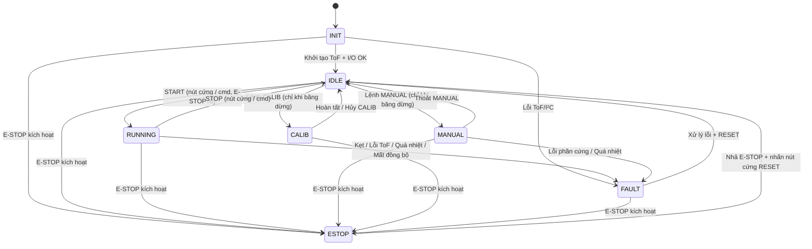

# SPEC-SORT — Điều khiển thời gian thực, đo chiều cao & phân loại trên Core 0

| Thuộc tính | Giá trị |
| --- | --- |
| Trạng thái | Draft |
| Giai đoạn | 1 |
| Phụ thuộc | [`SPEC-ARCH`](00-architecture.md) |
| Quyết định liên quan | [`D-01..D-05, D-11`](../decisions.md), [`phan-tich-thiet-ke-he-thong.md §2, §5, §8, §9`](../phan-tich-thiet-ke-he-thong.md) |
| Thiết kế | [`phan-tich-thiet-ke-he-thong.md §5.3, §8.1, §9`](../phan-tich-thiet-ke-he-thong.md) |

## Bản đọc ngắn để duyệt hành vi

- **Sau thay đổi, ai làm được gì:** Pico 2 W trên Core 0 tự động đọc 2 cảm biến ToF trên cùng bus I²C0, lọc trung vị $N$ mẫu, tính chiều cao $h$, phân loại `S/M/L`, đặt hardware alarm timer kích solenoid chính xác theo $t_0$, điều khiển băng tải và đèn tháp/nút cứng, đồng thời chống kẹt/quá nhiệt.
- **Ví dụ để tự kiểm:** Cho 100 sản phẩm trộn ngẫu nhiên `S/M/L` chạy qua băng ở tốc độ làm việc → theo `D-11`, Trạm 1 đẩy `M`, Trạm 2 đẩy `L`, `S` chạy thẳng về cuối băng với độ chính xác $\ge 98\%$ (`SORT-AC04`) và độ lệch thời điểm đẩy $\le \pm 5\text{ ms}$ (`SORT-AC05`).
- **Chưa làm trong lần đầu:** Cảm biến IR cuối băng xác nhận `S` (`FR-07`, xếp `SHOULD` / GĐ2); mặc định GĐ1 đếm `S/M/L` từ quyết định phân loại như §10.1.
- **Điều chưa biết & hệ quả:** Kích thước $\ell_p, w_p, h$ chuẩn theo thể lệ và thông số solenoid thực đo (`§8.7`) sẽ được điền trực tiếp khi test từng module trên phần cứng.
- **Phần người dùng chốt:** Phân công trạm đẩy theo code hiện trạng (`D-11`: Trạm 1 đẩy `M`, Trạm 2 đẩy `L`, `S` chạy thẳng cuối băng — ghi đè `.docx §1.1, FR-04, FR-05, FR-07`), máy trạng thái 7 trạng thái, logic 2 trạm độc lập (Trạm 2 đo lại để bắt `M` lọt), neo hẹn giờ vào $t_0$ bằng hardware alarm timer, khóa chuyển chế độ khi băng đang chạy, `ESTOP` chỉ thoát bằng nút cứng.
- **Giải thích kiến thức & quyết định kỹ thuật:** Xem thẻ **Neo hẹn giờ đẩy theo $t_0$ & lọc trung vị $N$ mẫu** ở §9.
- **Biên bản phản biện độc lập trước khi trình:** Chưa chạy phản biện chéo — spec đang ở trạng thái `Draft`.
- **Quyền chạy:** `Ready` chưa cấp quyền code; đợt được giao nằm ở [`../progress.md`](../progress.md).

## 1. Mục tiêu

Triển khai toàn bộ vòng điều khiển biên xác định (deterministic) trên Core 0 (`FR-01`..`FR-11`, `NFR-01`..`NFR-04`, `NFR-08`..`NFR-10`) sao cho mỗi sản phẩm được đo chiều cao tin cậy, phân loại đúng, đẩy trúng tâm và an toàn cơ–điện ngay cả khi không có mạng.

## 2. Phạm vi

**Trong phạm vi:**
- Khởi tạo 2 cảm biến ToF (VL53L0X/VL53L1X) chung bus I²C0 bằng chân `XSHUT` (`0x30`, `0x31`), đọc liên tục.
- Máy trạng thái 7 trạng thái Core 0 (`INIT`, `IDLE`, `RUNNING`, `MANUAL`, `CALIB`, `FAULT`, `ESTOP`).
- Thuật toán phát hiện sản phẩm, lọc trung vị $N$ mẫu, tính chiều cao $h$, phân loại `S/M/L`, Trạm 1 đẩy `M`, Trạm 2 đo lại đẩy `L` và phát hiện `M` lọt (`D-11`).
- Hẹn giờ kích solenoid bằng hardware alarm timer theo $t_0$, chặn trên $t_{on}$ và giới hạn nhiệt $D_{rated}$, ràng buộc bước tối thiểu $p_{min}$.
- Điều khiển PWM/DIR động cơ băng tải, nút cứng `START`/`STOP`/`RESET`, đọc `E-STOP` (`GP20`), đèn tháp 3 màu & còi (`GP10–13`), phát hiện kẹt / lỗi I²C.
- Cảm biến IR cuối băng xác nhận `S` (`GP8`, `SORT-R09`, `SHOULD` — GĐ2).

**Ngoài phạm vi:**
- Thuật toán tự hiệu chuẩn C1–C7 và bộ lọc hợp nhất tốc độ $\hat{v}$ đa nguồn (thuộc [`SPEC-CALIB`](05-calibration-and-runtime-health.md), `SPEC-SORT` nhận $\hat{v}$ hoặc giá trị mặc định $t_d$).
- Giao thức Wi-Fi, MQTT, bộ đệm vòng, lưu flash (thuộc [`SPEC-MQTT`](02-mqtt-edge-sync.md)).

## 3. Luồng tương tác, ví dụ đầu vào/đầu ra & kịch bản người dùng

- **US1 (P1)** — Là người vận hành tại máy, tôi muốn bấm `START`/`STOP`, kích hoạt `E-STOP` khi khẩn cấp và nhìn đèn tháp/còi để biết trạng thái tức thì. AC: `SORT-AC01`, `SORT-AC07`.
- **US2 (P1)** — Là hệ thống phân loại tự động (`UC-10`), khi sản phẩm đi qua Trạm 1 và Trạm 2, tôi muốn đo đủ $N$ mẫu, phân loại `S/M/L` và kích đúng solenoid với sai số $\le \pm 5\text{ ms}$ để sản phẩm rơi đúng máng. AC: `SORT-AC03`..`SORT-AC06`.
- **US3 (P2)** — Là kỹ thuật viên (`UC-04`), tôi muốn chuyển sang `MANUAL` khi băng dừng để test riêng băng tải hoặc từng solenoid mà không chạy vòng tự động. AC: `SORT-AC01`, `SORT-AC06`.

### Máy trạng thái Core 0 (Mermaid)



### Ví dụ luồng xử lý một sản phẩm (Concrete I/O Snapshot)

```text
+-------------------------------------------------------------------+
| [Dòng sự kiện Core 0 — Sản phẩm cỡ M (h1 = 50.2 mm) tại Trạm 1]   |
| Đầu vào : H0_1 = 100.4 mm, k1 = 1.0, c1 = 0.0, T_SM=40, T_ML=60   |
|           Mẫu ToF1 (d): [99.8, 74.5 (bỏ mép), 50.1, 50.3, 50.2]   |
| Xử lý   : t0 = 12000 ms (bắt đầu vào), median(50.1,50.3,50.2)=50.2|
|           h1 = ((100.4 - 50.2) - 0.0)/1.0 = 50.2 mm (40 < h <= 60)|
|           -> M; t_d = 608 ms -> đặt alarm t_fire = 12608 ms       |
| Đầu ra  : Tại t=12608 ms -> GP14 HIGH 50 ms rồi LOW               |
|           Đẩy FIFO sang Core 1: cls="M", station=1, result="pushed"|
+-------------------------------------------------------------------+
```

## 4. Yêu cầu

| ID | Mức | Yêu cầu | Nguồn gốc |
| --- | --- | --- | --- |
| `SORT-R01` | MUST | Core 0 MUST vận hành máy trạng thái 7 trạng thái (`INIT`, `IDLE`, `RUNNING`, `MANUAL`, `CALIB`, `FAULT`, `ESTOP`). Việc chuyển giữa `IDLE`/`RUNNING`/`MANUAL`/`CALIB` MUST chỉ thực hiện được khi băng đang dừng; mọi trạng thái MUST chuyển ngay sang `ESTOP` khi E-STOP kích hoạt và chỉ thoát `ESTOP` về `IDLE` khi đã nhả E-STOP vật lý và nhấn nút cứng `RESET` (`FR-09`, `§5.4`, `§8.1`). | Người dùng chốt — [`phan-tich-thiet-ke-he-thong.md §2, §8.1`](../phan-tich-thiet-ke-he-thong.md#L64) |
| `SORT-R02` | MUST | Khi khởi động trong `INIT`, Core 0 MUST điều khiển chân `XSHUT` (`GP6`, `GP7`) bật lần lượt để gán địa chỉ I²C `0x30` (ToF1) và `0x31` (ToF2) trên bus chung; ở chế độ đo liên tục, khi $d < H_0 - \Delta_{detect}$ (với ngưỡng chống nhiễu mặt băng từ $\sigma_0$) trong `RUNNING`, hệ thống MUST ghi nhận thời điểm vào $t_0$ của sản phẩm (`FR-01`, `§1.4`, `§9.4`). | Người dùng chốt — [`phan-tich-thiet-ke-he-thong.md §1.4, §2, §9.4`](../phan-tich-thiet-ke-he-thong.md#L56) |
| `SORT-R03` | MUST | Khi sản phẩm nằm dưới vùng đo của mỗi trạm, Core 0 MUST bỏ mẫu chuyển tiếp mép đầu tiên, lấy trung vị $N$ mẫu liên tiếp ($N \in [3, 5]$ mặc định, cấu hình được) và tính chiều cao $h = \frac{(H_0 - d) - c}{k}$ (mặc định $k=1, c=0$ trước C2) với sai số đo $\le \pm 3\text{ mm}$ (`FR-02`, `NFR-02`, `§9.4`, `§10.3`). | Người dùng chốt — [`phan-tich-thiet-ke-he-thong.md §2, §9.4, §10.3`](../phan-tich-thiet-ke-he-thong.md#L57) |
| `SORT-R04` | MUST | Core 0 MUST phân loại theo 2 ngưỡng cấu hình được: $h \le T_{SM} \to \text{S}$; $T_{SM} < h \le T_{ML} \to \text{M}$; $h > T_{ML} \to \text{L}$ (`FR-03`), trong đó khoảng cách các cỡ tới ngưỡng đạt $\ge 3 \cdot \frac{1.25\,\sigma}{\sqrt{N}}$ (`§9.4`) và đạt độ chính xác phân loại $\ge 98\%$ trên lô $\ge 100$ sản phẩm (`NFR-01`). | Người dùng chốt — [`phan-tich-thiet-ke-he-thong.md §2, §3, §9.4`](../phan-tich-thiet-ke-he-thong.md#L58) |
| `SORT-R05` | MUST | Theo [`D-11`](../decisions.md#L17), Trạm 1 MUST chỉ kích đẩy sản phẩm loại `M` ($T_{SM} < h_1 \le T_{ML}$). Trạm 2 MUST đo lại mọi sản phẩm đi qua Trạm 1: nếu $h_2 > T_{ML}$ (`L`) thì kích Solenoid 2; nếu $h_2 \le T_{SM}$ (`S`) thì cho đi thẳng về cuối băng (`cls="S", station=2, result="passed"`); nếu $T_{SM} < h_2 \le T_{ML}$ (sản phẩm `M` bị lọt qua Trạm 1) thì **KHÔNG** kích đẩy sang máng `L` mà phải ghi nhận bản ghi lỗi `cls="M", station=2, result="missed"` và phát cảnh báo *(ghi đè phân công trạm trong `.docx §1.1, FR-04` để giữ đúng code hiện trạng [`main.cpp:13-15`](../../main.cpp#L13-L15))*. | Người dùng chốt (`D-11`, 2026-11-25) — [`decisions.md`](../decisions.md#L17) · [`main.cpp:13-15`](../../main.cpp#L13-L15) |
| `SORT-R06` | MUST | Ngay khi có quyết định đẩy (`t_dec < t_fire`), Core 0 MUST đặt hardware alarm timer tại $t_{fire} = t_0 + t_d$ (với $t_d = \frac{L_p + e_{det} + \ell_p/2}{\hat{v}} - t_{act}$ hoặc `d1_ms`/`d2_ms` nếu chưa có thông số hình học C3), bảo đảm độ lệch kích thực tế $\le \pm 5\text{ ms}$ bất kể tải mạng (`FR-05`, `NFR-03`, `§9.2`, `§9.5`, `§10.5`). | Người dùng chốt — [`phan-tich-thiet-ke-he-thong.md §2, §9.2, §9.5`](../phan-tich-thiet-ke-he-thong.md#L60) |
| `SORT-R07` | MUST | Core 0 MUST tắt solenoid đúng sau xung $t_{on}$ bằng ngắt alarm timer, cưỡng bức chặn trên $t_{on} \le t_{on,max}$ (`NFR-09`) và theo dõi tổng $t_{on}$ trong cửa sổ trượt `60 s`: cảnh báo khi $> 80\%\,D_{rated}$ và đưa máy về `FAULT` nếu $> 100\%\,D_{rated}$ (`§9.7`, `§10.5`). | Người dùng chốt — [`phan-tich-thiet-ke-he-thong.md §3, §9.7, §10.5`](../phan-tich-thiet-ke-he-thong.md#L98) |
| `SORT-R08` | MUST | Core 0 MUST điều khiển chạy, dừng và đặt tốc độ băng tải bằng PWM/DIR (`GP16`, `GP17`), đáp ứng thay đổi tốc độ theo cấu hình trong $\le 1\text{ s}$ (`FR-06`) và hỗ trợ ramp khởi động $t_{ramp}$ (`§10.3 C3`). | Người dùng chốt — [`phan-tich-thiet-ke-he-thong.md §2 FR-06`](../phan-tich-thiet-ke-he-thong.md#L61) |
| `SORT-R09` | SHOULD | *(GĐ2 — tùy chọn phần cứng)* Nếu lắp cảm biến IR cuối băng (`GP8`), Core 0 SHOULD bắt ngắt cạnh để xác nhận và đếm sản phẩm `S` đi hết băng theo [`D-11`](../decisions.md#L17) (`FR-07`); khi không lắp IR, bộ đếm `S` lấy thẳng từ quyết định cho đi qua tại Trạm 2 (`§10.1`). | Người dùng chốt — [`phan-tich-thiet-ke-he-thong.md §2 FR-07, §10.1`](../phan-tich-thiet-ke-he-thong.md#L62) + `D-11` |
| `SORT-R10` | MUST | Core 0 MUST quét nút cứng `START` (`GP18`), `STOP` (`GP19`) có chống dội phần mềm và giám sát `E-STOP` (`GP20`) ở chu kỳ `1 ms`, đồng thời điều khiển đèn tháp Đỏ/Vàng/Xanh và còi (`GP10–13`) phản ánh đúng 7 trạng thái máy (`FR-08`). | Người dùng chốt — [`phan-tich-thiet-ke-he-thong.md §2 FR-08, §6.1, §6.2`](../phan-tich-thiet-ke-he-thong.md#L63) |
| `SORT-R11` | SHOULD | Core 0 SHOULD phát hiện: (a) kẹt sản phẩm khi vật che ToF vượt thời gian chờ tối đa; (b) lỗi bus I²C / cảm biến ToF không phản hồi quá timeout; (c) phát hiện 2 sản phẩm quá sát nhau trong cùng chu kỳ đẩy ($p < p_{min}$). Khi gặp kẹt hoặc lỗi ToF, máy MUST dừng băng, chuyển `FAULT` và đẩy mã lỗi sang Core 1 (`FR-11`, `§5.4`, `§8.5`). | Người dùng chốt — [`phan-tich-thiet-ke-he-thong.md §2 FR-11, §5.4, §8.5`](../phan-tich-thiet-ke-he-thong.md#L66) |
| `SORT-R12` | MUST | Ở chế độ `MANUAL`, Core 0 MUST cho phép kích đơn lẻ solenoid 1, solenoid 2 (tuân thủ giới hạn $t_{on,max}$ và $D_{rated}$) hoặc chạy thử băng tải theo lệnh; ở mọi lúc nếu nhận lệnh từ xa trong khi `E-STOP` đang kích hoạt, Core 0 MUST từ chối lệnh (`FR-09`, `FR-23`). | Người dùng chốt — [`phan-tich-thiet-ke-he-thong.md §2, §8.1`](../phan-tich-thiet-ke-he-thong.md#L64) |
| `SORT-R13` | SHOULD | Hệ thống phân loại MUST thiết kế thông số $T_b, N, v$ đạt ngưỡng tốc độ tối đa $v_{max} = \min(v_{max,1}, v_{max,2}, v_{max,3})$, khoảng cách tối thiểu $p_{min} = \max(\ell_p + D_{spot} + v T_b,\; v(t_{on}+t_{ret}-t_{act}) + (\ell_p+b)/2)$ và năng suất mục tiêu $Q \ge 30\text{ sản phẩm/phút}$ (`NFR-04`, `§9.4`–`§9.9`). | Người dùng chốt — [`phan-tich-thiet-ke-he-thong.md §3, §9.8, §9.9`](../phan-tich-thiet-ke-he-thong.md#L93) |

## 5. Yêu cầu phi chức năng

| Khía cạnh | Điều kiện kiểm được | Nhãn nguồn gốc & cách kiểm |
| --- | --- | --- |
| Hiệu năng | Chu kỳ vòng lặp chính Core 0 `1 ms` (`loop_max_us <= 1000 us`); sai số thời điểm kích solenoid $\le \pm 5\text{ ms}$ (`NFR-03`); thông lượng $\ge 30\text{ sp/phút}$ (`NFR-04`). | Người dùng chốt — `TC-03` Logic Analyzer + telemetry `loop_max_us`. |
| Bảo mật | Lệnh kích đẩy ở `MANUAL` bị khóa nếu chưa vào `MANUAL` hoặc đang `ESTOP`. | Người dùng chốt — Unit/bench test state guard. |
| Giới hạn / rate limit | Giới hạn độ dài hàng đợi hẹn giờ trạm; chặn trên $t_{on,max}$ và nhiệt $D_{rated}$ (`NFR-09`). | Người dùng chốt — Unit test + `SORT-AC06`. |
| Khả dụng / khôi phục | Lỗi ToF hoặc kẹt → chuyển `FAULT`, ngắt động cơ/solenoid; reset về `IDLE` khi hết lỗi. | Người dùng chốt — `SORT-AC08`. |
| Quan sát | Mọi quyết định sản phẩm (`h1_mm`, `h2_mm`, `cls`, `station`, `result`) và chuyển trạng thái đẩy qua FIFO sang Core 1. | Người dùng chốt — `SPEC-MQTT`. |
| i18n | `N/A — tầng firmware điều khiển không xử lý đa ngôn ngữ.` | — |
| a11y | `N/A — giao diện vật lý nút cứng + đèn tháp + còi phân biệt màu/âm.` | — |
| Trạng thái UI | Đèn tháp Xanh (`RUNNING`), Vàng (`IDLE`/`MANUAL`/`CALIB`), Đỏ + Còi (`FAULT`/`ESTOP`). | AI đề xuất ánh xạ màu đèn tháp từ danh sách linh kiện `§6.2` — cần xác nhận quy ước màu cụ thể. |

## 6. Trường hợp biên

- **Sản phẩm M lọt qua Trạm 1 (`D-11`):** Trạm 2 đo thấy $T_{SM} < h_2 \le T_{ML}$ → không kích Solenoid 2 (không làm lẫn máng `L`), ghi nhận lỗi `missed` ở sự kiện và sinh alarm (`FR-04`, `D-11`).
- **Hai sản phẩm nối đuôi sát nhau ($p < p_{min}$):** Không thấy mặt băng trống giữa hai vật hoặc vật thứ 2 tới khi bàn đẩy chưa thu về → phát cảnh báo cấp quá dày (`§8.5`, `§10.5`) và không kích chồng chu kỳ đẩy.
- **Mẫu đo ToF nhiễu / vượt tầm (`> 4000 mm` hoặc CRC/I²C timeout):** Bỏ mẫu lỗi khỏi bộ lọc trung vị; nếu mất phản hồi liên tiếp quá ngưỡng `SENSOR_TIMEOUT_MS` → dừng băng, `FAULT` (`FR-11`).
- **Chuyển chế độ khi băng đang chạy:** Bấm `MANUAL`/`CALIB` khi đang `RUNNING` → bị từ chối với lý do `INVALID_STATE` (`FR-09`).

## 7. Điều kiện nghiệm thu & bảng kiểm thử

| Trạng thái | Ý nghĩa |
| --- | --- |
| `[]` | chưa đạt |
| `[x]` | test xanh và có bằng chứng lệnh/kết quả |
| `[~]` | chưa kiểm chứng — ghi lý do, người/cách đóng; chặn `Done` |

### Bảng kiểm thử — duyệt trước khi code (Visible Test Matrix)

| Mã AC | Kịch bản (`Cho / Khi / Thì`) | Đầu vào cụ thể | Kỳ vọng quan sát được | Tầng & độ thật | Lệnh kiểm | Trạng thái |
| --- | --- | --- | --- | --- | --- | --- |
| **SORT-AC01** | **Cho** FSM Core 0 đang ở `RUNNING`, **Khi** nhận yêu cầu chuyển `MANUAL`/`CALIB` hoặc kích hoạt `ESTOP`, **Thì** chuyển chế độ bị từ chối khi đang chạy, còn `ESTOP` lập tức dừng động cơ/solenoid và chỉ thoát về `IDLE` sau khi nhả `ESTOP` + `RESET`. | Chuỗi sự kiện trạng thái FSM (host C++ unit test / bench) | `RUNNING` chặn `MANUAL`/`CALIB`; `ESTOP` ép mọi ngõ ra = 0 và chặn `START` cho tới khi `RESET` | `unit` — **0 Mock** thuật toán FSM | `ctest --output-on-failure -R SORT-AC01` *(dự kiến host test)* | `[]` |
| **SORT-AC02** | **Cho** hàm lọc trung vị và phân loại (`N=3..5`, $T_{SM}=40, T_{ML}=60$, theo `D-11`), **Khi** bơm chuỗi mẫu có 1 mẫu mép nhiễu đầu tiên tại Trạm 1/Trạm 2 cho cả 3 cỡ `S/M/L` và trường hợp `M` lọt tới Trạm 2, **Thì** bỏ đúng mẫu mép, Trạm 1 đẩy `M`, Trạm 2 đẩy `L`, `S` đi thẳng và `M` lọt tại Trạm 2 trả `missed` với `solenoid2=0`. | Vector `[99, 75, 50, 50.2, 49.9]` ($H_0=100$) cho `M` tại Trạm 1 & Trạm 2 + vector `S`, `L` | $h=50.0\text{ mm} \to \text{M}$ (Trạm 1 đẩy); `M` lọt ở Trạm 2 trả `missed`, `solenoid2=0`; `L` đẩy Trạm 2; `S` qua cả 2 trạm | `unit` — **0 Mock** thuật toán đo/lọc | `ctest --output-on-failure -R SORT-AC02` | `[]` |
| **SORT-AC03** | **Cho** băng tải gắn 2 ToF đã hiệu chuẩn $H_0$ (`TC-01`), **Khi** đo 3 mẫu chuẩn `S/M/L` $\times 30$ lần mỗi trạm, **Thì** sai số chiều cao đo được $\le \pm 3\text{ mm}$ (`NFR-02`). | 3 khối chuẩn đã đo thước kẹp $\times 30$ lượt/trạm | Toàn bộ $90$ phép đo/trạm có $|h_{đo} - h_{chuẩn}| \le 3\text{ mm}$ | `hardware bench` — **0 Mock** | `Bench TC-01: xuất log & kiểm sai số` | `[]` |
| **SORT-AC04** | **Cho** hệ thống chạy ở tốc độ làm việc mục tiêu ($\ge 30\text{ sp/phút}$), **Khi** thả 100 sản phẩm trộn ngẫu nhiên `S/M/L` (`TC-02`), **Thì** $\ge 98$ sản phẩm vào đúng máng tương ứng (`NFR-01`). | Lô 100 sản phẩm `S/M/L` giãn cách $\ge p_{min}$ | Tỉ lệ đúng máng $\ge 98\%$ | `hardware bench` — **0 Mock** | `Bench TC-02: đối chiếu số đếm 3 máng` | `[]` |
| **SORT-AC05** | **Cho** sản phẩm kích hoạt cạnh $t_0$ tại ToF, **Khi** đo bằng Logic Analyzer thời điểm cạnh lên GPIO solenoid (`TC-03`) khi tắt và bật truyền thông Wi-Fi/MQTT, **Thì** sai lệch so với $t_d$ tính toán $\le \pm 5\text{ ms}$ (`NFR-03`). | Logic Analyzer kênh $t_0$ và `GP14`/`GP15` | $|\Delta t - t_d| \le 5\text{ ms}$ trên cả 2 chế độ tải | `hardware bench` — **0 Mock** | `Bench TC-03: đo jitter Logic Analyzer` | `[]` |
| **SORT-AC06** | **Cho** solenoid đang ở chế độ `MANUAL` hoặc `RUNNING`, **Khi** cấu hình/ép xung vượt $t_{on,max}$ hoặc kích liên tục vượt $100\%\,D_{rated}$ trong cửa sổ 60 s, **Thì** firmware cưỡng bức cắt xung tại $t_{on,max}$ (`NFR-09`) và chuyển `FAULT` khi quá nhiệt. | Test xung vượt ngưỡng + ép chu kỳ vượt $D_{rated}$ | GPIO solenoid tắt đúng $\le t_{on,max}$; vượt $100\% D_{rated} \to$ `FAULT` | `unit + hardware bench` | `ctest -R SORT-AC06` | `[]` |
| **SORT-AC07** | **Cho** các nút cứng `START`/`STOP` (`GP18`/`GP19`) và đèn tháp/còi (`GP10–13`), **Khi** nhấn từng nút với nhiễu dội tiếp điểm, **Thì** chuyển đúng `IDLE ↔ RUNNING` và đèn tháp đổi màu tương ứng trong $\le 50\text{ ms}$. | Nhấn nút cứng tại bàn | Không kích đúp do dội phím; đèn tháp đổi đúng trạng thái | `hardware bench` — **0 Mock** | `Bench FR-08: thử nút cứng + đèn tháp` | `[]` |
| **SORT-AC08** | **Cho** máy đang `RUNNING`, **Khi** giữ cố định một vật dưới ToF vượt thời gian kẹt hoặc rút dây SDA ToF, **Thì** băng dừng, máy chuyển `FAULT` và phát sự kiện `alarm` kèm mã lỗi (`FR-11`). | Giữ vật cản $> T_{jam}$ / ngắt I²C | Động cơ dừng, solenoid tắt, trạng thái = `FAULT`, có `alarm` | `hardware bench` — **0 Mock** | `Bench FR-11: mô phỏng kẹt & ngắt ToF` | `[]` |
| **SORT-AC09** | **Cho** công thức giới hạn tốc độ & bước tối thiểu (`§9.8`), **Khi** tính từ thông số thực tế ($T_b, N, \ell_p, D_{spot}, t_{on}, t_{ret}, b$) và chạy 5 phút, **Thì** năng suất đạt mục tiêu $\ge 30\text{ sp/phút}$ (`NFR-04`) mà không kẹt/đẩy chồng. | Lô sản phẩm chạy liên tục 5 phút ở bước $\ge p_{min}$ | Tổng sản phẩm / 5 phút $\ge 30\text{ sp/phút}$ | `hardware bench` — **0 Mock** | `Bench NFR-04: đếm 5 phút` | `[]` |

## 8. Kiểm tra end-to-end

Chạy bộ host unit test logic FSM + bộ lọc trung vị + tính $t_d$ (`SORT-AC01`, `SORT-AC02`, `SORT-AC06`), sau đó chạy nghiệm thu bench `TC-01`, `TC-02`, `TC-03` trên dây chuyền thật.

## 9. Ghi chú thiết kế

- Sử dụng hardware alarm pool / `add_alarm_at` của Pico SDK trên Core 0 để thời điểm $t_{fire}$ neo chính xác theo $t_0$ mà không bị ảnh hưởng bởi chu kỳ quét I²C.
- Cần lọc bỏ mẫu chuyển tiếp đầu tiên vì khi sản phẩm mới chạm mép vết đo $D_{spot}$, chùm tia ToF đọc lẫn cả mặt băng và đỉnh sản phẩm (`§9.4`).

### Giải thích kiến thức & quyết định kỹ thuật (Thẻ giải thích kỹ thuật)

**Khái niệm / Quyết định 1:** Neo hẹn giờ đẩy vào mốc $t_0$ kết hợp lọc trung vị bỏ mẫu mép · Nhãn: `Người dùng chốt`
- **Bản chất là gì (nói dễ hiểu + ví dụ thực tế của dự án):** Khi sản phẩm cỡ `M` đi vào vùng tia laser ToF1, cảm biến mất khoảng $3\text{–}5$ lần đo ($80\text{–}130\text{ ms}$) mới kết luận được chiều cao $h_1$. Thay vì đợi đo xong rồi mới đếm trễ "đẩy sau $X$ ms nữa", Core 0 ghi nhớ ngay đồng hồ lúc mới chạm mép vào $t_0 = 12000\text{ ms}$, sau đó hẹn chuông báo thức phần cứng (alarm timer) kích solenoid đúng lúc $t_{fire} = t_0 + t_d$. Nhờ vậy thời gian tính toán $t_{dec}$ không cộng dồn làm sai vị trí chạm bàn đẩy.
- **Tại sao bắt buộc cần ở đây (nếu không có thì lỗi gì xảy ra?):** Nếu dùng `travel_delay` tính từ lúc đo xong hoặc lấy trung bình cộng (mean) bao gồm mẫu mép đầu tiên, một mẫu mép đọc dở dang giữa mặt băng ($90\text{ mm}$) và đỉnh vật ($50\text{ mm}$) sẽ kéo chiều cao sai lệch quá $\pm 3\text{ mm}$ (`NFR-02`) và thời điểm đẩy bị trễ theo số lần retry I²C (`NFR-03`).
- **Chạy thế nào trong dự án này (Đầu vào → Xử lý → Đầu ra):** ToF đọc khoảng cách $d$ liên tục → Bỏ mẫu mép đầu tiên, lấy trung vị $N$ mẫu tính $h$ → Tính $t_d = (L_p + e_{det} + \ell_p/2)/\hat{v} - t_{act}$ và đặt hardware alarm tại $t_0 + t_d$ → Đến giờ ngắt, kích `GP14`/`GP15` đúng $t_{on}$ rồi tắt.
- **Tự kiểm trong ≤ 5 phút:** Với chuỗi `[99, 75, 50, 50.2, 49.9]`, `99` là mẫu nền trước khi phát hiện vật, `75` là mẫu mép bị bỏ; trung vị của 3 mẫu còn lại là `50.0 mm`, suy ra $h = 50.0\text{ mm}$ khi $H_0=100$. Kiểm tra neo `t_fire - t_0` riêng khi triển khai bộ hẹn giờ. Không dùng cả 4 mẫu sau `99` để tính trung vị trong ví dụ N=3 này.
- **Nguồn đối chiếu & Giới hạn không tự kiểm được:** [`phan-tich-thiet-ke-he-thong.md §9.2, §9.4, §9.5`](../phan-tich-thiet-ke-he-thong.md). Độ chính xác vị trí đẩy thực tế còn phụ thuộc độ chính xác hiệu chuẩn $e_{det}$ ở bước `C6`.

## 10. Hướng dẫn vận hành

Xem quy trình test `MANUAL` và vận hành tại chỗ ở `§5.1`, `§8.1` tài liệu phân tích thiết kế.

## 11. Làm rõ

### Phiên 2026-11-25
- H: Phân công trạm đẩy (`Q-SORT-01`) theo code hiện trạng (`Trạm 1 = M`, `Trạm 2 = L`, `S` cuối băng) hay theo `.docx` (`Trạm 1 = S`, `Trạm 2 = M`, `L` cuối băng)? → Đ: **Thiết kế đúng theo code** (ghi nhận [`D-11`](../decisions.md#L17)); các thông số phần cứng/thể lệ còn lại giữ định hướng tách module để người dùng đo thực nghiệm trực tiếp với phần cứng.

## 12. Câu hỏi mở

*(Các thông số dưới đây chưa cần chốt trên giấy trước khi code — đo trực tiếp trên phần cứng theo lộ trình tại [`specs/README.md §6`](README.md#6-định-hướng-chia-module-code--quy-trình-đo-thông-số-trên-phần-cứng).)*

| Điều chưa biết / đề xuất | Nguồn đã kiểm | Ảnh hưởng / AC bị chặn | Cách xác minh & người phụ trách |
| --- | --- | --- | --- |
| **Q-SORT-02 (Kích thước & vật liệu 3 cỡ sản phẩm):** Chiều dài $\ell_p$, rộng $w_p$, cao $h$ chuẩn, dung sai và bề mặt của `S/M/L`. | [`§8.7`](../phan-tich-thiet-ke-he-thong.md) | Thông số nhập cấu hình mặc định $T_{SM}, T_{ML}, D_{spot}, p_{min}$ | Đo trực tiếp trên phôi thật + bước `C5` (`SORT-AC03`, `SORT-AC04`) |
| **Q-SORT-03 (Thông số solenoid & thông lượng):** Điện áp, hành trình $S$, $t_{act}, t_{push}, t_{ret}$, $D_{rated}$ của solenoid thực tế. | [`§8.7`](../phan-tich-thiet-ke-he-thong.md) | Chốt $t_{on,max}$, $Q_{st,max}$ và tốc độ băng chọn trong `SORT-AC09` | Đo bench solenoid (bước `C4`) trước khi chốt giới hạn cứng |
