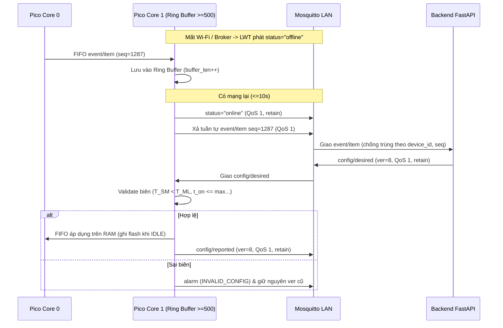

# SPEC-MQTT — Giao tiếp Core 1, đồng bộ MQTT & bộ đệm mất mạng

| Thuộc tính | Giá trị |
| --- | --- |
| Trạng thái | Draft |
| Giai đoạn | 1 |
| Phụ thuộc | [`SPEC-ARCH`](00-architecture.md), [`SPEC-SORT`](01-firmware-sorting-control.md) |
| Quyết định liên quan | [`D-11`](../decisions.md), [`phan-tich-thiet-ke-he-thong.md §7.1, §7.2, §10.4, §10.5`](../phan-tich-thiet-ke-he-thong.md) |
| Thiết kế | [`phan-tich-thiet-ke-he-thong.md §6.1, §7`](../phan-tich-thiet-ke-he-thong.md) |

## Bản đọc ngắn để duyệt hành vi

- **Sau thay đổi, ai làm được gì:** Core 1 của Pico 2 W kết nối Wi-Fi và broker Mosquitto LAN (user/pass + ACL), phát trạng thái `online/offline` (LWT), gửi `telemetry` mỗi 1 s, đẩy sự kiện từng sản phẩm (`event/item`) với `seq` chống trùng, đệm $\ge 500$ sự kiện khi rớt mạng để gửi bù, và nhận `config/desired` + `cmd` có xác thực 2 lớp.
- **Ví dụ để tự kiểm:** Rút nguồn router Wi-Fi trong 60 s khi băng đang phân loại 20 sản phẩm, sau đó cắm lại → Pico tự kết nối lại $\le 10\text{ s}$, xả đủ 20 `event/item` theo đúng `seq` từ ring buffer mà không mất hay trùng bản ghi nào (`MQTT-AC04`).
- **Chưa làm trong lần đầu:** TLS/MQTTS lên cloud broker (chỉ dùng khi triển khai ra ngoài LAN theo `NFR-11`); bridge Mosquitto lên cloud.
- **Điều chưa biết & hệ quả:** Hợp nhất hợp đồng MQTT hiện tại trong `dashboard/protocol.py` (`pegatron/v1/{device_id}/`) sang chuẩn mới `vmu/unknow/sorter/{device_id}/` (`§7.1`); chuẩn hóa trường cấu hình chuyển từ `d1_ms`/`d2_ms` (`§7.2`) sang `l_p1_mm`/`l_p2_mm`/`e_det_mm` (`§10.5`).
- **Phần người dùng chốt:** Gốc topic `vmu/unknow/sorter/{device_id}/`, 10 topic chuẩn (`status`, `telemetry`, `event/item`, `alarm`, `config/reported`, `config/desired`, `cmd`, `cmd/ack`, `calib/progress`, `calib/result`), `seq` đơn điệu, đệm $\ge 500$ sự kiện, kiểm tra biên cấu hình trên cả Pico và backend.
- **Giải thích kiến thức & quyết định kỹ thuật:** Xem thẻ **Bộ đệm vòng chống mất/trùng `event/item` & Phân tách `desired` vs `reported`** ở §9.
- **Biên bản phản biện độc lập trước khi trình:** Chưa chạy phản biện chéo — spec đang ở trạng thái `Draft`.
- **Quyền chạy:** `Ready` chưa cấp quyền code; đợt được giao nằm ở [`../progress.md`](../progress.md).

## 1. Mục tiêu

Bảo đảm đồng bộ dữ liệu hai chiều tin cậy giữa Core 1 trên Pico 2 W và Mosquitto broker trong LAN (`FR-12`..`FR-16`, `FR-20`, `FR-21`, `FR-23`, `NFR-06`, `NFR-07`, `NFR-11`) mà không làm ảnh hưởng đến độ trễ vòng điều khiển trên Core 0.

## 2. Phạm vi

**Trong phạm vi:**
- Kết nối Wi-Fi 2.4 GHz, xác thực NTP (fallback `uptime_ms`), kết nối MQTT 3.1.1 có user/pass + LWT + tự phục hồi $\le 10\text{ s}$.
- Toàn bộ hợp đồng 10 topic dưới gốc `vmu/unknow/sorter/{device_id}/` và định dạng JSON payload.
- Bộ đệm vòng (ring buffer) trên RAM tối thiểu 500 bản ghi `event/item` khi ngoại tuyến và xả bù theo thứ tự `seq` khi nối lại.
- Kiểm tra tính hợp lệ của `config/desired` trên firmware trước khi đẩy FIFO sang Core 0; áp dụng RAM tức thì hoặc hoãn lưu flash về `IDLE`; phản hồi `config/reported`.
- Tiếp nhận `cmd` (`start`, `stop`, `reset_counter`, `test_pusher`, `calibrate`), chuyển Core 0 kiểm tra điều kiện và phát `cmd/ack`.

**Ngoài phạm vi:**
- Giao diện web và API REST/WebSocket (thuộc [`SPEC-BACK`](03-backend-api-storage.md) và [`SPEC-DASH`](04-web-dashboard-ui.md)).
- Logic toán học của từng bước hiệu chuẩn C1–C7 (thuộc [`SPEC-CALIB`](05-calibration-and-runtime-health.md)).

## 3. Luồng tương tác, ví dụ đầu vào/đầu ra & kịch bản người dùng

- **US1 (P1)** — Là hệ thống giám sát, khi mạng Wi-Fi bị ngắt giữa chừng, tôi muốn Pico tiếp tục đệm sự kiện vào bộ đệm vòng và gửi bù đủ theo `seq` khi có mạng lại để không mất bất kỳ sản phẩm nào (`FR-15`). AC: `MQTT-AC04`.
- **US2 (P1)** — Là Admin, khi lưu cấu hình mới qua dashboard, tôi muốn Pico tự kiểm tra giới hạn hợp lệ một lần nữa, chỉ lưu flash khi `IDLE` và xác nhận lại bằng `config/reported` để đảm bảo thông số thực chạy khớp với thông số đã gửi (`FR-20`, `FR-21`). AC: `MQTT-AC05`, `MQTT-AC06`.

### Luồng đồng bộ cấu hình & bù dữ liệu mất mạng (Mermaid)



### Danh sách Topic & Payload chuẩn (Concrete Contract Snapshot)

Gốc topic: `vmu/unknow/sorter/{device_id}/` (ví dụ `device_id = line01`).

| Topic (sau gốc) | Hướng | QoS | Retain | Nội dung | Tần suất |
| --- | --- | --- | --- | --- | --- |
| `status` | Pico → Server | 1 | Có | `online` / `offline` (LWT) | Khi đổi |
| `telemetry` | Pico → Server | 0 | Không | Trạng thái, PWM, đếm, sp/phút, RSSI, `buffer_len`, `uptime_ms` + sức khỏe §10.5 | 1 s |
| `event/item` | Pico → Server | 1 | Không | Bản ghi mỗi sản phẩm (`seq`, `ts`/`uptime_ms`, `h1_mm`, `h2_mm`, `cls`, `station`, `result`, `cfg_ver`) | Mỗi sản phẩm |
| `alarm` | Pico → Server | 1 | Không | Mã lỗi, mức độ, mô tả | Khi phát sinh |
| `config/reported` | Pico → Server | 1 | Có | Cấu hình đang chạy + `ver` | Khi đổi |
| `config/desired` | Server → Pico | 1 | Có | Cấu hình mới + `ver` | Khi lưu |
| `cmd` | Server → Pico | 1 | Không | `start`, `stop`, `reset_counter`, `test_pusher`, `calibrate` + `cmd_id` | Theo yêu cầu |
| `cmd/ack` | Pico → Server | 1 | Không | `cmd_id`, `ok`, `reason` | Sau mỗi lệnh |
| `calib/progress` | Pico → Server | 0 | Không | Bước hiệu chuẩn (`C1..C7`), số mẫu, giá trị tạm | Trong `CALIB` |
| `calib/result` | Pico → Server | 1 | Có | Kết quả từng bước, `ok`, thông số, `calib_ver` | Xong mỗi bước |

event/item (Pico -> Server) — minh họa theo D-11 (Trạm 1 đẩy M):

```json
{
  "seq": 1287,
  "ts": "2026-10-09T09:15:02.341Z",
  "uptime_ms": 845120,
  "h1_mm": 68.4,
  "h2_mm": null,
  "cls": "M",
  "station": 1,
  "result": "pushed",
  "cfg_ver": 7
}
```

config/desired & config/reported (hợp nhất §7.2 và §10.5; số minh họa, không phải thông số đã đo):

```json
{
  "ver": 8,
  "t_sm_mm": 55.0,
  "t_ml_mm": 85.0,
  "l_p1_mm": 80.0,
  "l_p2_mm": 80.0,
  "e_det_mm": 15.5,
  "pulse_ms": 80,
  "belt_pwm": 60,
  "n_samples": 5
}
```

cmd (Server -> Pico):

```json
{"cmd_id": "c-0192", "type": "test_pusher", "args": {"station": 2}}
```

cmd/ack (Pico -> Server):

```json
{"cmd_id": "c-0192", "ok": false, "reason": "ESTOP_ACTIVE"}
```

## 4. Yêu cầu

| ID | Mức | Yêu cầu | Nguồn gốc |
| --- | --- | --- | --- |
| `MQTT-R01` | MUST | Core 1 MUST kết nối Wi-Fi và broker MQTT 3.1.1 bằng tài khoản/mật khẩu (`NFR-11`), đăng ký Last Will trên `vmu/unknow/sorter/{device_id}/status` (`offline`, QoS 1, retain) trước khi publish `online` (`status`, QoS 1, retain) (`FR-12`, `§7.1`). | Người dùng chốt — [`phan-tich-thiet-ke-he-thong.md §2 FR-12, §7.1`](../phan-tich-thiet-ke-he-thong.md#L239) |
| `MQTT-R02` | MUST | Khi mất kết nối Wi-Fi hoặc broker, Core 1 MUST tự động kết nối lại bằng cơ chế non-blocking và khôi phục phiên MQTT trong $\le 10\text{ s}$ sau khi mạng có lại (`NFR-07`). | Người dùng chốt — [`phan-tich-thiet-ke-he-thong.md §3 NFR-07`](../phan-tich-thiet-ke-he-thong.md#L96) |
| `MQTT-R03` | MUST | Core 1 MUST xuất bản bản tin `telemetry` (QoS 0, không retain) định kỳ `1 s` chứa trạng thái máy, `belt_pwm`, bộ đếm S/M/L, sản phẩm/phút, RSSI, `buffer_len`, `uptime_ms` và các chỉ số sức khỏe hiệu chuẩn (`v_mm_s`, `v_src`, `v_age_s`, `v_model_mm_s`, `vs_v`, `h0_mm`, `sigma_mm`, `pitch_min_mm`, `duty_pct`, `loop_max_us`) (`FR-14`, `§7.1`, `§10.5`). | Người dùng chốt — [`phan-tich-thiet-ke-he-thong.md §2 FR-14, §10.5`](../phan-tich-thiet-ke-he-thong.md#L775-L798) |
| `MQTT-R04` | MUST | Với mỗi sản phẩm xử lý xong trên Core 0, Core 1 MUST gửi một bản tin `event/item` (QoS 1, không retain) mang `seq` tăng đơn điệu theo thiết bị, `ts` (hoặc `null` kèm `uptime_ms`), `h1_mm`, `h2_mm`, `cls`, `station`, `result`, `cfg_ver` (`FR-13`, `§7.1`, `§7.2`). | Người dùng chốt — [`phan-tich-thiet-ke-he-thong.md §2 FR-13, §7.2`](../phan-tich-thiet-ke-he-thong.md#L254-L266) |
| `MQTT-R05` | MUST | Khi mất kết nối MQTT, Core 1 MUST lưu tuần tự `event/item` (và `alarm` phát sinh) vào bộ đệm vòng RAM sức chứa $\ge 500$ bản ghi (`NFR-06`); khi kết nối lại MUST xả bù theo đúng thứ tự `seq` mà không làm rớt sự kiện mới (`FR-15`). Nếu tràn $\ge 500$, ghi đè mục cũ nhất (hoặc ưu tiên giữ `alarm`) và tăng bộ đếm tràn để báo cảnh báo. | Người dùng chốt — [`phan-tich-thiet-ke-he-thong.md §2 FR-15, §3 NFR-06`](../phan-tich-thiet-ke-he-thong.md#L95) · AI đề xuất chính sách xử lý tràn `> 500` ưu tiên cảnh báo. |
| `MQTT-R06` | SHOULD | Core 1 SHOULD đồng bộ thời gian qua NTP khi có kết nối (`FR-16`); khi chưa đồng bộ được NTP, bản tin `event/item` MUST gửi kèm `uptime_ms` và `ts: null` để backend nội suy thời gian thực tế (`§2 FR-16`). | Người dùng chốt — [`phan-tich-thiet-ke-he-thong.md §2 FR-16`](../phan-tich-thiet-ke-he-thong.md#L71) |
| `MQTT-R07` | MUST | Khi nhận `config/desired` (QoS 1, retain), firmware MUST tự kiểm tra lại toàn bộ giới hạn hợp lệ ($0 < T_{SM} < T_{ML}$, $0 < t_{on} \le t_{on,max}$, $0 \le \text{belt\_pwm} \le 100$, $N \in [3, 5]$, $L_{p1}, L_{p2} > 0$). Nếu sai biên, firmware MUST giữ nguyên cấu hình cũ và gửi `alarm` (`INVALID_CONFIG`) (`FR-20`, `TC-06`). | Người dùng chốt — [`phan-tich-thiet-ke-he-thong.md §2 FR-20, §5.4, §8.4 TC-06`](../phan-tich-thiet-ke-he-thong.md#L75) |
| `MQTT-R08` | MUST | Khi `config/desired` hợp lệ, Core 1 MUST chuyển cấu hình qua FIFO để Core 0 áp dụng ngay vào RAM, phát `config/reported` (QoS 1, retain) mang phiên bản mới, và chỉ thực thi ghi vào flash khi trạng thái máy là `IDLE` (`FR-21`, `§6.1`). | Người dùng chốt — [`phan-tich-thiet-ke-he-thong.md §2 FR-21, §6.1`](../phan-tich-thiet-ke-he-thong.md#L76) |
| `MQTT-R09` | MUST | Khi nhận lệnh `calibrate` (`§10.4`), Core 1 MUST gửi tiến độ theo từng mẫu qua `calib/progress` (QoS 0) và kết quả bước qua `calib/result` (QoS 1, retain) kèm `calib_ver` (`FR-10`, `§10.4`). | Người dùng chốt — [`phan-tich-thiet-ke-he-thong.md §10.4`](../phan-tich-thiet-ke-he-thong.md#L703-L739) |
| `MQTT-R10` | MUST | Topic `cmd` MUST không dùng `retain` để lệnh cũ không tự chạy lại sau khi Pico khởi động lại (`§7.1`). Core 1 MUST chống lặp `cmd_id` gần nhất, chuyển sang Core 0 kiểm tra trạng thái thật (`ESTOP` đang nhấn, sai chế độ) rồi phản hồi `cmd/ack` (QoS 1) mang `cmd_id`, `ok` và `reason` (`FR-23`, `§5.4`, `TC-07`). | Người dùng chốt — [`phan-tich-thiet-ke-he-thong.md §7.1, §8.4 TC-07`](../phan-tich-thiet-ke-he-thong.md#L248) |

## 5. Yêu cầu phi chức năng

| Khía cạnh | Điều kiện kiểm được | Nhãn nguồn gốc & cách kiểm |
| --- | --- | --- |
| Hiệu năng | `telemetry` `1 s/lần`; thời gian xử lý gói JSON + publish không được chặn vòng `1 ms` của Core 0 (`NFR-03`). | Người dùng chốt — `ARCH-AC01` + `MQTT-AC01`. |
| Bảo mật | Xác thực MQTT `username`/`password` + file ACL giới hạn thiết bị `line01` chỉ ghi `status`, `telemetry`, `event/item`, `alarm`, `config/reported`, `cmd/ack`, `calib/*` và chỉ đọc `config/desired`, `cmd` (`NFR-11`). | Người dùng chốt — `MQTT-AC07`. |
| Giới hạn / rate limit | Bộ đệm vòng $\ge 500$ bản ghi (`NFR-06`); giới hạn độ dài payload JSON hợp lệ trước khi parse. | Người dùng chốt — `MQTT-AC04`. |
| Khả dụng / khôi phục | Tự nối lại $\le 10\text{ s}$ (`NFR-07`), LWT báo `offline` ngay khi mất keepalive. | Người dùng chốt — `MQTT-AC02`. |
| Quan sát | Trường `buffer_len` và `rssi` gửi trong `telemetry` mỗi `1 s`; tràn bộ đệm phát `alarm`. | Người dùng chốt — `MQTT-AC01`. |
| i18n | `N/A — giao thức máy–máy JSON dùng mã ASCII chuẩn.` | — |
| a11y | `N/A — giao thức truyền thông.` | — |
| Trạng thái UI | `N/A — thuộc SPEC-DASH.` | — |

## 6. Trường hợp biên

- **Broker nhận gói `event/item` QoS 1 bị lặp khi rớt mạng lúc đang chờ PUBACK:** Pico gửi lại gói có cùng `seq`; backend dùng `UNIQUE(device_id, seq)` bỏ qua bản sao (`TC-04`).
- **Gửi thẳng JSON độc hại / âm `T_SM` trực tiếp vào topic `config/desired` qua MQTT (bỏ qua backend):** Firmware tự kiểm tra biên từ chối, giữ `ver` cũ, không đổi `config/reported` (`TC-06`).
- **Pico mất điện giữa lúc đang `RUNNING` với cấu hình chưa lưu flash:** Khi có điện lại, Pico đọc flash cũ rồi ngay khi kết nối MQTT nhận lại bản tin `retain` trên `config/desired` để đồng bộ bản mới nhất (`§7.1`).
- **Khởi động trước khi đồng bộ được NTP:** Gửi `ts: null` kèm `uptime_ms` để server tự gán timestamp chuẩn.

## 7. Điều kiện nghiệm thu & bảng kiểm thử

| Trạng thái | Ý nghĩa |
| --- | --- |
| `[]` | chưa đạt |
| `[x]` | test xanh và có bằng chứng lệnh/kết quả |
| `[~]` | chưa kiểm chứng — ghi lý do, người/cách đóng; chặn `Done` |

### Bảng kiểm thử — duyệt trước khi code (Visible Test Matrix)

| Mã AC | Kịch bản (`Cho / Khi / Thì`) | Đầu vào cụ thể | Kỳ vọng quan sát được | Tầng & độ thật | Lệnh kiểm | Trạng thái |
| --- | --- | --- | --- | --- | --- | --- |
| **MQTT-AC01** | **Cho** Pico 2 W cấu hình đúng tài khoản MQTT, **Khi** kết nối vào Mosquitto LAN, **Thì** nhận `status="online"` (retain), `telemetry` đều đặn 1 s/lần đủ trường theo `MQTT-R03`, và khi ngắt nguồn đột ngột LWT phát `status="offline"`. | Broker Mosquitto + `mosquitto_sub -v -t "vmu/unknow/sorter/line01/#"` | `status` đổi `online` → `offline`; chu kỳ `telemetry` $\approx 1\text{ s}$ | `integration` — **0 Mock** (Mosquitto thật) | `mosquitto_sub -t "vmu/unknow/sorter/line01/#" -v` | `[]` |
| **MQTT-AC02** | **Cho** Pico đang `ONLINE`, **Khi** tắt router Wi-Fi 15 s rồi bật lại (`NFR-07`), **Thì** Pico tự nối lại Wi-Fi + MQTT trong $\le 10\text{ s}$ kể từ khi AP sẵn sàng. | Ngắt/bật lại router AP | Thời gian từ lúc AP lên tới lúc nhận `status="online"` $\le 10\text{ s}$ | `hardware bench` — **0 Mock** | `Bench NFR-07: đo timestamp AP lên vs status=online` | `[]` |
| **MQTT-AC03** | **Cho** module bộ đệm vòng của Core 1 (unit test trên host), **Khi** đẩy liên tiếp 550 sự kiện ở trạng thái offline rồi kích hoạt xả bù, **Thì** tối thiểu 500 sự kiện được bảo toàn theo thứ tự `seq` tăng dần không sai lệch dữ liệu. | 550 struct `ItemEvent` giả lập mất mạng | Kích thước buffer $\ge 500$; thứ tự `seq` khi xả đơn điệu tăng | `unit` — **0 Mock** | `ctest --output-on-failure -R MQTT-AC03` | `[]` |
| **MQTT-AC04** | **Cho** hệ thống chạy đầy đủ với Mosquitto + FastAPI (`TC-04`), **Khi** tắt router `60 s` trong lúc cho 30 sản phẩm đi qua băng rồi bật lại, **Thì** Core 0 phân loại không gián đoạn và server nhận đủ 30 `event/item` đúng `seq`, 0 bản trùng. | 30 sản phẩm thật khi router tắt 60 s | DB bảng `items` có đủ 30 dòng `seq` liên tiếp, 0 thiếu/trùng | `integration` — **0 Mock** | `Bench TC-04 + truy vấn SQLite count/distinct seq` | `[]` |
| **MQTT-AC05** | **Cho** kẻ thử gửi thẳng JSON lỗi (`t_sm_mm = -5` hoặc `t_sm_mm >= t_ml_mm` hoặc `pulse_ms > max`) lên topic `config/desired` (`TC-06`), **Thì** firmware từ chối, giữ nguyên `config/reported` phiên bản cũ và phát `alarm`. | `mosquitto_pub -t .../config/desired -m '{"ver":99,"t_sm_mm":-5,...}'` | `config/reported` vẫn là `ver` cũ; xuất hiện `alarm` | `integration` — **0 Mock** (Mosquitto + Pico thật) | `mosquitto_pub ... && mosquitto_sub -t .../config/reported` | `[]` |
| **MQTT-AC06** | **Cho** thiết bị đang ở trạng thái `ESTOP`, **Khi** gửi lệnh `start` hoặc `test_pusher` qua topic `cmd` (`TC-07`), **Thì** Core 0 không tác động cơ cấu và Core 1 phát `cmd/ack` với `ok: false, reason: "ESTOP_ACTIVE"`. | `{"cmd_id":"c-t7","type":"start","args":{}}` khi đang E-STOP | `cmd/ack` trả `ok=false, reason="ESTOP_ACTIVE"` | `integration` — **0 Mock** | `Bench TC-07: kiểm tra cmd/ack` | `[]` |
| **MQTT-AC07** | **Cho** cấu hình `mosquitto.conf` + file ACL, **Khi** client dùng tài khoản thiết bị `line01` thử `publish` vào topic `cmd` hoặc `config/desired`, **Thì** broker từ chối quyền ghi (`NFR-11`). | `mosquitto_pub -u line01 ... -t .../cmd` | Broker từ chối publish (không đến được subscriber) | `integration` — **0 Mock** | `Kiểm tra ACL Mosquitto` | `[]` |

## 8. Kiểm tra end-to-end

Chạy `ctest` kiểm tra parser JSON + ring buffer + validator cấu hình (`MQTT-AC03`), sau đó chạy tích hợp với Mosquitto thật qua `TC-04`, `TC-06`, `TC-07`.

## 9. Ghi chú thiết kế

- Sử dụng `StaticJsonDocument` / buffer kích thước cố định (không cấp phát động `malloc` liên tục) trên Core 1 để tránh phân mảnh heap khi chạy dài ngày.
- Trong giai đoạn chuyển tiếp từ §7.2 sang §10.5: payload `config/desired` chuẩn hóa dùng `l_p1_mm`, `l_p2_mm`, `e_det_mm`; có thể chấp nhận trường dự phòng `d1_ms`/`d2_ms` khi chưa chạy C3 (`§8.2`).

### Giải thích kiến thức & quyết định kỹ thuật (Thẻ giải thích kỹ thuật)

**Khái niệm / Quyết định 1:** Bộ đệm vòng + `seq` chống trùng & Tách cặp topic `desired` / `reported` · Nhãn: `Người dùng chốt`
- **Bản chất là gì (nói dễ hiểu + ví dụ thực tế của dự án):** Thay vì mất mạng là bỏ rơi dữ liệu, Core 1 giữ một hàng đợi vòng tròn `>= 500` ô nhớ; mỗi sản phẩm đi qua được dán nhãn số thứ tự tăng dần (`seq = 1287, 1288...`). Khi Wi-Fi có lại, Pico xả từng gói với QoS 1; dù gói có lỡ gửi 2 lần vì chập chờn, server chỉ nhận 1 lần dựa vào cặp `(device_id, seq)`. Tương tự, cấu hình không dùng chung 1 topic mà tách `config/desired` (cái người dùng muốn) và `config/reported` (cái Pico thực sự đang chạy) để tránh tình trạng web báo "Đã lưu" trong khi Pico chưa áp dụng hoặc vừa từ chối.
- **Tại sao bắt buộc cần ở đây (nếu không có thì lỗi gì xảy ra?):** Nếu không có `seq` + `UNIQUE(device_id, seq)`, khi mạng chập chờn lúc gửi QoS 1, một sản phẩm sẽ bị đếm thành 2 lần trên báo cáo sản lượng. Nếu không tách `desired`/`reported`, người vận hành không thể biết băng đang chạy ngưỡng cũ hay mới khi Pico ngoại tuyến hoặc đang chạy dở.
- **Chạy thế nào trong dự án này (Đầu vào → Xử lý → Đầu ra):** Dashboard lưu `ver = 8` lên `config/desired` (retain) → Pico nhận, kiểm tra hợp lệ, nạp RAM → Pico phát `config/reported` `ver = 8` → Backend đánh dấu `applied_ts` và dashboard tắt cảnh báo lệch phiên bản.
- **Tự kiểm trong ≤ 5 phút:** Thực hiện `MQTT-AC04` (tắt router 60 s trong lúc chạy 30 sản phẩm): sau khi bật lại, đếm bản ghi trong bảng `items` phải bằng đúng 30, không nhảy số hay đúp dòng.
- **Nguồn đối chiếu & Giới hạn không tự kiểm được:** [`phan-tich-thiet-ke-he-thong.md §7.1, §7.2`](../phan-tich-thiet-ke-he-thong.md#L233-L303). Số lượng sự kiện lưu được khi mất mạng tối đa bằng kích thước ring buffer RAM (mặc định $\ge 500$); nếu mất mạng quá thời gian đó sẽ tràn buffer.

## 10. Hướng dẫn vận hành

Cấu hình tài khoản Mosquitto riêng cho từng `device_id` và `backend` trước khi chạy.

## 11. Làm rõ

*(Chưa có phiên làm rõ bổ sung.)*

## 12. Câu hỏi mở

| Điều chưa biết / đề xuất | Nguồn đã kiểm | Ảnh hưởng / AC bị chặn | Cách xác minh & người phụ trách |
| --- | --- | --- | --- |
| **Q-MQTT-01 (Chuyển đổi hợp đồng MQTT từ code hiện có):** Hiện trạng `dashboard/protocol.py:20-155` đang dùng gốc `pegatron/v1/{device_id}/` (`availability`, `telemetry`, `events`, `command`, `ack`, `wifi/*`), khác với 10 topic `vmu/unknow/sorter/{device_id}/` của `.docx §7.1, §10.4`. | [`dashboard/protocol.py:20-155`](../../dashboard/protocol.py#L20-L155), [`§7.1`](../phan-tich-thiet-ke-he-thong.md#L233-L248) | Chặn chuyển đổi đồng bộ giữa Pico và FastAPI (`MQTT-AC01..06`) | Người dùng chốt nâng cấp thẳng lên `vmu/unknow/sorter/{device_id}/` (có giữ `wifi/*` bổ sung hay không?) |
| **Q-MQTT-02 (Trường `config/desired` giữa §7.2 và §10.5):** §7.2 dùng `d1_ms`/`d2_ms`, còn §10.5 yêu cầu thay bằng `l_p1_mm`, `l_p2_mm`, `e_det_mm`. | [`§7.2`](../phan-tich-thiet-ke-he-thong.md#L270-L280), [`§10.5`](../phan-tich-thiet-ke-he-thong.md#L771) | Schema JSON validator trên cả Pico và FastAPI | Đề xuất hỗ trợ cả `l_p1_mm/l_p2_mm/e_det_mm` (chuẩn) và tùy chọn `d1_ms/d2_ms` (khi chưa C3) — chờ xác nhận |
