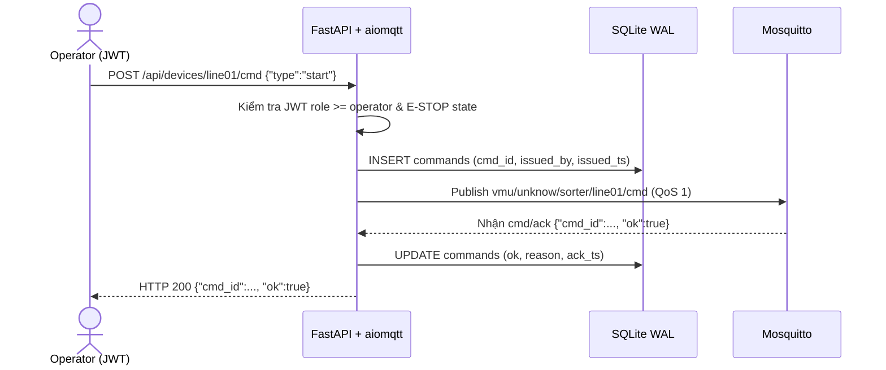

# SPEC-BACK — Backend FastAPI, lưu trữ dữ liệu & phân quyền API

| Thuộc tính | Giá trị |
| --- | --- |
| Trạng thái | Draft |
| Giai đoạn | 1 |
| Phụ thuộc | [`SPEC-MQTT`](02-mqtt-edge-sync.md) |
| Quyết định liên quan | [`phan-tich-thiet-ke-he-thong.md §6.3, §7.3, §7.4, §10.4`](../phan-tich-thiet-ke-he-thong.md) |
| Thiết kế | [`phan-tich-thiet-ke-he-thong.md §7.3, §7.4`](../phan-tich-thiet-ke-he-thong.md) |

## Bản đọc ngắn để duyệt hành vi

- **Sau thay đổi, ai làm được gì:** Backend Python FastAPI kết nối Mosquitto qua `aiomqtt`, lưu toàn bộ dữ liệu đa thiết bị vào 9 bảng SQLite (WAL) / PostgreSQL, cung cấp xác thực JWT + phân quyền 3 vai trò (`viewer`, `operator`, `admin`), API REST, xuất CSV, báo cáo phiên chạy và WebSocket `/ws/live`.
- **Ví dụ để tự kiểm:** Gửi `POST /api/devices/line01/cmd` bằng token `viewer` → HTTP `403` bị từ chối và ghi log; gửi bằng token `operator` khi E-STOP không nhấn → phát `cmd` MQTT và trả về kết quả `cmd/ack` trong `BACK-AC05`.
- **Chưa làm trong lần đầu:** Chuyển đổi thực tế sang PostgreSQL/TimescaleDB ở giai đoạn mở rộng (nhưng giữ schema tương thích ngay từ GĐ1 theo `§1.4`).
- **Điều chưa biết & hệ quả:** Hợp nhất `dashboard/app.py` + `dashboard/storage.py` (4 bảng hiện có, chưa JWT/RBAC) lên lược đồ 9 bảng và JWT/RBAC của `.docx`; ngưỡng giới hạn cứng của từng tham số cấu hình (`T_SM`, `T_ML`, `pulse_ms`, `belt_pwm`) cần chốt chung với firmware.
- **Phần người dùng chốt:** FastAPI + `aiomqtt` + SQLAlchemy + JWT + SQLite WAL, 9 bảng dữ liệu (`devices`, `runs`, `items`, `telemetry`, `alarms`, `configs`, `commands`, `users`, `calibrations`), RBAC 3 vai trò, chống trùng `(device_id, seq)`, giữ sự kiện $\ge 30$ ngày và gộp telemetry theo phút sau 7 ngày.
- **Giải thích kiến thức & quyết định kỹ thuật:** Xem thẻ **Chống trùng `UNIQUE(device_id, seq)` + SQLite WAL & Lưu phiên bản `configs`/`calibrations`** ở §9.
- **Biên bản phản biện độc lập trước khi trình:** Chưa chạy phản biện chéo — spec đang ở trạng thái `Draft`.
- **Quyền chạy:** `Ready` chưa cấp quyền code; đợt được giao nằm ở [`../progress.md`](../progress.md).

## 1. Mục tiêu

Xây dựng tầng xử lý trung tâm và lưu trữ bền vững cho toàn bộ dữ liệu sản xuất, cấu hình, lệnh điều khiển và hiệu chuẩn (`FR-15`, `FR-16`, `FR-18`..`FR-26`, `NFR-05`, `NFR-11`, `NFR-12`, `NFR-15`, `NFR-17`).

## 2. Phạm vi

**Trong phạm vi:**
- Dịch vụ MQTT ingest (`aiomqtt`) ghi nhận `status`, `telemetry`, `event/item`, `alarm`, `config/reported`, `cmd/ack`, `calib/progress`, `calib/result` vào DB và đẩy WebSocket `/ws/live`.
- Lược đồ 9 bảng SQLAlchemy tương thích cả SQLite (WAL) và PostgreSQL.
- Xác thực JWT (`POST /api/auth/login`) + phân quyền `viewer`, `operator`, `admin` + quản lý tài khoản (`UC-09`).
- Toàn bộ REST API (`§7.4`) kèm preset/lịch sử cấu hình (`FR-22`), khôi phục baseline hiệu chuẩn (`§10.4`), xuất CSV (`FR-24`) và báo cáo phiên chạy (`FR-25`).
- Tác vụ nền dọn/gộp dữ liệu theo chính sách lưu trữ `NFR-17`.

**Ngoài phạm vi:**
- Giao diện người dùng SPA (thuộc [`SPEC-DASH`](04-web-dashboard-ui.md)).
- Logic tính toán trong firmware Pico (thuộc [`SPEC-SORT`](01-firmware-sorting-control.md), [`SPEC-CALIB`](05-calibration-and-runtime-health.md)).

## 3. Luồng tương tác, ví dụ đầu vào/đầu ra & kịch bản người dùng

- **US1 (P1)** — Là Admin (`UC-06`, `UC-09`), tôi muốn đăng nhập JWT, tạo tài khoản theo vai trò và cập nhật cấu hình với kiểm tra giới hạn hợp lệ trước khi gửi xuống Pico. AC: `BACK-AC03`, `BACK-AC04`.
- **US2 (P1)** — Là Operator (`UC-03`, `UC-05`), tôi muốn gửi lệnh điều khiển qua API và xác nhận cảnh báo có lưu vết kiểm toán ai làm, lúc nào. AC: `BACK-AC05`, `BACK-AC06`.
- **US3 (P1)** — Là Viewer (`UC-08`), tôi muốn truy vấn lịch sử sản phẩm, xuất CSV và xem báo cáo phiên chạy mà không thể gửi lệnh hay đổi cấu hình. AC: `BACK-AC03`, `BACK-AC07`.

### Luồng xử lý lệnh REST → MQTT → `cmd/ack` (Mermaid)



### Ví dụ Schema & API (Concrete I/O Snapshot)

```text
+-------------------------------------------------------------------+
| [PUT /api/devices/line01/config — Admin JWT]                      |
| Input : {"t_sm_mm": 55.0, "t_ml_mm": 85.0, "l_p1_mm": 80.0,       |
|          "l_p2_mm": 80.0, "e_det_mm": 15.5, "pulse_ms": 80,       |
|          "belt_pwm": 60, "n_samples": 5}                          |
| Validate fail (t_sm_mm=-5): HTTP 422 {"detail": "..."} (không gửi)|
| Validate ok: tăng ver=8 -> INSERT configs -> publish config/desired|
| Output: HTTP 200 {"ver": 8, "applied_ts": null, ...}              |
+-------------------------------------------------------------------+
```

## 4. Yêu cầu

| ID | Mức | Yêu cầu | Nguồn gốc |
| --- | --- | --- | --- |
| `BACK-R01` | MUST | Backend MUST kết nối Mosquitto (`aiomqtt`) theo tài khoản riêng, dùng SQLite ở chế độ `WAL` (tương thích PostgreSQL qua SQLAlchemy) và phục vụ static files của SPA cùng API trên một origin (`§1.4`, `§6.3`, `NFR-12`). | Người dùng chốt — [`phan-tich-thiet-ke-he-thong.md §1.4, §6.3`](../phan-tich-thiet-ke-he-thong.md#L219-L222) |
| `BACK-R02` | MUST | CSDL MUST gồm 9 bảng chuẩn: `devices`, `runs`, `items` (khóa duy nhất `UNIQUE(device_id, seq)`), `telemetry`, `alarms`, `configs` (cột `applied_ts` cập nhật khi nhận `config/reported` trùng `ver`), `commands` (nhật ký kiểm toán), `users`, và `calibrations` (`§7.3`, `§10.4`, `NFR-15`). | Người dùng chốt — [`phan-tich-thiet-ke-he-thong.md §7.3, §10.4`](../phan-tich-thiet-ke-he-thong.md#L305-L317) |
| `BACK-R03` | SHOULD | Khi nhận `event/item` có `ts == null` (Pico chưa đồng bộ NTP), backend MUST tự gán timestamp theo đồng hồ server (hoặc nội suy từ `uptime_ms`) trước khi ghi vào bảng `items` (`FR-16`). | Người dùng chốt — [`phan-tich-thiet-ke-he-thong.md §2 FR-16`](../phan-tich-thiet-ke-he-thong.md#L71) |
| `BACK-R04` | MUST | Backend MUST cung cấp `POST /api/auth/login` trả JWT với mật khẩu băm an toàn (Argon2/bcrypt), thực thi RBAC 3 vai trò: `viewer` (đọc & export CSV), `operator` (`viewer` + gửi `cmd` + ack `alarm`), `admin` (`operator` + cấu hình + hiệu chuẩn + quản lý `users` cho `UC-09`) (`FR-26`, `NFR-11`, `TC-07`). | Người dùng chốt — [`phan-tich-thiet-ke-he-thong.md §2 FR-26, §5.1 UC-09, §7.4`](../phan-tich-thiet-ke-he-thong.md#L81) |
| `BACK-R05` | MUST | Backend MUST cung cấp các endpoint đọc dữ liệu cho `viewer` trở lên: `GET /api/devices`, `GET /api/devices/{id}/state`, `GET /api/items?from=&to=&cls=` (hỗ trợ lọc theo `run_id`), `GET /api/items/export.csv` (`FR-18`, `FR-24`, `§7.4`). | Người dùng chốt — [`phan-tich-thiet-ke-he-thong.md §7.4`](../phan-tich-thiet-ke-he-thong.md#L318-L330) |
| `BACK-R06` | MUST | `GET /api/devices/{id}/config` (`Viewer`) và `PUT /api/devices/{id}/config` (`Admin`) MUST kiểm tra chặt chẽ giới hạn hợp lệ của mọi tham số ($0 < T_{SM} < T_{ML}$, $0 < t_{on} \le t_{on,max}$, $0 \le \text{belt\_pwm} \le 100$, $N \in [3, 5]$, hình học $> 0$) — từ chối HTTP `422` nếu vi phạm mà không publish MQTT (`TC-06`); khi hợp lệ MUST tăng `ver`, lưu `configs` và publish `config/desired` (QoS 1, retain) (`FR-20`, `FR-21`). Đồng thời hỗ trợ lưu preset & khôi phục phiên bản cấu hình bất kỳ (`FR-22`, `SHOULD`). | Người dùng chốt — [`phan-tich-thiet-ke-he-thong.md §2 FR-20..22, §7.4, §8.4 TC-06`](../phan-tich-thiet-ke-he-thong.md#L75-L77) |
| `BACK-R07` | MUST | `POST /api/devices/{id}/cmd` (`Operator`) MUST ghi nhận bản ghi kiểm toán vào `commands` (`issued_by`, `issued_ts`), từ chối ngay nếu thiết bị đang ở `ESTOP` (`FR-23`, `TC-07`), ngược lại publish MQTT `cmd` (QoS 1, không retain), chờ `cmd/ack` trong timeout quy định rồi cập nhật `ok`, `reason`, `ack_ts` và trả kết quả về client (`§7.4`). | Người dùng chốt — [`phan-tich-thiet-ke-he-thong.md §2 FR-23, §7.4`](../phan-tich-thiet-ke-he-thong.md#L327) |
| `BACK-R08` | MUST | `GET /api/alarms` (`Viewer`) và `POST /api/alarms/{id}/ack` (`Operator`) MUST trả danh sách cảnh báo và lưu `ack_by`, `ack_ts` từ JWT hiện hành (`FR-19`, `§7.4`). | Người dùng chốt — [`phan-tich-thiet-ke-he-thong.md §2 FR-19, §7.4`](../phan-tich-thiet-ke-he-thong.md#L74) |
| `BACK-R09` | SHOULD | Backend SHOULD quản lý vòng đời phiên chạy trong bảng `runs` (tạo/đóng theo `START`/`STOP` với `total_s`, `total_m`, `total_l`, `faults`) và tự động sinh báo cáo phiên tại `GET /api/runs/{id}/report` khi kết thúc phiên (`FR-25`, `§7.3`, `§7.4`). | Người dùng chốt — [`phan-tich-thiet-ke-he-thong.md §2 FR-25, §7.3, §7.4`](../phan-tich-thiet-ke-he-thong.md#L80) |
| `BACK-R10` | MUST | WebSocket `WS /ws/live` (`Viewer` trở lên) MUST đẩy các bản tin `telemetry`, `event/item`, `alarm`, `status`, `config/reported`, `calib/*` tới dashboard với độ trễ đầu–cuối trong LAN $\le 1\text{ s}$ (`NFR-05`) và chịu tải tối thiểu 5 thiết bị $\times$ 2 sản phẩm/s (`TC-09`). | Người dùng chốt — [`phan-tich-thiet-ke-he-thong.md §3 NFR-05, §7.4, §8.4 TC-09`](../phan-tich-thiet-ke-he-thong.md#L94) |
| `BACK-R11` | MUST | Hệ thống lưu trữ MUST giữ nguyên sự kiện (`items`, `alarms`, `commands`) tối thiểu `30 ngày` và gộp dữ liệu `telemetry` chi tiết theo từng phút sau `7 ngày` (`NFR-17`, `§7.3`). | Người dùng chốt — [`phan-tich-thiet-ke-he-thong.md §3 NFR-17, §7.3`](../phan-tich-thiet-ke-he-thong.md#L106) |
| `BACK-R12` | MUST | Backend MUST lưu kết quả từng bước hiệu chuẩn `calib/result` vào bảng `calibrations` và cung cấp API cho `Admin` kích hoạt lệnh `calibrate` theo bước (`C1..C7`) cũng như "Khôi phục baseline" (gửi lại toàn bộ tham số của phiên bản đã nghiệm thu `C7`) (`§10.4`). | Người dùng chốt — [`phan-tich-thiet-ke-he-thong.md §10.4`](../phan-tich-thiet-ke-he-thong.md#L741) |

## 5. Yêu cầu phi chức năng

| Khía cạnh | Điều kiện kiểm được | Nhãn nguồn gốc & cách kiểm |
| --- | --- | --- |
| Hiệu năng | Độ trễ LAN $\le 1\text{ s}$ (`NFR-05`); tải 5 thiết bị $\times$ 2 sp/s ($\approx 10\text{ items/s}$ + `5 telemetry/s`) không rớt gói (`TC-09`). | Người dùng chốt — `BACK-AC08`. |
| Bảo mật | JWT có chữ ký bí mật từ biến môi trường; mật khẩu hash Argon2/bcrypt; không log mật khẩu/token; kiểm tra RBAC ở mọi endpoint; parameterized SQL (`NFR-11`). | Người dùng chốt — `BACK-AC03`, `BACK-AC04`. |
| Giới hạn / rate limit | Payload MQTT strict validation; không nhận WebSocket chưa xác thực. | AI đề xuất kiểm tra JWT khi handshake `WS /ws/live`. |
| Khả dụng / khôi phục | SQLite WAL + Docker `restart: unless-stopped`; khởi động lại không mất lịch sử đã commit (`NFR-12`). | Người dùng chốt — `ARCH-AC06`. |
| Quan sát | Mọi lệnh vào bảng `commands`, mọi cảnh báo vào `alarms`, lỗi ingest MQTT ghi structured log. | Người dùng chốt — `BACK-AC05`, `BACK-AC06`. |
| i18n | Timestamp chuẩn ISO-8601 UTC; thông điệp lỗi có mã chuẩn để UI hiển thị tiếng Việt. | AI đề xuất — giữ tách biệt mã lỗi API và bản dịch UI. |
| a11y | `N/A — tầng API/CSDL.` | — |
| Trạng thái UI | `N/A — thuộc SPEC-DASH.` | — |

## 6. Trường hợp biên

- **Nhận lại bản tin `event/item` đã có `(device_id, seq)` trong DB:** `INSERT ... ON CONFLICT DO NOTHING` — trả ACK không báo lỗi, không tăng lại bộ đếm `runs` (`TC-04`).
- **`cmd/ack` không về trong thời gian chờ (Pico mất mạng giữa lúc gửi lệnh):** HTTP `POST /cmd` trả trạng thái timeout rõ ràng (ví dụ HTTP `504` hoặc `ok: false, reason: "ACK_TIMEOUT"`) và giữ nguyên bản ghi `commands` để audit.
- **CSV export khoảng thời gian lớn:** Stream từng chunk theo cursor để không tràn RAM server.
- **Tạo người dùng / xóa admin cuối cùng:** Cấm hạ quyền hoặc xóa tài khoản `admin` duy nhất còn lại.

## 7. Điều kiện nghiệm thu & bảng kiểm thử

| Trạng thái | Ý nghĩa |
| --- | --- |
| `[]` | chưa đạt |
| `[x]` | test xanh và có bằng chứng lệnh/kết quả |
| `[~]` | chưa kiểm chứng — ghi lý do, người/cách đóng; chặn `Done` |

### Bảng kiểm thử — duyệt trước khi code (Visible Test Matrix)

| Mã AC | Kịch bản (`Cho / Khi / Thì`) | Đầu vào cụ thể | Kỳ vọng quan sát được | Tầng & độ thật | Lệnh kiểm | Trạng thái |
| --- | --- | --- | --- | --- | --- | --- |
| **BACK-AC01** | **Cho** DB SQLite WAL khởi tạo sạch với 9 bảng, **Khi** ingest hai lần cùng bản tin `event/item` (`device_id="line01", seq=1287`), một bản có `ts: null`, **Thì** DB chỉ có 1 dòng và `ts` được gán tự động khác rỗng (`FR-15`, `FR-16`). | Hai bản tin JSON giống hệt `seq=1287` | `SELECT COUNT(*) FROM items WHERE seq=1287` = 1; `ts IS NOT NULL` | `integration` — **0 Mock** DB (SQLite thật) | `pytest tests/test_ingest.py -k BACK-AC01` | `[]` |
| **BACK-AC02** | **Cho** người dùng đăng nhập qua `POST /api/auth/login`, **Khi** truy cập với mật khẩu đúng và mật khẩu sai, **Thì** mật khẩu đúng trả JWT chứa `role`, mật khẩu sai trả `401` và DB lưu hash không lưu plaintext (`FR-26`). | `{"username":"op1","password":"..."}` | Đúng → `200` + JWT; sai → `401`; DB `password_hash` không bằng plaintext | `integration` — **0 Mock** | `pytest tests/test_auth.py -k BACK-AC02` | `[]` |
| **BACK-AC03** | **Cho** 3 token `viewer`, `operator`, `admin` (`TC-07`), **Khi** `viewer` gọi `POST /cmd` hoặc `PUT /config`, và `operator` gọi `PUT /config`, **Thì** đều bị từ chối `403 Forbidden` và không phát MQTT. | Request kèm JWT không đủ quyền | HTTP `403`, 0 bản tin tới broker | `integration` — **0 Mock** API/Auth | `pytest tests/test_rbac.py -k BACK-AC03` | `[]` |
| **BACK-AC04** | **Cho** `admin` gọi `PUT /api/devices/line01/config` (`TC-06`), **Khi** gửi `t_sm_mm = -1`, `t_sm_mm >= t_ml_mm`, hoặc `pulse_ms` vượt giới hạn, **Thì** trả HTTP `422` và không publish `config/desired`; khi gửi hợp lệ, lưu `configs` và `applied_ts` cập nhật lúc nhận `config/reported`. | Payload sai biên vs payload đúng biên | Sai → `422`; đúng → `200` + MQTT `config/desired` + DB `applied_ts` cập nhật | `integration` — **0 Mock** DB, broker in-process/Mosquitto | `pytest tests/test_config.py -k BACK-AC04` | `[]` |
| **BACK-AC05** | **Cho** `operator` gọi `POST /api/devices/line01/cmd` (`FR-23`, `TC-07`), **Khi** thiết bị đang `ESTOP` hoặc bình thường, **Thì** lúc `ESTOP` bị từ chối có ghi bảng `commands`; lúc bình thường chờ `cmd/ack`, cập nhật `commands.ok`/`ack_ts` và trả `200`. | `{"type":"start","args":{}}` | Đang `ESTOP` → từ chối + log `commands`; bình thường → ghi đủ `ok`, `ack_ts` | `integration` — **0 Mock** DB | `pytest tests/test_commands.py -k BACK-AC05` | `[]` |
| **BACK-AC06** | **Cho** bảng `alarms` có cảnh báo chưa xác nhận và một phiên chạy hoàn tất `START→STOP`, **Khi** `operator` gọi `POST /api/alarms/{id}/ack` và `viewer` gọi `GET /api/runs/{id}/report`, **Thì** alarm ghi `ack_by`/`ack_ts` và báo cáo phiên trả tổng S/M/L, tỉ lệ %, số lỗi, thông lượng TB (`FR-19`, `FR-25`). | `alarm_id=1`, `run_id=1` | DB `alarms` có `ack_by`, `ack_ts`; báo cáo JSON khớp số liệu `items` | `integration` — **0 Mock** | `pytest tests/test_alarms_runs.py -k BACK-AC06` | `[]` |
| **BACK-AC07** | **Cho** dữ liệu đa thiết bị `line01`, `line02` trong DB, **Khi** lọc `GET /api/items?cls=S` và tải `GET /api/items/export.csv` (`FR-18`, `FR-24`, `NFR-15`), **Thì** trả đúng tập lọc và CSV chuẩn UTF-8. | Query `from`, `to`, `cls=S` | CSV có header + đúng số dòng `cls=S` | `integration` — **0 Mock** | `pytest tests/test_items_export.py -k BACK-AC07` | `[]` |
| **BACK-AC08** | **Cho** tải giả lập **5 thiết bị $\times$ 2 sản phẩm/s** trong `60 s` (`TC-09`, `600` items + `300` telemetry), **Khi** chạy qua Mosquitto → FastAPI → SQLite WAL → `WS /ws/live`, **Thì** 100% `600` items vào DB không mất/trùng và độ trễ đến client WebSocket $\le 1\text{ s}$ (`NFR-05`). | Script tải MQTT 5 device_id song song | `items` count = 600; P95 latency $\le 1000\text{ ms}$ | `load / integration` — **0 Mock** (Mosquitto + FastAPI thật) | `pytest tests/test_load_tc09.py -k BACK-AC08` | `[]` |
| **BACK-AC09** | **Cho** bảng `telemetry` có dữ liệu 10 ngày và `items` có dữ liệu 40 ngày, **Khi** chạy tác vụ dọn/gộp định kỳ (`NFR-17`), **Thì** các bản ghi `telemetry` cũ hơn 7 ngày được gộp thành trung bình/phút và bản ghi `items` trong vòng 30 ngày vẫn nguyên vẹn. | Dataset DB mô phỏng mốc thời gian 40 ngày | Dòng `telemetry > 7d` gộp 1 phút; `items <= 30d` giữ đủ 100% | `unit/integration` — **0 Mock** DB | `pytest tests/test_retention.py -k BACK-AC09` | `[]` |

## 8. Kiểm tra end-to-end

Chạy `pytest -v` toàn bộ suite backend + bài tải `TC-09` với Mosquitto container đang chạy trong Docker Compose.

## 9. Ghi chú thiết kế

- Sử dụng SQLAlchemy async hoặc SQLite WAL với `busy_timeout = 5000 ms` để tránh lỗi `database is locked` khi vừa ghi `event/item` liên tục vừa xuất CSV.
- Không truyền lỗi stack trace nội bộ ra HTTP response; map thành HTTP `4xx/5xx` chuẩn kèm mã lỗi.

### Giải thích kiến thức & quyết định kỹ thuật (Thẻ giải thích kỹ thuật)

**Khái niệm / Quyết định 1:** Chống trùng `UNIQUE(device_id, seq)` + SQLite WAL & Lịch sử `configs`/`calibrations` · Nhãn: `Người dùng chốt`
- **Bản chất là gì (nói dễ hiểu + ví dụ thực tế của dự án):** Trong bảng `items`, mỗi sản phẩm từ băng tải `line01` có một số thứ tự `seq` duy nhất. Khi SQLite đặt khóa `UNIQUE(device_id, seq)` và bật chế độ `WAL` (Write-Ahead Logging), hai luồng đọc/ghi có thể chạy song song: WebSocket và xuất CSV đọc lịch sử mượt mà trong khi luồng MQTT vẫn ghi `event/item` mới, và mọi gói gửi bù bị lặp tự động bị bỏ qua an toàn.
- **Tại sao bắt buộc cần ở đây (nếu không có thì lỗi gì xảy ra?):** Nếu không có `WAL`, khi người xem bấm xuất CSV hay báo cáo phiên trong lúc băng đang chạy, SQLite có thể bị khóa làm nghẽn tiến trình nhận tin MQTT; nếu không có `UNIQUE(device_id, seq)`, mỗi lần mạng rớt gửi bù QoS 1 sẽ làm sai lệch hoàn toàn báo cáo sản lượng.
- **Chạy thế nào trong dự án này (Đầu vào → Xử lý → Đầu ra):** `aiomqtt` nhận `event/item` → Validate JSON → `INSERT OR IGNORE` vào `items` (với `device_id, seq`) → Nếu là bản ghi mới, cập nhật bộ đếm phiên `runs` và đẩy qua `WS /ws/live`.
- **Tự kiểm trong ≤ 5 phút:** Chạy `BACK-AC01` và `BACK-AC08` bằng `pytest`: bơm trùng bản ghi `seq=1287` và chạy 600 bản ghi từ 5 thiết bị đồng thời, kiểm tra bảng `items` không có bản ghi trùng và không phát sinh lỗi khóa DB.
- **Nguồn đối chiếu & Giới hạn không tự kiểm được:** [`phan-tich-thiet-ke-he-thong.md §6.3, §7.2, §7.3`](../phan-tich-thiet-ke-he-thong.md#L303-L317). Khi mở rộng nhiều server ghi đồng thời từ xa cần chuyển sang PostgreSQL/TimescaleDB.

## 10. Hướng dẫn vận hành

Khởi tạo tài khoản `admin` mặc định qua biến môi trường hoặc CLI seed khi dựng container lần đầu; xoay JWT secret trước khi đem đi thi.

## 11. Làm rõ

*(Chưa có phiên làm rõ bổ sung.)*

## 12. Câu hỏi mở

| Điều chưa biết / đề xuất | Nguồn đã kiểm | Ảnh hưởng / AC bị chặn | Cách xác minh & người phụ trách |
| --- | --- | --- | --- |
| **Q-BACK-01 (Nâng cấp từ backend hiện có `dashboard/`):** `dashboard/app.py` và `dashboard/storage.py:12-35` hiện dùng 4 bảng (`samples`, `events`, `commands`, `runs`), chưa có JWT/RBAC, chưa có `configs`/`calibrations`, đang dùng `pegatron/v1/`. | [`dashboard/storage.py:12-35`](../../dashboard/storage.py#L12-L35), [`§7.3`](../phan-tich-thiet-ke-he-thong.md#L305-L317) | Xác định giữ/di trú DB cũ hay tạo mới hoàn toàn schema 9 bảng | Người dùng chốt nâng cấp in-place hay tạo module mới thay thế `dashboard/` |
| **Q-BACK-02 (Khoảng giới hạn cứng của `FR-20`):** Giá trị `min`/`max` cụ thể cho `t_sm_mm`, `t_ml_mm`, `pulse_ms` (`t_on,max`), `n_samples`, `l_p1_mm`, `l_p2_mm`. | [`§2 FR-20`](../phan-tich-thiet-ke-he-thong.md#L75), [`§8.7`](../phan-tich-thiet-ke-he-thong.md) | Cần đồng nhất 100% giới hạn giữa Pydantic backend và C++ firmware (`BACK-AC04`, `MQTT-AC05`) | Chốt cùng `Q-SORT-02`, `Q-SORT-03` |
