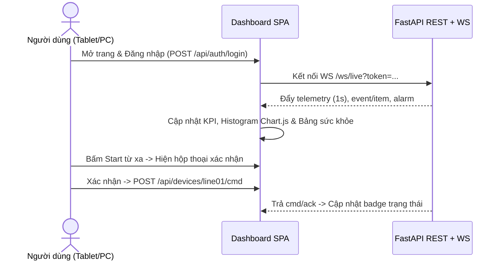

# SPEC-DASH — Giao diện Web Dashboard giám sát, cấu hình & điều khiển

| Thuộc tính | Giá trị |
| --- | --- |
| Trạng thái | Draft |
| Giai đoạn | 1 |
| Phụ thuộc | [`SPEC-BACK`](03-backend-api-storage.md) |
| Quyết định liên quan | [`phan-tich-thiet-ke-he-thong.md §1.4, §2, §5.1, §8.3, §10.4, §10.5`](../phan-tich-thiet-ke-he-thong.md) |
| Thiết kế | [`phan-tich-thiet-ke-he-thong.md §1.4, §6.3, §10.5`](../phan-tich-thiet-ke-he-thong.md) |

## Bản đọc ngắn để duyệt hành vi

- **Sau thay đổi, ai làm được gì:** Người vận hành, quản trị và người xem dùng trình duyệt trên laptop hoặc máy tính bảng (phục vụ trực tiếp từ FastAPI cùng origin LAN) để đăng nhập theo vai trò, theo dõi dây chuyền thời gian thực, xem biểu đồ phân bố chiều cao, chỉnh cấu hình có đối chiếu phiên bản đang chạy, gửi lệnh điều khiển an toàn, xử lý cảnh báo, xuất CSV/báo cáo phiên và xem sức khỏe hiệu chuẩn.
- **Ví dụ để tự kiểm:** Mở trình duyệt đăng nhập bằng `operator`, kiểm tra nút `Start`/`Stop` thực hiện trong 1 thao tác (có hộp thoại xác nhận khi `Start` từ xa), thử đăng nhập lại bằng `viewer` → toàn bộ nút điều khiển và cấu hình bị khóa (`DASH-AC01`, `DASH-AC04`).
- **Chưa làm trong lần đầu:** Ứng dụng di động native (`§1.2`); trang GitHub Pages HTTPS tĩnh chỉ dùng cho chế độ demo mô phỏng, không kết nối backend HTTP LAN (`§1.4`).
- **Điều chưa biết & hệ quả:** Lựa chọn framework SPA (Vue hoặc React + Chart.js theo `§6.3`) hay giữ vanilla JS nâng cấp từ `dashboard/static/`; đồng bộ giao diện với schema API mới ở `SPEC-BACK`.
- **Phần người dùng chốt:** Phục vụ từ backend FastAPI trong LAN, WebSocket live, phân quyền UI theo `Viewer/Operator/Admin`, xác nhận trước lệnh `Start` từ xa, hiển thị rõ máy đang điều khiển tại chỗ hay từ xa, đối chiếu `desired` vs `reported`, giao diện dùng được trên máy tính bảng (`NFR-13`).
- **Giải thích kiến thức & quyết định kỹ thuật:** Xem thẻ **Phục vụ SPA cùng origin LAN & Đối chiếu `Đã gửi` vs `Đang chạy`** ở §9.
- **Biên bản phản biện độc lập trước khi trình:** Chưa chạy phản biện chéo — spec đang ở trạng thái `Draft`.
- **Quyền chạy:** `Ready` chưa cấp quyền code; đợt được giao nằm ở [`../progress.md`](../progress.md).

## 1. Mục tiêu

Cung cấp giao diện web trực quan, phản hồi nhanh ($\le 1\text{ s}$, `NFR-05`), thao tác ít cho người vận hành trên máy tính/máy tính bảng (`NFR-13`) và đầy đủ công cụ giám sát, cấu hình, báo cáo và hiệu chuẩn cho đội thi (`FR-17`..`FR-27`).

## 2. Phạm vi

**Trong phạm vi:**
- Đăng nhập JWT & ẩn/khóa chức năng theo vai trò `Viewer`, `Operator`, `Admin` (`UC-01`, `FR-26`).
- Trang Giám sát thời gian thực: trạng thái online/offline, trạng thái FSM, chế độ điều khiển tại chỗ/từ xa, tốc độ $\hat{v}$, bộ đếm S/M/L, sản phẩm/phút, nhật ký sản phẩm gần nhất có lọc, biểu đồ phân bố chiều cao kèm đường ngưỡng $T_{SM}, T_{ML}$ (`FR-17`, `FR-18`, `UC-02`).
- Trang Cấu hình & Preset: form thiết lập tham số có kiểm tra biên client-side, banner so khớp `đã gửi (desired)` vs `đang chạy (reported)`, lịch sử phiên bản & khôi phục preset (`FR-20`..`FR-22`, `UC-06`).
- Trang Điều khiển & Test `MANUAL`: nút `Start` (1 thao tác + hộp thoại xác nhận từ xa), `Stop` (1 thao tác), `Reset bộ đếm`, `Test solenoid 1/2` (khi `MANUAL`), `Hiệu chuẩn`, khóa khi `ESTOP`, hiển thị kết quả `cmd/ack` (`FR-23`, `§8.3`, `NFR-13`, `UC-03`, `UC-04`).
- Trang Cảnh báo & Báo cáo: danh sách cảnh báo + nút `Ack`, xuất CSV theo khoảng thời gian, xem báo cáo phiên chạy (`FR-19`, `FR-24`, `FR-25`, `UC-05`, `UC-08`).
- Trang Quản lý tài khoản cho `Admin` (`UC-09`).
- Panel "Sức khỏe hiệu chuẩn" (11 chỉ số xanh/vàng/đỏ + biểu đồ $\hat{v}, H_0$) & giao diện Wizard hiệu chuẩn `C1–C7` + nút "Khôi phục baseline" (`§10.4`, `§10.5`, `UC-07`).
- Chế độ giả lập dữ liệu khi chưa có phần cứng (`FR-27`, `MAY`).

**Ngoài phạm vi:**
- Ứng dụng di động iOS/Android riêng (`§1.2`).
- Kết nối trực tiếp từ trang GitHub Pages HTTPS tới backend HTTP trong LAN (bị chặn bởi mixed-content trình duyệt, `§1.4`).

## 3. Luồng tương tác, ví dụ đầu vào/đầu ra & kịch bản người dùng

- **US1 (P1)** — Là Operator (`UC-03`), tôi muốn dừng máy khẩn cấp/bình thường trong $\le 1$ thao tác trên máy tính bảng và nhận xác nhận rõ ràng trước khi bấm `Start` từ xa để không chạy nhầm băng khi có người đang thao tác cơ khí. AC: `DASH-AC02`, `DASH-AC04`.
- **US2 (P1)** — Là Admin (`UC-06`), tôi muốn nhìn ngay sự khác biệt giữa cấu hình vừa lưu (`desired`) và cấu hình Pico đang thực sự chạy (`reported`) kèm biểu đồ phân bố chiều cao để tinh chỉnh $T_{SM}, T_{ML}$. AC: `DASH-AC03`.
- **US3 (P1)** — Là Viewer (`UC-02`, `UC-08`), tôi muốn theo dõi dây chuyền theo thời gian thực và tải CSV/báo cáo phiên sau mỗi lượt thi. AC: `DASH-AC01`, `DASH-AC06`.

### Bố cục giao diện chính & Luồng WebSocket (Concrete UI Wireframe)

```text
+-------------------------------------------------------------------------+
| [VMU-PEGATRON Sorter]  Thiết bị: [line01 v]  ● ONLINE  [ĐK: TỪ XA]     |
| Vai trò: Operator (op1)   Trạng thái: RUNNING    Tốc độ: 198.6 mm/s     |
+-------------------------------------------------------------------------+
| [Bật (Start)] [Dừng (Stop)] [Reset đếm] | S: 42 | M: 38 | L: 29 | 126/p |
+------------------------------------+------------------------------------+
| Biểu đồ phân bố chiều cao (Chart.js)| Nhật ký sản phẩm (lọc S/M/L, run)  |
|   |   [S]    |   [M]   |   [L]     | #1287 | h1=68.4 | M | St1 | pushed |
| --+----------+---------+---------  | #1286 | h2=91.4 | L | St2 | pushed |
|             T_SM      T_ML         | #1285 | h2=42.1 | S |  -  | passed |
+------------------------------------+------------------------------------+
| Cảnh báo: [!] Lệch H0 trạm 1 > 2mm [Xác nhận (Ack)] | Sức khỏe hiệu chuẩn|
+-------------------------------------------------------------------------+
```



## 4. Yêu cầu

| ID | Mức | Yêu cầu | Nguồn gốc |
| --- | --- | --- | --- |
| `DASH-R01` | MUST | Giao diện SPA MUST phục vụ trực tiếp từ server FastAPI trong LAN (`§1.4`), cung cấp màn hình đăng nhập JWT và ẩn hoặc vô hiệu hóa hoàn toàn các nút điều khiển/cấu hình/quản trị vượt quá vai trò (`Viewer` / `Operator` / `Admin`) (`FR-26`, `UC-01`, `UC-09`). | Người dùng chốt — [`phan-tich-thiet-ke-he-thong.md §1.4, §2 FR-26`](../phan-tich-thiet-ke-he-thong.md#L47) |
| `DASH-R02` | MUST | Trang Giám sát MUST cập nhật qua WebSocket trong $\le 1\text{ s}$ (`NFR-05`) các thông số: trạng thái `online/offline`, trạng thái FSM (`INIT`..`ESTOP`), nguồn điều khiển (`tại chỗ` hay `từ xa`), tốc độ $\hat{v}$, bộ đếm `S/M/L`, năng suất `sản phẩm/phút`, RSSI và độ dài bộ đệm (`FR-17`, `§8.3`). | Người dùng chốt — [`phan-tich-thiet-ke-he-thong.md §2 FR-17, §8.3`](../phan-tich-thiet-ke-he-thong.md#L72) |
| `DASH-R03` | MUST | Trang Giám sát MUST hiển thị nhật ký sản phẩm gần nhất có bộ lọc theo loại (`S/M/L`) và theo phiên chạy, cùng biểu đồ phân bố chiều cao (`Chart.js`) vẽ rõ hai đường ngưỡng $T_{SM}$ và $T_{ML}$ (`FR-18`, `§6.3`). | Người dùng chốt — [`phan-tich-thiet-ke-he-thong.md §2 FR-18, §6.3`](../phan-tich-thiet-ke-he-thong.md#L73) |
| `DASH-R04` | MUST | Trang Cấu hình (`Admin`) MUST cho phép chỉnh $T_{SM}, T_{ML}$, thông số hình học $L_{p1}, L_{p2}, e_{det}$ (hoặc $t_{d1}/t_{d2}$), $t_{on}$, PWM, $N$ kèm kiểm tra biên trước khi gửi; hiển thị song song trạng thái `đã gửi (desired)` vs `đang chạy (reported)` và cảnh báo nổi bật khi lệch phiên bản (`FR-20`, `FR-21`). Kèm danh sách lịch sử phiên bản & nút khôi phục preset (`FR-22`, `SHOULD`). | Người dùng chốt — [`phan-tich-thiet-ke-he-thong.md §2 FR-20..22, §10.5`](../phan-tich-thiet-ke-he-thong.md#L75-L77) |
| `DASH-R05` | MUST | Giao diện Điều khiển (`Operator` trở lên) MUST cho phép kích hoạt `Start`/`Stop` trong $\le 1$ thao tác chính (`NFR-13`), bắt buộc hộp thoại xác nhận trước khi gửi `Start` từ xa (`§8.3`), hỗ trợ `Reset bộ đếm`, `Test solenoid 1/2` (khi `MANUAL`), `Hiệu chuẩn`, vô hiệu hóa nút khi `ESTOP` đang kích hoạt và hiển thị rõ phản hồi `cmd/ack` (`FR-23`). | Người dùng chốt — [`phan-tich-thiet-ke-he-thong.md §2 FR-23, §3 NFR-13, §8.3`](../phan-tich-thiet-ke-he-thong.md#L78) |
| `DASH-R06` | MUST | Trang Cảnh báo MUST hiển thị danh sách cảnh báo theo thời gian và cho phép `Operator` bấm xác nhận (`Ack`), hiển thị rõ người xác nhận và thời điểm sau khi API ghi nhận (`FR-19`). | Người dùng chốt — [`phan-tich-thiet-ke-he-thong.md §2 FR-19`](../phan-tich-thiet-ke-he-thong.md#L74) |
| `DASH-R07` | MUST | Trang Lịch sử & Báo cáo MUST cho phép chọn khoảng thời gian để tải file CSV (`FR-24`) và hiển thị báo cáo tổng kết phiên chạy (`FR-25`, `SHOULD`: tổng sản phẩm, tỉ lệ từng cỡ, số lỗi, thông lượng trung bình). | Người dùng chốt — [`phan-tich-thiet-ke-he-thong.md §2 FR-24, FR-25`](../phan-tich-thiet-ke-he-thong.md#L79-L80) |
| `DASH-R08` | MUST | Dashboard MUST có panel "Sức khỏe hiệu chuẩn" hiển thị trạng thái xanh/vàng/đỏ cho các chỉ số runtime (`§10.5`: $\hat{v}$, lệch mô hình, tuổi số đo, $V_s$, dòng động cơ nếu có, $H_0$, $\sigma$, $\hat{\ell}_p$, bước $p_{min}$, nhiệt solenoid, `loop_max_us`/`buffer_len`) kèm biểu đồ $\hat{v}$ và $H_0$ theo thời gian (`§10.5`). | Người dùng chốt — [`phan-tich-thiet-ke-he-thong.md §10.5`](../phan-tich-thiet-ke-he-thong.md#L800) |
| `DASH-R09` | MUST | Dashboard MUST cung cấp giao diện Wizard hiệu chuẩn khóa tuần tự các bước `C1` → `C7` (khóa bước sau cho đến khi bước trước đạt `ok: true`), hiển thị tiến độ từ `calib/progress` và có nút "Khôi phục baseline" (`FR-10`, `§10.3`, `§10.4`). | Người dùng chốt — [`phan-tich-thiet-ke-he-thong.md §10.3, §10.4`](../phan-tich-thiet-ke-he-thong.md#L701-L741) |
| `DASH-R10` | MUST | Giao diện web MUST bố cục responsive dùng tốt trên màn hình máy tính bảng cảm ứng (`NFR-13`) và hỗ trợ chuyển đổi chọn thiết bị theo `device_id` (`NFR-15`). | Người dùng chốt — [`phan-tich-thiet-ke-he-thong.md §3 NFR-13, NFR-15`](../phan-tich-thiet-ke-he-thong.md#L102) |
| `DASH-R11` | MAY | Dashboard MAY hỗ trợ chế độ giả lập phát dữ liệu (`FR-27`) khi chưa gắn phần cứng (có thể tái sử dụng/liên kết bản mô phỏng tĩnh), nhưng MUST gắn nhãn phân biệt rõ ràng không gây nhầm lẫn với dây chuyền thật. | Người dùng chốt — [`phan-tich-thiet-ke-he-thong.md §2 FR-27`](../phan-tich-thiet-ke-he-thong.md#L82) · Đã xác minh nguyên mẫu [`decisions.md D-10`](../decisions.md#L16) |

## 5. Yêu cầu phi chức năng

| Khía cạnh | Điều kiện kiểm được | Nhãn nguồn gốc & cách kiểm |
| --- | --- | --- |
| Hiệu năng | Cập nhật UI qua `/ws/live` trễ $\le 1\text{ s}$ (`NFR-05`); biểu đồ phân bố/thời gian thực mượt trên thiết bị di động/tablet. | Người dùng chốt — `DASH-AC02`, `BACK-AC08`. |
| Bảo mật | Lưu JWT an toàn trong phiên; không lưu mật khẩu; vô hiệu hóa thao tác trái quyền trên UI (và backend vẫn ép `403`). | Người dùng chốt — `DASH-AC01`. |
| Giới hạn / rate limit | Nút bấm lệnh chống double-click khi đang chờ `cmd/ack`. | AI đề xuất tránh gửi lặp lệnh khi đang chờ phản hồi. |
| Khả dụng / khôi phục | Khi mất WebSocket tự nối lại và hiển thị banner cảnh báo mất kết nối tới server. | AI đề xuất — trạng thái lỗi UI. |
| Quan sát | Hiển thị rõ badge `ONLINE`/`OFFLINE`, nguồn điều khiển (`tại chỗ`/`từ xa`), lệch phiên bản cấu hình. | Người dùng chốt — `DASH-R02`, `DASH-R04`. |
| i18n | Giao diện hoàn toàn tiếng Việt rõ ràng; số đo kèm đơn vị `mm`, `mm/s`, `ms`, `sp/phút`. | Người dùng chốt — [`§1.3, §10.5`](../phan-tich-thiet-ke-he-thong.md). |
| a11y | Kích thước vùng chạm nút thao tác chính (`Start/Stop`, `Ack`) đủ lớn ($\ge 44\times 44\text{ px}$) cho màn hình cảm ứng tablet (`NFR-13`); màu xanh/vàng/đỏ đi kèm chữ/biểu tượng. | AI đề xuất cụ thể hóa `NFR-13` trên tablet. |
| Trạng thái UI | Đủ 4 trạng thái: `Loading` (đang tải dữ liệu/chờ ack), `Empty` (chưa có sản phẩm/cảnh báo), `Error` (mất WS, từ chối lệnh), `Forbidden` (vai trò không đủ quyền). | Chuẩn UI — `DASH-AC01`, `DASH-AC05`. |

## 6. Trường hợp biên

- **Mất kết nối Pico (`status = offline`):** Banner báo mất kết nối thiết bị, khóa các nút gửi lệnh thực thi, vẫn cho phép xem lịch sử và tải CSV đã lưu trên server.
- **Lệch phiên bản cấu hình (`desired.ver != reported.ver`):** Hiện cảnh báo vàng "Cấu hình đã gửi chưa được Pico áp dụng (hoặc đang chờ IDLE để lưu flash)".
- **Đang ở `ESTOP`:** Toàn bộ nút `Start`, `Test solenoid`, `Calibrate` bị khóa kèm thông báo cần nhả E-STOP và nhấn `RESET` cứng tại máy (`§8.1`).
- **Trình duyệt đang chờ `cmd/ack` nhưng mạng chập chờn:** Hiện trạng thái đang chờ với timeout rõ ràng, không cho spam nút liên tiếp.

## 7. Điều kiện nghiệm thu & bảng kiểm thử

| Trạng thái | Ý nghĩa |
| --- | --- |
| `[]` | chưa đạt |
| `[x]` | test xanh và có bằng chứng lệnh/kết quả |
| `[~]` | chưa kiểm chứng — ghi lý do, người/cách đóng; chặn `Done` |

### Bảng kiểm thử — duyệt trước khi code (Visible Test Matrix)

| Mã AC | Kịch bản (`Cho / Khi / Thì`) | Đầu vào cụ thể | Kỳ vọng quan sát được | Tầng & độ thật | Lệnh kiểm | Trạng thái |
| --- | --- | --- | --- | --- | --- | --- |
| **DASH-AC01** | **Cho** người dùng truy cập dashboard, **Khi** đăng nhập lần lượt bằng `viewer`, `operator`, `admin`, **Thì** `viewer` bị ẩn/khóa nút lệnh và cấu hình, `operator` gửi được lệnh nhưng không sửa được cấu hình/user, `admin` truy cập đủ mọi trang (`FR-26`). | Tài khoản 3 vai trò thật trên backend | DOM xác nhận trạng thái hiển thị/disabled đúng từng vai trò | `E2E (Playwright)` — **0 Mock** (FastAPI thật) | `npx playwright test -g "DASH-AC01"` | `[]` |
| **DASH-AC02** | **Cho** backend nhận `telemetry` và `event/item` qua MQTT, **Khi** mở trang Giám sát, **Thì** bộ đếm `S/M/L`, tốc độ, nhật ký lọc được theo loại/phiên và biểu đồ phân bố chiều cao có ngưỡng $T_{SM}, T_{ML}$ cập nhật trong $\le 1\text{ s}$ (`FR-17`, `FR-18`, `NFR-05`). | Bơm 5 `event/item` + `telemetry` | UI cập nhật số đếm, lọc đúng, biểu đồ vẽ đủ cột + 2 ngưỡng | `E2E (Playwright)` — **0 Mock** | `npx playwright test -g "DASH-AC02"` | `[]` |
| **DASH-AC03** | **Cho** trang Cấu hình của `admin`, **Khi** nhập ngưỡng lỗi ($T_{SM} \ge T_{ML}$) và sau đó nhập đúng ($T_{SM}=55, T_{ML}=85$), **Thì** input lỗi bị chặn ngay tại form; input hợp lệ hiện trạng thái "đang chờ đồng bộ" rồi khớp khi `config/reported` về (`FR-20`, `FR-21`, `FR-22`). | Form input sai → đúng + `config/reported` | Sai bị chặn tại form; đúng hiện đối khớp `desired == reported` và lịch sử preset | `E2E (Playwright)` — **0 Mock** | `npx playwright test -g "DASH-AC03"` | `[]` |
| **DASH-AC04** | **Cho** trang Điều khiển của `operator`, **Khi** bấm `Start` (hiện xác nhận rồi đồng ý), bấm `Stop`, hoặc khi máy đang `ESTOP`, **Thì** `Stop` gửi 1 chạm, `Start` yêu cầu xác nhận, và khi `ESTOP` toàn bộ nút lệnh bị khóa (`FR-23`, `§8.3`, `NFR-13`). | Thao tác click nút trên UI | Dialog xác nhận xuất hiện cho `Start`; khi `ESTOP` nút disabled | `E2E (Playwright)` — **0 Mock** | `npx playwright test -g "DASH-AC04"` | `[]` |
| **DASH-AC05** | **Cho** danh sách cảnh báo mới và lỗi mất kết nối, **Khi** `operator` bấm `Ack` một cảnh báo, **Thì** hàng cảnh báo cập nhật ngay tên `operator` và thời gian xác nhận (`FR-19`). | Click `Ack` trên dòng cảnh báo | UI hiện `Đã xác nhận bởi op1 lúc ...` | `E2E (Playwright)` — **0 Mock** | `npx playwright test -g "DASH-AC05"` | `[]` |
| **DASH-AC06** | **Cho** lịch sử chạy và phiên hoàn tất trong DB, **Khi** chọn khoảng thời gian bấm `Xuất CSV` và mở `Báo cáo phiên`, **Thì** tải về file CSV hợp lệ và hiển thị đầy đủ tổng, tỉ lệ S/M/L, lỗi, thông lượng (`FR-24`, `FR-25`). | Khoảng thời gian + `run_id` | Download `.csv` non-empty + modal/trang báo cáo đủ số liệu | `E2E (Playwright)` — **0 Mock** | `npx playwright test -g "DASH-AC06"` | `[]` |
| **DASH-AC07** | **Cho** panel "Sức khỏe hiệu chuẩn", Wizard `C1–C7` và viewport máy tính bảng (`768x1024`), **Khi** nhận telemetry có ngưỡng cảnh báo (`V_s < 90%`, `H0 trôi > 2mm`) và mở Wizard lúc `C1` chưa đạt, **Thì** dòng tương ứng đổi màu vàng/đỏ đúng ngưỡng, bước `C2..C7` bị khóa tuần tự, và giao diện không tràn ngang trên tablet (`NFR-13`, `§10.3`, `§10.5`). | Telemetry giả lập ngưỡng vàng/đỏ + viewport `768x1024` | Màu trạng thái khớp ngưỡng; `C2` disabled trước khi `C1` đạt; `scrollWidth <= innerWidth` | `E2E (Playwright)` — **0 Mock** | `npx playwright test -g "DASH-AC07"` | `[]` |

## 8. Kiểm tra end-to-end

Chạy toàn bộ Playwright suite (`npx playwright test`) trên dashboard được phục vụ trực tiếp bởi `uvicorn` (`SPEC-BACK`).

## 9. Ghi chú thiết kế

- Nên xây dựng SPA gọn nhẹ (Vue 3 / React + Vite build ra `static/` hoặc JS module thuần + Chart.js) đóng gói vào container `api` để chạy offline hoàn toàn trong LAN hội trường mà không phụ thuộc CDN Internet.

### Giải thích kiến thức & quyết định kỹ thuật (Thẻ giải thích kỹ thuật)

**Khái niệm / Quyết định 1:** Phục vụ SPA từ Backend LAN (tránh lỗi Mixed Content) & Hiển thị lệch `Đã gửi` vs `Đang chạy` · Nhãn: `Người dùng chốt`
- **Bản chất là gì (nói dễ hiểu + ví dụ thực tế của dự án):** Nếu đặt web dashboard trên GitHub Pages (chạy qua `https://`), trình duyệt sẽ chặn không cho trang web đó gọi xuống backend FastAPI đang chạy `http://` trong mạng LAN nội bộ của hội trường. Do đó backend FastAPI tự phát luôn file web SPA qua LAN (`http://<ip-server>:8000`). Ngoài ra, trên màn hình Cấu hình luôn có 2 cột: thông số bạn vừa bấm lưu (`desired`) và thông số Pico báo ngược lại (`reported`).
- **Tại sao bắt buộc cần ở đây (nếu không có thì lỗi gì xảy ra?):** Dùng trang HTTPS ngoài LAN sẽ bị lỗi bảo mật trình duyệt (Mixed Content) khiến không điều khiển được máy tại hội trường (nơi có thể không có Internet). Và nếu không đối chiếu `desired`/`reported`, Admin sẽ tưởng ngưỡng $T_{SM}$ mới đã chạy trong khi Pico vừa rớt mạng hoặc chưa lưu vì đang `RUNNING`.
- **Chạy thế nào trong dự án này (Đầu vào → Xử lý → Đầu ra):** FastAPI phục vụ HTML/JS tĩnh → Trình duyệt mở WebSocket `/ws/live` cùng origin → Khi Admin lưu `ver=8`, UI hiện "Chờ Pico xác nhận v8" cho đến khi nhận bản tin `config/reported` `ver=8`.
- **Tự kiểm trong ≤ 5 phút:** Chạy Docker Compose cục bộ, truy cập `http://localhost:8000` không cần Internet (`DASH-AC03`): ngắt kết nối giả lập Pico rồi bấm Lưu cấu hình, giao diện phải cảnh báo lệch phiên bản cho tới khi Pico gửi `config/reported`.
- **Nguồn đối chiếu & Giới hạn không tự kiểm được:** [`phan-tich-thiet-ke-he-thong.md §1.4, §2 FR-21`](../phan-tich-thiet-ke-he-thong.md#L47). Khi triển khai lên cloud thực tế sau này cần bật HTTPS + WSS + TLS MQTT.

## 10. Hướng dẫn vận hành

Dùng máy tính bảng hoặc laptop kết nối cùng mạng LAN router thi đấu, truy cập địa chỉ IP LAN của server FastAPI.

## 11. Làm rõ

*(Chưa có phiên làm rõ bổ sung.)*

## 12. Câu hỏi mở

| Điều chưa biết / đề xuất | Nguồn đã kiểm | Ảnh hưởng / AC bị chặn | Cách xác minh & người phụ trách |
| --- | --- | --- | --- |
| **Q-DASH-01 (Framework SPA cho giao diện mới):** `.docx §6.3` đề xuất Vue hoặc React + Chart.js, trong khi nguyên mẫu `dashboard/static/` hiện dùng HTML/JS thuần. | [`§6.3`](../phan-tich-thiet-ke-he-thong.md#L221), [`dashboard/static/`](../../dashboard/static) | Quyết định toolchain build frontend (`npm`/`vite` vs static thuần) | Đội phát triển chốt: dựng mới bằng Vue/React + Vite hay mở rộng static JS + Chart.js nội bộ? |
| **Q-DASH-02 (Bản demo trên GitHub Pages, `FR-27`):** Có giữ một build mock tách riêng cho GitHub Pages để trình chiếu khi không mang server không? | [`§1.4`](../phan-tich-thiet-ke-he-thong.md#L47), [`FR-27`](../phan-tich-thiet-ke-he-thong.md#L82) | Phân tách rõ bản demo tĩnh vs bản vận hành LAN | Người dùng chốt (ưu tiên `MAY`) |
