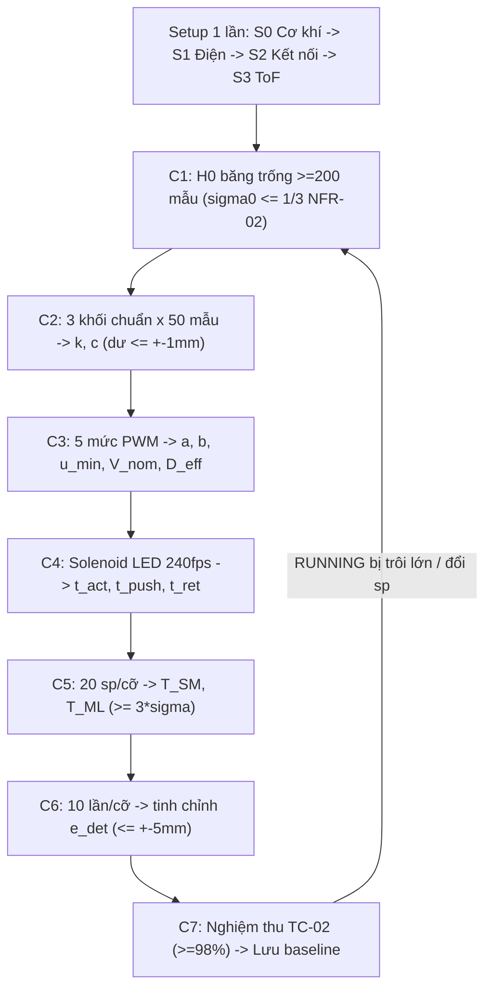

# SPEC-CALIB — Setup ban đầu, Wizard hiệu chuẩn C1–C7 & Giám sát sức khỏe chạy

| Thuộc tính | Giá trị |
| --- | --- |
| Trạng thái | Draft |
| Giai đoạn | 2 *(Riêng C1 đo $H_0$ thuộc Giai đoạn 1 theo `FR-10`)* |
| Phụ thuộc | [`SPEC-SORT`](01-firmware-sorting-control.md), [`SPEC-MQTT`](02-mqtt-edge-sync.md), [`SPEC-BACK`](03-backend-api-storage.md), [`SPEC-DASH`](04-web-dashboard-ui.md) |
| Quyết định liên quan | [`D-11`](../decisions.md), [`phan-tich-thiet-ke-he-thong.md §9, §10`](../phan-tich-thiet-ke-he-thong.md) |
| Thiết kế | [`phan-tich-thiet-ke-he-thong.md §10`](../phan-tich-thiet-ke-he-thong.md) |

## Bản đọc ngắn để duyệt hành vi

- **Sau thay đổi, ai làm được gì:** Kỹ thuật viên thiết lập phần cứng theo checklist `S0–S3`, chạy Wizard hiệu chuẩn 7 bước khóa tuần tự `C1 → C7` trên dashboard để lưu bộ `baseline` (gồm $H_0, \sigma_0, k, c$, mô hình tốc độ, $t_{act}/t_{ret}$, $T_{SM}/T_{ML}$, $e_{det}$); trong lúc `RUNNING`, Pico tự ước lượng tốc độ băng $\hat{v}$ không cần encoder, tự tính lại $t_d$, tự bù khi $H_0$/điện áp trôi nhẹ và báo hiệu chuẩn lại khi trôi lớn.
- **Ví dụ để tự kiểm:** Chạy bước `C1` trên băng trống $\ge 200$ mẫu → lưu $H_0, \sigma_0$ đạt $\sigma_0 \le 1\text{ mm}$ (`NFR-02/3`), sau đó bước `C2` mở khóa; khi `RUNNING` ở tốc độ bị sụt áp $V_s$, firmware tự bù duty và tính lại $t_d$ từ $\hat{v}$ mà không cần sửa bằng tay (`CALIB-AC02`, `CALIB-AC05`).
- **Chưa làm trong lần đầu:** Cảm biến INA219 (`0x40`) ước lượng sức phản điện động $v_{emf}$ và cảnh báo dòng kẹt là **tùy chọn phần cứng** (`§10.1 ④`, `§10.5`).
- **Điều chưa biết & hệ quả:** Chưa có số liệu thực đo phần cứng thật (chiều dài băng $L_{băng}$, đường kính con lăn, $\sigma_0$, $V_{nom}$, $t_{act}, t_{push}, t_{ret}$ bằng video 240 fps); người dùng chưa chốt có gắn thêm cầu phân áp ADC `GP27` và INA219 hay chưa.
- **Phần người dùng chốt:** Checklist `S0–S3`, thứ tự bắt buộc khóa tuần tự `C1 → C7`, cấu hình hình học theo mm thay cho ms, lọc trượt hợp nhất tốc độ 4 nguồn ($\alpha_1=0.3, \alpha_2=0.1, \alpha_3=0.02$, loại ngoại lai $\pm 20\%$), 11 chỉ số sức khỏe và bảng sự kiện hiệu chuẩn lại (`§10.6`).
- **Giải thích kiến thức & quyết định kỹ thuật:** Xem thẻ **Hợp nhất tốc độ không encoder & Cấu hình hình học theo mm** ở §9.
- **Biên bản phản biện độc lập trước khi trình:** Chưa chạy phản biện chéo — spec đang ở trạng thái `Draft`.
- **Quyền chạy:** `Ready` chưa cấp quyền code; đợt được giao nằm ở [`../progress.md`](../progress.md).

## 1. Mục tiêu

Chuẩn hóa quy trình cài đặt một lần, quy trình hiệu chuẩn có kiểm chứng theo từng bước `C1–C7` (`FR-10`, `§10.2–10.4`), và cơ chế giám sát liên tục khi chạy (`§10.5`) nhằm giữ độ chính xác phân loại $\ge 98\%$ (`NFR-01`) bất chấp thay đổi tốc độ băng, sụt áp nguồn hoặc xê dịch cơ khí nhẹ.

## 2. Phạm vi

**Trong phạm vi:**
- Checklist chuẩn bị phần cứng một lần (`S0` Cơ khí, `S1` Điện, `S2` Kết nối, `S3` ToF).
- Wizard chế độ `CALIB` 7 bước tuần tự (`C1`..`C7`), luồng bản tin `calib/progress` & `calib/result`, bảng `calibrations`, lưu và khôi phục `baseline`.
- Ước lượng tốc độ băng $\hat{v}$ không cần encoder từ 4 nguồn (`① cặp ToF`, `② che ToF1`, `③ mô hình PWM+Vs`, `④ tùy chọn INA219`) kèm bù điện áp nguồn $u_{cmd}$.
- Bộ 11 chỉ số sức khỏe liên tục khi `RUNNING`, ngưỡng cảnh báo / `FAULT` và tự bù $H_0$ khi trôi $\le 2\text{ mm}$.
- Quy tắc kích hoạt hiệu chuẩn lại theo sự kiện (`§10.6`).

**Ngoài phạm vi:**
- Phần cứng encoder vật lý gắn trục con lăn (không có trong thiết kế hiện tại theo `§10.1`).
- Vẽ giao diện đồ họa chi tiết (thuộc [`SPEC-DASH`](04-web-dashboard-ui.md); `SPEC-CALIB` quy định logic, công thức và ngưỡng màu).

## 3. Luồng tương tác, ví dụ đầu vào/đầu ra & kịch bản người dùng

- **US1 (P1)** — Là Admin (`UC-07`), tôi muốn thực hiện hiệu chuẩn theo từng bước có khóa thứ tự `C1 → C7` để không bao giờ lưu cấu hình `baseline` khi bước trước chưa đạt tiêu chuẩn. AC: `CALIB-AC01`, `CALIB-AC02`.
- **US2 (P2)** — Là hệ thống runtime, tôi muốn hợp nhất tốc độ $\hat{v}$ liên tục trong lúc chạy và tự tính lại $t_d$ theo $L_p, e_{det}, \ell_p$ để đổi tốc độ băng hoặc sụt pin không làm đẩy trượt tâm sản phẩm. AC: `CALIB-AC03`, `CALIB-AC05`.
- **US3 (P2)** — Là Operator/Admin, tôi muốn được cảnh báo sớm khi $H_0$ trôi, nhiễu $\sigma$ tăng do bụi/đèn, nguồn $V_s$ sụt hay solenoid sắp quá nhiệt trước khi xảy ra phân loại sai. AC: `CALIB-AC06`, `CALIB-AC07`.

### Vòng đời hiệu chuẩn & Luồng Wizard MQTT (Mermaid)



### Ví dụ thông số Wizard & Telemetry sức khỏe (Concrete I/O Snapshot)

Lệnh chạy bước C1 (giá trị minh họa):

```json
{
  "cmd_id": "c-0301",
  "type": "calibrate",
  "args": {"step": "C1", "samples": 200}
}
```

Kết quả (calib/result):

```json
{
  "step": "C1",
  "ok": true,
  "st1": {"h0_mm": 100.4, "sigma_mm": 0.6},
  "st2": {"h0_mm": 99.8, "sigma_mm": 0.7},
  "calib_ver": 3
}
```

Telemetry bổ sung sức khỏe hiệu chuẩn khi RUNNING (§10.5; giá trị minh họa):

```json
{
  "state": "RUNNING",
  "v_mm_s": 198.6,
  "v_src": "tof_pair",
  "v_age_s": 4.2,
  "v_model_mm_s": 203.0,
  "vs_v": 11.8,
  "h0_mm": [100.6, 99.9],
  "sigma_mm": [0.7, 0.8],
  "pitch_min_mm": 112,
  "duty_pct": [9, 6],
  "loop_max_us": 140
}
```

## 4. Yêu cầu

| ID | Mức | Yêu cầu | Nguồn gốc |
| --- | --- | --- | --- |
| `CALIB-R01` | MUST | Trước khi vào Wizard `CALIB`, người vận hành MUST hoàn tất checklist thiết lập một lần `S0` (cơ khí: $L_{p1}, L_{p2}, L_{12}, b, B, D_e$; băng chạy lệch ngang $\le 1\text{ mm}$/vòng), `S1` (điện & `TC-05`, 50 lần đóng cắt solenoid không reset), `S2` (kết nối & đồng bộ `< 50 ms`), `S3` (gán `0x30/0x31`, $T_b$, ROI) (`§10.2`). | Người dùng chốt — [`phan-tich-thiet-ke-he-thong.md §10.2`](../phan-tich-thiet-ke-he-thong.md#L674-L682) |
| `CALIB-R02` | MUST | Bước `C1` (Giai đoạn 1 — `FR-10`): khi ở chế độ `CALIB`, chạy băng trống chậm hết ít nhất 1 vòng và thu $\ge 200$ mẫu mỗi ToF; tính trung vị $H_0$ và độ lệch chuẩn $\sigma_0$ từng trạm; bước đạt khi $\sigma_0 \le \frac{1}{3}$ sai số `NFR-02` ($\le 1{,}0\text{ mm}$), phát tiến độ qua `calib/progress` và lưu kết quả flash + DB qua `calib/result` (`§10.3`, `§10.4`). | Người dùng chốt — [`phan-tich-thiet-ke-he-thong.md §2 FR-10, §10.3`](../phan-tich-thiet-ke-he-thong.md#L687) |
| `CALIB-R03` | SHOULD | Bước `C2`: thu 50 mẫu/khối trên 3 khối chuẩn cho mỗi trạm, khớp tuyến tính tìm $(k, c)$ sao cho phần dư sau hiệu chỉnh $h = \frac{(H_0 - d) - c}{k}$ đạt $\le \pm 1\text{ mm}$ (`§10.3 C2`). | Người dùng chốt — [`phan-tich-thiet-ke-he-thong.md §10.3 C2`](../phan-tich-thiet-ke-he-thong.md#L688) |
| `CALIB-R04` | SHOULD | Bước `C3`: ở 5 mức duty PWM, khớp mô hình tuyến tính tốc độ $v(u) = a\,u + b$, xác định $u_{min}, t_{ramp}, V_{nom}$ và vết đo hiệu dụng $D_{eff,cls} = v_{ref} T_{occ} - \ell_{cls}$ cho S/M/L (kèm $k_v, R_a$ nếu có INA219), đạt $\hat{v}_{12}$ khớp $v_{ref}$ trong $2\%$ và mô hình khớp $\le 3\%$ (`§10.3 C3`). | Người dùng chốt — [`phan-tich-thiet-ke-he-thong.md §10.3 C3`](../phan-tich-thiet-ke-he-thong.md#L689) |
| `CALIB-R05` | SHOULD | Bước `C4` (đo $t_{act}, t_{push}, t_{ret}$ qua LED + 240 fps với sai lệch $t_{act} \le 1$ khung), bước `C5` (20 sản phẩm/cỡ tính $T_{SM}, T_{ML}$ đạt khoảng cách biên $\ge 3\sigma$), bước `C6` (10 lần/cỡ tinh chỉnh $e_{det}$ đạt lệch $\le \pm 5\text{ mm}$ và 10/10 đúng máng) MUST tuân thủ đúng công thức `§10.3`. | Người dùng chốt — [`phan-tich-thiet-ke-he-thong.md §10.3 C4-C6`](../phan-tich-thiet-ke-he-thong.md#L690-L692) |
| `CALIB-R06` | MUST | Wizard hiệu chuẩn MUST cưỡng bức thứ tự tuần tự `C1 → C2 → C3 → C4 → C5 → C6 → C7`: khóa mọi bước sau cho tới khi bước ngay trước đó có bản ghi `ok: true`. Chỉ khi bước `C7` (`TC-02` đạt $\ge 98\%$ trên 100 sản phẩm) hoàn tất, bộ tham số mới được đánh dấu là `baseline` trên flash và bảng `calibrations` (`§10.3`, `§10.4`, `§10.6`). | Người dùng chốt — [`phan-tich-thiet-ke-he-thong.md §10.3, §10.4, §10.6`](../phan-tich-thiet-ke-he-thong.md#L701) |
| `CALIB-R07` | MUST | Hệ thống MUST cung cấp chức năng "Khôi phục baseline" gửi lại toàn bộ tham số của phiên bản đã nghiệm thu `C7` xuống Pico (`§10.4`). | Người dùng chốt — [`phan-tich-thiet-ke-he-thong.md §10.4`](../phan-tich-thiet-ke-he-thong.md#L741) |
| `CALIB-R08` | SHOULD | Khi `RUNNING`, Core 0/1 MUST ước lượng tốc độ băng $\hat{v}$ không cần encoder bằng bộ lọc trượt có trọng số $\hat{v}_k = \hat{v}_{k-1} + \alpha_{src}(v_k - \hat{v}_{k-1})$ kết hợp ① cặp ToF $\hat{v}_{12} = \frac{1}{2}\left(\frac{L_{12}}{t_{0,2}-t_{0,1}} + \frac{L_{12}}{t_{1,2}-t_{1,1}}\right)$ ($\alpha_1=0{,}3$), ② thời gian che ToF1 $\hat{v}_{occ} = \frac{\ell_{p,cls}+D_{eff,cls}}{T_{occ}}$ ($\alpha_2=0{,}1$), ③ mô hình $v_{model} = a\frac{u V_s}{V_{nom}}+b$ ($\alpha_3=0{,}02$ mỗi `100 ms`), và tùy chọn ④ INA219 $v_{emf} = k_v(V_m - I_m R_a)$; loại bỏ số đo lệch quá $\pm 20\%$ so với $\hat{v}$ hiện tại trước khi gộp (`§10.1`, `§10.5`). | Người dùng chốt — [`phan-tich-thiet-ke-he-thong.md §10.1, §10.5`](../phan-tich-thiet-ke-he-thong.md#L759-L763) |
| `CALIB-R09` | SHOULD | Firmware MUST đo $V_s$ mỗi `100 ms` qua ADC `GP27`, bù duty $u_{cmd} = u_{target}\frac{V_{nom}}{V_s}$ khi điện áp sụt và tính lại $t_d = \frac{L_p + e_{det} + \ell_p/2}{\hat{v}} - t_{act}$ cho từng sản phẩm từ $\hat{v}$ (`§10.1 ③`, `§10.5`). | Người dùng chốt — [`phan-tich-thiet-ke-he-thong.md §10.1, §10.5`](../phan-tich-thiet-ke-he-thong.md#L665-L768) |
| `CALIB-R10` | SHOULD | Trong khi `RUNNING`, firmware MUST liên tục giám sát đủ 11 chỉ số sức khỏe (`§10.5`): tự bù $H_0$ nếu trung vị 200 mẫu khe băng trôi $\le 2\text{ mm}$, cảnh báo nếu trôi $> 2\text{ mm}$ và đề nghị chạy lại `C1` nếu $> 4\text{ mm}$; cảnh báo lệch đo–mô hình $> 5\%$ trong `30 s` và `FAULT` nếu $> 10\%$; cảnh báo tuổi số đo $> 30\text{ s}$ (kéo $\hat{v}$ dần về $v_{model}$); cảnh báo $\sigma > 2\sigma_0$; đánh dấu nghi vấn nếu $\hat{\ell}_p = \hat{v} T_{occ} - D_{eff,cls}$ lệch $> 15\%$; cảnh báo cấp dày nếu bước $< p_{min}$; cảnh báo nhiệt solenoid $> 80\% D_{rated}$ và `FAULT` nếu $> 100\% D_{rated}$; cảnh báo `loop_max_us > 1 ms` hoặc `buffer_len > 80\%`. Nếu có INA219: dòng $> 50\%$ cảnh báo, $> 100\%$ kéo dài `1 s` → dừng băng `FAULT`. | Người dùng chốt — [`phan-tich-thiet-ke-he-thong.md §10.5`](../phan-tich-thiet-ke-he-thong.md#L745-L758) |
| `CALIB-R11` | SHOULD | Tài liệu vận hành & cảnh báo dashboard MUST nhắc đúng bước hiệu chuẩn cần làm lại theo bảng `§10.6` (vd: đầu buổi → `C1` + 10 sp; trôi $H_0 > 4\text{ mm}$ → `C1, C2, C5`; đổi loại sp → `C3 (D_eff), C5, C6, C7`). | Người dùng chốt — [`phan-tich-thiet-ke-he-thong.md §10.6`](../phan-tich-thiet-ke-he-thong.md#L802-L814) |

## 5. Yêu cầu phi chức năng

| Khía cạnh | Điều kiện kiểm được | Nhãn nguồn gốc & cách kiểm |
| --- | --- | --- |
| Hiệu năng | Tính $\hat{v}_{12}$, $\hat{v}_{occ}$, bộ lọc $\alpha_{src}$ và `median` 200 mẫu khe băng không làm `loop_max_us` vượt `1 ms` trên Core 0. | Người dùng chốt — `telemetry.loop_max_us`. |
| Bảo mật | Chỉ `Admin` được phép chạy lệnh `calibrate` và `Khôi phục baseline` (`UC-07`, `BACK-R04`). | Người dùng chốt — `SPEC-BACK` RBAC. |
| Giới hạn / rate limit | Loại bỏ số đo tốc độ ngoại lai $> \pm 20\%$ trước khi cập nhật $\hat{v}$; chặn `u_cmd` trong dải `[0, 100]%` khi bù áp. | Người dùng chốt — [`§10.5`](../phan-tich-thiet-ke-he-thong.md#L759). |
| Khả dụng / khôi phục | Lưu `baseline` trên cả flash và DB giúp khôi phục nhanh sau sự cố chỉnh nhầm thông số. | Người dùng chốt — `CALIB-R07`. |
| Quan sát | Đủ 11 dòng sức khỏe và chuỗi `calib/progress` + `calib/result` lưu vào `calibrations`. | Người dùng chốt — `§10.4`, `§10.5`. |
| i18n | `N/A — hướng dẫn tiếng Việt ở SPEC-DASH.` | — |
| a11y | `N/A — hiển thị ở SPEC-DASH.` | — |
| Trạng thái UI | `N/A — quy định ở SPEC-DASH.` | — |

## 6. Trường hợp biên

- **Chỉ chạy toàn sản phẩm cỡ `M` trong $> 30\text{ s}$:** Theo `D-11` (Trạm 1 đẩy `M`, cho `S` và `L` đi qua tới Trạm 2), bình thường cả `S` và `L` đều tạo số đo nguồn ① ($\hat{v}_{12}$); nhưng nếu lô thử chỉ toàn `M` bị đẩy hết ở Trạm 1 trong $> 30\text{ s}$ thì dùng nguồn ② ($\hat{v}_{occ}$ tại ToF1) với $\alpha_2=0.1$, đồng thời báo tuổi số đo $> 30\text{ s}$ và kéo dần $\hat{v}$ về $v_{model}$ theo bảng `§10.5`.
- **Hai sản phẩm dính nhau đi qua ToF1:** $\hat{\ell}_p = \hat{v} T_{occ} - D_{eff,cls}$ lệch $> 15\%$ so với cỡ phân loại → gắn cờ nghi vấn trên bản ghi (và không dùng số đo $T_{occ}$ đó làm hỏng $\hat{v}$ nhờ bộ lọc $\pm 20\%$).
- **Bước `C1` đo $\sigma_0 > 1\text{ mm}$ (rung cơ khí hoặc nhiễu ánh sáng):** `calib/result` trả `ok: false`, Wizard giữ khóa không cho mở `C2` (`§10.3`).
- **Tụ nguồn sụt làm $V_s < 90\% V_{nom}$:** Tăng `u_cmd` theo $V_{nom}/V_s$ (bão hòa ở $100\%$) và phát cảnh báo nguồn yếu.

## 7. Điều kiện nghiệm thu & bảng kiểm thử

| Trạng thái | Ý nghĩa |
| --- | --- |
| `[]` | chưa đạt |
| `[x]` | test xanh và có bằng chứng lệnh/kết quả |
| `[~]` | chưa kiểm chứng — ghi lý do, người/cách đóng; chặn `Done` |

### Bảng kiểm thử — duyệt trước khi code (Visible Test Matrix)

| Mã AC | Kịch bản (`Cho / Khi / Thì`) | Đầu vào cụ thể | Kỳ vọng quan sát được | Tầng & độ thật | Lệnh kiểm | Trạng thái |
| --- | --- | --- | --- | --- | --- | --- |
| **CALIB-AC01** | **Cho** Wizard hiệu chuẩn ở trạng thái chưa hoàn thành `C1`, **Khi** gửi lệnh chạy `C2` hoặc cố lưu `baseline` trước khi `C7` đạt, **Thì** backend và trạng thái Wizard từ chối yêu cầu, chỉ mở `C(n+1)` khi `C(n)` đạt `ok: true` (`§10.3`, `§10.4`). | `POST /cmd` `calibrate` `step="C2"` khi `C1` chưa `ok` | HTTP `409`/`400` bị từ chối; `baseline` không đổi | `integration` — **0 Mock** DB | `pytest tests/test_calib_wizard.py -k CALIB-AC01` | `[]` |
| **CALIB-AC02** | **Cho** băng chạy trống ở chế độ `CALIB` bước `C1` (`FR-10`), **Khi** thu 200 mẫu hợp lệ trên mỗi ToF (loại ổn định $\sigma_0 \le 1\text{ mm}$ và loại nhiễu $\sigma_0 = 1.5\text{ mm}$), **Thì** trường hợp ổn định trả `ok: true`, lưu `H0`, `sigma0` vào flash và bảng `calibrations`; trường hợp nhiễu trả `ok: false`. | 200 mẫu mẫu thật / vector test C1 | Ổn định → `ok=true` lưu `H0`; nhiễu → `ok=false` | `unit + bench` | `ctest -R CALIB-AC02` | `[]` |
| **CALIB-AC03** | **Cho** thuật toán khớp tuyến tính `C2` (`h = ((H0-d)-c)/k`) và bộ lọc tốc độ $\hat{v}$ (`§10.1`, `§10.5`), **Khi** bơm 3 khối chuẩn C2 và chuỗi $\hat{v}_{12}$, $\hat{v}_{occ}$, $v_{model}$ kèm 1 mẫu ngoại lai lệch $+35\%$, **Thì** phần dư C2 $\le \pm 1\text{ mm}$, mẫu $+35\%$ bị loại bỏ và $\hat{v}$ cập nhật đúng trọng số $\alpha_1=0.3, \alpha_2=0.1, \alpha_3=0.02$. | Vector dữ liệu toán học chuẩn | Residual $\le 1\text{ mm}$; ngoại lai bị bỏ qua; $\hat{v}_k$ khớp công thức | `unit` — **0 Mock** thuật toán | `ctest -R CALIB-AC03` | `[]` |
| **CALIB-AC04** | **Cho** bộ tham số `baseline` đã lưu ở phiên bản `calib_ver = 3`, **Khi** Admin chỉnh sai thông số rồi bấm `Khôi phục baseline`, **Thì** toàn bộ thông số của `calib_ver = 3` được gửi lại qua `config/desired` và xác nhận khớp ở `config/reported`. | Nhấn `Khôi phục baseline` | `configs` tạo phiên bản phục hồi mang đúng giá trị `calib_ver=3` | `integration` — **0 Mock** DB | `pytest tests/test_calib_wizard.py -k CALIB-AC04` | `[]` |
| **CALIB-AC05** | **Cho** băng đang `RUNNING` có dữ liệu mô hình `C3`, **Khi** giảm điện áp $V_s$ xuống $85\% V_{nom}$ (hoặc đổi tốc độ PWM), **Thì** firmware bù $u_{cmd}$, cảnh báo `V_s < 90%`, tính lại $t_d$ theo $\hat{v}$ và giữ vị trí đẩy đúng tâm (`§10.1`, `§10.5`). | Test mô phỏng/nguồn điều chỉnh $V_s$ | `u_cmd` tăng theo $V_{nom}/V_s$, cảnh báo $V_s$ phát ra, $t_d$ cập nhật | `unit + bench` | `ctest -R CALIB-AC05` | `[]` |
| **CALIB-AC06** | **Cho** logic giám sát 11 chỉ số sức khỏe `§10.5`, **Khi** mô phỏng $H_0$ trôi $1.5\text{ mm}$ vs $2.5\text{ mm}$ vs $4.5\text{ mm}$, $\sigma > 2\sigma_0$, $\hat{\ell}_p$ lệch $>15\%$, lệch mô hình $>10\%$, nhiệt $>100\% D_{rated}$, **Thì** trôi $\le 2\text{ mm}$ tự bù êm; $2\text{–}4\text{ mm}$ cảnh báo; $>4\text{ mm}$ đề nghị `C1`; lệch $>10\%$ hoặc nhiệt $>100\%$ chuyển `FAULT`. | Chuỗi mẫu kiểm tra từng ngưỡng bảng `§10.5` | Mọi phản ứng tự động & mức cảnh báo khớp 100% bảng `§10.5` | `unit` — **0 Mock** | `ctest -R CALIB-AC06` | `[]` |
| **CALIB-AC07** | **Cho** băng tải hoàn chỉnh sau `S0–S3`, **Khi** thực hiện trọn vẹn Wizard `C1 → C7` trên phần cứng thật, **Thì** mỗi bước đạt tiêu chí bảng `§10.3` và bước `C7` (`TC-02`) đạt $\ge 98\%$ trên 100 sản phẩm. | Quy trình hiệu chuẩn bench thực tế | Đạt `C1..C7` và lưu `baseline` thành công | `hardware bench` — **0 Mock** | `Bench C1-C7: biên bản nghiệm thu baseline` | `[]` |

## 8. Kiểm tra end-to-end

Chạy unit test toán học hiệu chuẩn & bộ lọc (`CALIB-AC03`, `CALIB-AC06`) + integration test khóa Wizard & khôi phục baseline (`CALIB-AC01`, `CALIB-AC04`), sau đó diễn tập bench `C1–C7` trên máy thật.

## 9. Ghi chú thiết kế

- Trên Core 0, tính trung vị cửa sổ 200 mẫu của `H0` bằng histogram/bucket hoặc thực hiện định kỳ khi vừa thu đủ cửa sổ (hoặc đẩy sang tác vụ nền nhẹ) để không vượt ngân sách `1 ms` của vòng lặp chính.

### Giải thích kiến thức & quyết định kỹ thuật (Thẻ giải thích kỹ thuật)

**Khái niệm / Quyết định 1:** Cấu hình hình học theo `mm` + Hợp nhất tốc độ $\hat{v}$ không cần encoder · Nhãn: `Người dùng chốt`
- **Bản chất là gì (nói dễ hiểu + ví dụ thực tế của dự án):** Thay vì bắt người dùng tự bấm máy tính đổi `mm` ra mili-giây `d1_ms` mỗi lần tăng giảm tốc độ băng, dashboard lưu khoảng cách hình học cố định trên khung máy ($L_{p1} = 80\text{ mm}, e_{det} = 15.5\text{ mm}$). Trong lúc chạy, Pico tự đo tốc độ băng $\hat{v}$ bằng 3 nguồn ghép lại: chuẩn nhất là thời gian sản phẩm `S`/`L` (theo `D-11`) đi từ ToF1 sang ToF2 ($\hat{v}_{12}$), hỗ trợ thêm bởi thời gian che ToF1 khi lô chạy toàn `M`, và dự phòng bằng mô hình điện áp–PWM khi băng trống; từ đó tự tính $t_d = (L_p + e_{det} + \ell_p/2)/\hat{v} - t_{act}$.
- **Tại sao bắt buộc cần ở đây (nếu không có thì lỗi gì xảy ra?):** Băng tải không gắn encoder phần cứng. Nếu giữ `d1_ms` cố định mà nguồn động cơ sụt áp (làm băng chạy chậm đi 10%) hoặc đội thi tăng PWM lúc chạy thử, solenoid sẽ bắn sớm hoặc muộn hẳn khỏi tâm sản phẩm gây kẹt hoặc trượt máng.
- **Chạy thế nào trong dự án này (Đầu vào → Xử lý → Đầu ra):** Số đo mới $v_k$ từ cặp ToF / che ToF1 / mô hình → Loại nếu lệch quá $\pm 20\%$ so với $\hat{v}$ hiện tại → Cập nhật $\hat{v}_k = \hat{v}_{k-1} + \alpha_{src}(v_k - \hat{v}_{k-1})$ → Tính $t_d$ mới cho từng sản phẩm đi qua trạm.
- **Tự kiểm trong ≤ 5 phút:** Chạy `CALIB-AC03` với chuỗi tốc độ $200\text{ mm/s}$ có xen 1 giá trị lỗi $270\text{ mm/s}$ (`+35%`): giá trị $270$ phải bị loại và $\hat{v}$ giữ ổn định quanh $200\text{ mm/s}$.
- **Nguồn đối chiếu & Giới hạn không tự kiểm được:** [`phan-tich-thiet-ke-he-thong.md §10, §10.1, §10.5`](../phan-tich-thiet-ke-he-thong.md#L633-L772). Độ chính xác của $\hat{v}_{occ}$ phụ thuộc độ chính xác $D_{eff,cls}$ đo được ở `C3`.

## 10. Hướng dẫn vận hành

Tham khảo bảng sự kiện cần hiệu chuẩn lại tại [`phan-tich-thiet-ke-he-thong.md §10.6`](../phan-tich-thiet-ke-he-thong.md#L802-L814).

## 11. Làm rõ

*(Chưa có phiên làm rõ bổ sung.)*

## 12. Câu hỏi mở

| Điều chưa biết / đề xuất | Nguồn đã kiểm | Ảnh hưởng / AC bị chặn | Cách xác minh & người phụ trách |
| --- | --- | --- | --- |
| **Q-CALIB-01 (Phần cứng đo $V_s$ và INA219):** Đội phần cứng đã lắp cầu phân áp ADC vào `GP27` và có lắp module INA219 (`0x40`) cho động cơ không? | [`§10.1`](../phan-tich-thiet-ke-he-thong.md#L639-L640) | Quyết định kích hoạt nguồn ③ bù áp và nguồn ④ + bảo vệ quá dòng động cơ (`CALIB-R09`, `CALIB-R10`) | Đội phần cứng xác nhận sơ đồ mạch thực tế |
| **Q-CALIB-02 (Thông số cơ khí khung băng `S0`):** Các số đo thật $L_{p1}, L_{p2}, L_{12}, b, B, L_{băng}, V_{nom}$ chưa đo trên khung máy hoàn chỉnh. | [`§9.10`, `§10.2`](../phan-tich-thiet-ke-he-thong.md#L676-L678) | Chặn chạy thực nghiệm `C3–C7` (`CALIB-AC07`) | Đo thực tế khi hoàn thiện cơ khí (`S0`) |
